# jsb-plus-2

『점프 투 스프링부트』(SBB)를 처음부터 구현하면서 장희성 강사의 14163(점프 투 스프링부트 개선)·14168(JPA·타임리프 개선) 수업 내용을 적용한 학습용 저장소입니다.

**각 단계마다 핵심 코드의 변경 전후와 실행 화면을 함께 남겼습니다.** 아래 작업내역을 위에서부터 따라 읽으면 됩니다.

- 진행 계획: [docs/PLAN.md](docs/PLAN.md)
- 1차 구현: [jhs512/jsb-plus](https://github.com/jhs512/jsb-plus)
- 단계 링크: **이 시점의 코드**(`/tree/태그`, 그 시점의 README와 이미지) · **변경 내용**(`/commit/태그`, diff)
- 태그: 기능 태그(`004-03`)와 커밋 순번 태그(`001`, `002`, …)

## 작업내역

### 000-01 저장소 준비, README와 진행 계획
[이 시점의 코드](https://github.com/jhs512/jsb-plus-2/tree/000-01) · [변경 내용](https://github.com/jhs512/jsb-plus-2/commit/000-01)

**무엇을** 빈 저장소에 README(작업내역 뼈대), 진행 계획([docs/PLAN.md](docs/PLAN.md)), `.gitignore`를 만들었습니다.

**왜** 이 저장소는 단계마다 "변경 전후 코드 + 실행 화면"을 README에 쌓아 가는 학습 기록입니다. 그 틀을 먼저 세웁니다.

`.gitignore`
```gitignore
.DS_Store
.idea/
build/
.gradle/
```

> **확인해 볼 것** 위의 "이 시점의 코드" 링크를 열면 GitHub이 이 커밋 시점의 README를 보여 줍니다. 앞으로 모든 단계를 이렇게 그 시점 기준으로 열어 볼 수 있습니다.

### 001-01 프로젝트 생성, Spring Initializr로 생성
[이 시점의 코드](https://github.com/jhs512/jsb-plus-2/tree/001-01) · [변경 내용](https://github.com/jhs512/jsb-plus-2/commit/001-01)

**무엇을** [Spring Initializr](https://start.spring.io)로 프로젝트를 만들었습니다. 의존성은 Spring Web MVC, Lombok, DevTools 세 가지입니다.

**왜** 교재는 Spring Boot 3.2 + Gradle Groovy를 쓰지만, 14163 강의처럼 최신 환경(Boot 4.1.2, Java 25, Kotlin DSL)으로 시작합니다.

`build.gradle.kts`
```kotlin
plugins {
    java
    id("org.springframework.boot") version "4.1.2"
    id("io.spring.dependency-management") version "1.1.7"
}

java { toolchain { languageVersion = JavaLanguageVersion.of(25) } }

dependencies {
    implementation("org.springframework.boot:spring-boot-starter-webmvc")
    compileOnly("org.projectlombok:lombok")
    developmentOnly("org.springframework.boot:spring-boot-devtools")
    // ...
}
```

**결과** 앱은 뜨지만, 아직 요청을 처리할 컨트롤러가 없어서 `/`는 **404**입니다.


> **교재와 다른 점** Boot 3.2.1 → 4.1.2, `build.gradle`(Groovy) → `build.gradle.kts`(Kotlin). Boot 4부터 웹 스타터 이름이 `starter-web`에서 `starter-webmvc`로 바뀌었습니다.
> **확인해 볼 것** 메인 클래스 `SbbApplication`이 있는 패키지(`com.mysite.sbb`) 아래에 있어야 스프링이 컴포넌트를 찾습니다.

### 001-02 프로젝트 생성, application.yaml로 전환
[이 시점의 코드](https://github.com/jhs512/jsb-plus-2/tree/001-02) · [변경 내용](https://github.com/jhs512/jsb-plus-2/commit/001-02)

**무엇을** 설정 파일을 `application.properties`에서 `application.yaml`로 바꿨습니다.

**왜** 설정이 늘어나면 `spring.jpa.hibernate.ddl-auto`처럼 같은 앞부분이 반복됩니다. yaml은 들여쓰기로 계층을 표현해서 읽기 쉽습니다(14163·14168 방식).

`application.properties` → `application.yaml`
```diff
- spring.application.name=sbb
+ spring:
+   application:
+     name: sbb
+   output:
+     ansi:
+       enabled: always   # 콘솔 로그에 색을 입힘
```

> **확인해 볼 것** 같은 설정을 properties로 쓰면 `spring.output.ansi.enabled=always`입니다. 두 형식이 1:1로 대응합니다.

### 002-01 간단한 웹 프로그램, [실험] void 액션은 500
[이 시점의 코드](https://github.com/jhs512/jsb-plus-2/tree/002-01) · [변경 내용](https://github.com/jhs512/jsb-plus-2/commit/002-01)

**무엇을** `MainController`에 `GET /`, `GET /hello`를 처리하는 액션 메서드를 만들었습니다. 반환형은 일부러 `void`로 했습니다. **(실험 커밋)**

**왜** `@Controller`와 `@GetMapping`으로 URL과 메서드가 연결되는 것을 확인하고, "메서드가 실행되는 것"과 "브라우저가 응답을 받는 것"이 다르다는 것을 직접 봅니다(14163 3강).

`MainController.java`
```java
@Controller
public class MainController {
    @GetMapping("/hello")
    public void hello() {
        System.out.println("hello"); // 서버 콘솔에만 찍힌다
    }
}
```

**결과** 서버 콘솔에는 `hello`가 찍히지만(메서드는 실행됨), 브라우저는 **500**을 받습니다.


> **왜 500일까?** `void`를 반환하면 스프링은 요청 URL(`hello`)을 화면(뷰) 이름으로 씁니다. 그 화면을 찾으려고 다시 `/hello`로 보내고, 또 같은 메서드가 실행되는 무한 반복이 되어 `Circular view path` 에러가 납니다.
> **확인해 볼 것** 없는 주소(`/not-exist`)는 500이 아니라 404입니다. 매핑된 메서드가 아예 없기 때문입니다.

### 002-02 간단한 웹 프로그램, @ResponseBody로 문자열 응답
[이 시점의 코드](https://github.com/jhs512/jsb-plus-2/tree/002-02) · [변경 내용](https://github.com/jhs512/jsb-plus-2/commit/002-02)

**무엇을** 액션 메서드가 `String`을 반환하고 `@ResponseBody`를 붙였습니다. 브라우저 대신 반복해서 확인할 수 있도록 MockMvc 테스트도 만들었습니다.

**왜** `@ResponseBody`가 있으면 반환값이 **화면 이름이 아니라 응답 본문 그 자체**가 됩니다(14163 4강).

`MainController.java`
```diff
  @GetMapping("/hello")
- public void hello() {
-     System.out.println("hello");
- }
+ @ResponseBody // 반환값이 그대로 HTTP 응답 본문이 된다.
+ public String hello() {
+     return "안녕하세요.";
+ }
```

`MainControllerTest.java`
```java
mvc.perform(get("/hello"))
        .andExpect(status().isOk())
        .andExpect(content().string("안녕하세요."));
```

**결과** 이제 **200**과 함께 문자열이 그대로 보입니다.


> **확인해 볼 것** 문자열 대신 객체를 반환하면 어떻게 될까요? 스프링이 자동으로 JSON으로 바꿉니다(14168 29강).

### 003-01 DB 설정, H2·JPA 추가와 dev/test 프로파일 분리
[이 시점의 코드](https://github.com/jhs512/jsb-plus-2/tree/003-01) · [변경 내용](https://github.com/jhs512/jsb-plus-2/commit/003-01)

**무엇을** H2 데이터베이스와 Spring Data JPA를 추가하고, 설정을 **dev(파일 DB)**와 **test(메모리 DB)** 프로파일로 나눴습니다.

**왜** 교재는 DB 하나로 개발과 테스트를 함께 합니다. 그러면 테스트가 개발 데이터를 계속 쌓거나 지웁니다. 14163 5강처럼 둘을 분리합니다.

`build.gradle.kts`
```diff
  implementation("org.springframework.boot:spring-boot-starter-webmvc")
+ implementation("org.springframework.boot:spring-boot-starter-data-jpa")
+ implementation("org.springframework.boot:spring-boot-h2console")
+ runtimeOnly("com.h2database:h2")
```

`application-dev.yaml` / `application-test.yaml`
```yaml
# dev: 재시작해도 데이터가 남는 파일 DB
url: jdbc:h2:./db_dev
# test: 테스트가 끝나면 사라지는 메모리 DB
url: jdbc:h2:mem:db_test
```

`application.yaml`
```yaml
spring:
  profiles:
    active: dev   # 기본은 dev, 테스트 클래스는 @ActiveProfiles("test")
  jpa:
    hibernate:
      ddl-auto: update   # 엔티티를 보고 테이블을 자동 생성/수정
```

**결과** `/h2-console`에 접속됩니다. 아직 엔티티가 없어서 테이블은 없습니다.


> **교재와 다른 점** DB 하나(`~/local`) → dev/test 분리. 개발 DB 파일(`db_dev.mv.db`)은 `.gitignore`에 추가했습니다.
> **확인해 볼 것** 앱을 한 번 실행하면 프로젝트 폴더에 `db_dev.mv.db` 파일이 생깁니다.

### 003-02 DB 설정, 테스트는 항상 test 프로파일
[이 시점의 코드](https://github.com/jhs512/jsb-plus-2/tree/003-02) · [변경 내용](https://github.com/jhs512/jsb-plus-2/commit/003-02)

**무엇을** Gradle 테스트 태스크에 `spring.profiles.active=test`를 지정했습니다. 그리고 일부러 `@ActiveProfiles`를 붙이지 않은 확인용 테스트를 만들었습니다.

**왜** 테스트 클래스마다 `@ActiveProfiles("test")`를 붙이는 방식은 하나만 빠뜨려도 기본 프로파일(dev)이 적용됩니다. 그러면 그 테스트가 개발용 파일 DB를 건드립니다. 실수가 생기지 않도록 테스트의 기본값을 아예 test로 고정합니다.

`build.gradle.kts`
```diff
  tasks.withType<Test> {
      useJUnitPlatform()
+     systemProperty("spring.profiles.active", "test")
  }
```

`DefaultTestProfileTest.java`
```java
@SpringBootTest // @ActiveProfiles 일부러 없음
class DefaultTestProfileTest {
    @Value("${spring.datasource.url}")
    private String datasourceUrl;

    @Test
    void t1() {
        assertThat(datasourceUrl).startsWith("jdbc:h2:mem:");
    }
}
```

**결과** 설정 전에는 이 테스트가 **개발용 파일 DB**(`jdbc:h2:./db_dev`)를 쓰고 있어서 실패했습니다. 설정 후에는 모든 테스트가 메모리 DB로 실행됩니다.


> **교재와 다른 점** 교재에는 없는 안전장치입니다. 1차 구현에서는 마지막(040)에야 넣었는데, DB 설정 단계로 옮겼습니다.

### 003-03 DB 설정, SQL 로그 출력
[이 시점의 코드](https://github.com/jhs512/jsb-plus-2/tree/003-03) · [변경 내용](https://github.com/jhs512/jsb-plus-2/commit/003-03)

**무엇을** JPA가 실행하는 SQL을 콘솔에 보기 좋게 출력하도록 설정했습니다. `?` 자리에 들어간 실제 값과 트랜잭션 시작·종료도 함께 출력합니다.

**왜** JPA는 SQL을 대신 만들어 줍니다. 그래서 "지금 무슨 SQL이 나갔는지"를 눈으로 확인하는 습관이 중요합니다(14163 6강). 다음 단계부터 엔티티를 만들면 이 로그로 테이블 생성 SQL을 확인합니다.

`application.yaml`
```diff
  jpa:
    hibernate:
      ddl-auto: update
+   show-sql: true                 # 실행되는 SQL 출력
+   properties:
+     hibernate:
+       format_sql: true           # 줄바꿈 정렬
+       highlight_sql: true        # 색상 강조
+       use_sql_comments: true     # 어떤 JPA 동작에서 나온 SQL인지 주석
+ logging:
+   level:
+     org.hibernate.orm.jdbc.bind: TRACE      # ? 자리에 바인딩된 실제 값
+     org.hibernate.orm.jdbc.extract: TRACE   # 조회 결과 값
+     org.springframework.transaction.interceptor: TRACE  # 트랜잭션 시작/종료
```

> **확인해 볼 것** 아직 엔티티가 없어서 출력될 SQL이 없습니다. 바로 다음 단계(004-01)에서 `create table question …`이 이 형식으로 찍힙니다.

### 004-01 엔티티, Question 엔티티
[이 시점의 코드](https://github.com/jhs512/jsb-plus-2/tree/004-01) · [변경 내용](https://github.com/jhs512/jsb-plus-2/commit/004-01)

**무엇을** 질문을 저장할 `Question` 엔티티를 만들었습니다.

**왜** `@Entity`가 붙은 클래스를 보고 JPA가 테이블을 만듭니다(`ddl-auto: update`). 테이블을 SQL로 직접 만들지 않고 자바 클래스로 설계합니다(교재 2-04).

`Question.java` (새 파일)
```java
@Entity            // 이 클래스를 기준으로 question 테이블이 만들어진다.
@Getter @Setter
public class Question {
    @Id                                    // 기본키
    @GeneratedValue(strategy = IDENTITY)   // 1, 2, 3 … 자동 증가
    private int id;

    @Column(length = 200)                  // varchar(200)
    private String subject;

    @Column(columnDefinition = "TEXT")     // 길이 제한 없는 텍스트
    private String content;

    private LocalDateTime createDate;      // 컬럼 이름은 create_date
}
```

**결과** H2 콘솔에서 `QUESTION` 테이블과 컬럼을 확인했습니다. 앞 단계에서 켠 SQL 로그에도 테이블 생성문이 찍힙니다.


> **확인해 볼 것** `@Setter`는 지금은 편하지만, 009-02에서 생성자와 의미 있는 메서드로 바꿉니다(14168 방식).

### 004-02 엔티티, Answer와 @ManyToOne(LAZY)
[이 시점의 코드](https://github.com/jhs512/jsb-plus-2/tree/004-02) · [변경 내용](https://github.com/jhs512/jsb-plus-2/commit/004-02)

**무엇을** 답변을 저장할 `Answer` 엔티티를 만들고, 답변이 어느 질문에 속하는지 `@ManyToOne`으로 연결했습니다.

**왜** 답변 여러 개(N)가 질문 하나(1)에 속합니다. `@ManyToOne`을 붙이면 answer 테이블에 `question_id` 외래키 컬럼이 생깁니다. `@ManyToOne`의 기본값은 즉시 로딩(EAGER)이라 답변을 조회할 때마다 질문도 함께 조회합니다. 그래서 필요할 때만 조회하는 지연 로딩(LAZY)을 명시합니다(14163 25강).

`Answer.java` (새 파일, 핵심)
```java
@Entity
public class Answer {
    // ... id, content, createDate

    @ManyToOne(fetch = LAZY)   // 기본값 EAGER 대신 LAZY
    private Question question; // → question_id 컬럼 + 외래키
}
```

**결과** `ANSWER` 테이블에 `QUESTION_ID` 컬럼과 `QUESTION`을 가리키는 외래키 제약이 생겼습니다.


> **교재와 다른 점** 교재는 `@ManyToOne`만 씁니다(EAGER). 여기서는 `fetch = LAZY`를 붙였습니다.
> **확인해 볼 것** 외래키가 있으니 존재하지 않는 질문 번호(예: 999)로 답변을 INSERT하면 DB가 거부합니다.

### 004-03 엔티티, [실험] mappedBy 없는 OneToMany는 중간 테이블을 만든다
[이 시점의 코드](https://github.com/jhs512/jsb-plus-2/tree/004-03) · [변경 내용](https://github.com/jhs512/jsb-plus-2/commit/004-03)

**무엇을** `Question`에 답변 목록 필드를 `@OneToMany`로 추가했습니다. 이때 일부러 `mappedBy`를 빼 봤습니다. **(실험 커밋)**

**왜** 질문 쪽에서도 답변 목록을 바로 꺼내 쓰려면 `@OneToMany` 필드가 필요합니다. 그런데 이 필드와 `Answer.question`이 **같은 관계**라는 걸 JPA에게 알려 주지 않으면 어떻게 되는지 직접 봅니다(14163 11강).

`Question.java`
```diff
  private LocalDateTime createDate;
+
+ @OneToMany   // mappedBy 없음!
+ private List<Answer> answers = new ArrayList<>();
```

**결과** 만든 적 없는 `QUESTION_ANSWERS` 테이블이 생겼습니다. 이미 `answer.question_id`로 충분히 표현되는 관계를 중간 테이블에 한 번 더 저장하려는 것입니다.


> **확인해 볼 것** 다음 커밋에서 `mappedBy = "question"` 한 단어를 넣으면 이 테이블이 사라집니다.

### 004-04 엔티티, mappedBy와 cascade로 OneToMany 완성
[이 시점의 코드](https://github.com/jhs512/jsb-plus-2/tree/004-04) · [변경 내용](https://github.com/jhs512/jsb-plus-2/commit/004-04)

**무엇을** `@OneToMany`에 `mappedBy = "question"`과 `cascade`를 넣었습니다.

**왜** `mappedBy = "question"`은 "이 관계의 주인은 `Answer.question` 필드(= `question_id` 외래키)"라는 뜻입니다. 질문 쪽 `answers`는 그 관계를 읽기만 하므로 중간 테이블이 필요 없습니다(14163 12강). `cascade`는 질문을 저장하거나 삭제할 때 답변도 함께 처리하도록 합니다(14163 21강).

`Question.java`
```diff
- @OneToMany
+ @OneToMany(mappedBy = "question", cascade = {CascadeType.PERSIST, CascadeType.REMOVE})
  private List<Answer> answers = new ArrayList<>();
```

| 옵션 | 뜻 |
|---|---|
| `mappedBy = "question"` | 외래키는 `Answer.question`이 관리 → 중간 테이블 없음 |
| `PERSIST` | 이 목록에 새로 추가한 답변은 자동 INSERT |
| `REMOVE` | 질문을 삭제하면 답변도 자동 DELETE |
| `= new ArrayList<>()` | null이 아니라서 바로 `add` 가능 (14163 23강) |

**결과** 이전 단계와 비교하면 `QUESTION_ANSWERS` 테이블이 사라졌습니다.

| 이전 (004-03) | 이후 (004-04) |
|---|---|
|  |  |

### 004-05 엔티티, BaseEntity와 JPA Auditing
[이 시점의 코드](https://github.com/jhs512/jsb-plus-2/tree/004-05) · [변경 내용](https://github.com/jhs512/jsb-plus-2/commit/004-05)

**무엇을** 모든 엔티티가 공통으로 갖는 id, 생성일, 수정일을 `BaseEntity` 하나로 모았습니다. 날짜는 JPA Auditing이 자동으로 채웁니다.

**왜** 교재는 엔티티마다 id와 날짜를 따로 선언하고, `createDate`를 서비스에서 `LocalDateTime.now()`로 직접 넣습니다. 공통 필드는 한 곳에서 관리하고 날짜는 자동으로 기록합니다(14168 2강).

`BaseEntity.java` (새 파일)
```java
@MappedSuperclass   // 테이블은 안 되고, 필드만 자식 엔티티 테이블에 들어간다
@EntityListeners(AuditingEntityListener.class)
@Getter
public abstract class BaseEntity {
    @Id @GeneratedValue(strategy = IDENTITY)
    private int id;

    @CreatedDate        // INSERT 될 때 자동 기록
    private LocalDateTime createDate;

    @LastModifiedDate   // INSERT, UPDATE 될 때 자동 기록
    private LocalDateTime modifyDate;
}
```

`Question.java`, `Answer.java`
```diff
- public class Question {
-     @Id @GeneratedValue(strategy = IDENTITY)
-     private int id;
-     private LocalDateTime createDate;
+ public class Question extends BaseEntity {
```

`SbbApplication.java`
```diff
  @SpringBootApplication
+ @EnableJpaAuditing   // @CreatedDate, @LastModifiedDate 동작에 필요
```

**결과** 두 테이블 모두 `CREATE_DATE`와 새 `MODIFY_DATE` 컬럼을 갖게 되었습니다.


### 005-01 리포지터리, Repository와 샘플 데이터 자동 생성
[이 시점의 코드](https://github.com/jhs512/jsb-plus-2/tree/005-01) · [변경 내용](https://github.com/jhs512/jsb-plus-2/commit/005-01)

**무엇을** 질문·답변 리포지터리를 만들고, 앱이 시작될 때 샘플 데이터(질문 2개, 답변 1개)를 자동으로 넣는 `TestInitData`를 만들었습니다.

**왜** 교재는 테스트 코드로 데이터를 넣습니다. 여기서는 앱을 켤 때마다 같은 샘플 데이터가 보장되도록 `ApplicationRunner`를 씁니다(14163 14강).

`QuestionRepository.java` (새 파일)
```java
// JpaRepository<엔티티, PK 타입>: save, findAll, findById, count, delete가 자동으로 생긴다.
public interface QuestionRepository extends JpaRepository<Question, Integer> {
}
```

`TestInitData.java` (새 파일, 핵심)
```java
@Configuration
@RequiredArgsConstructor
public class TestInitData {
    @Autowired @Lazy
    private TestInitData self;   // 자기 자신의 프록시

    @Bean
    public ApplicationRunner testInitDataApplicationRunner() {
        return args -> self.work1();   // this.work1()이면 @Transactional이 안 걸린다
    }

    @Transactional
    public void work1() {
        if (questionRepository.count() > 0) return;   // 이미 있으면 건너뜀
        // 질문 2개, 답변 1개 save
    }
}
```

**결과** DB에 샘플 데이터가 들어갔고, 로그를 보면 `work1()` **트랜잭션 하나 안에서** INSERT 3번이 실행됐습니다.


> **확인해 볼 것** `self.work1()`을 `this.work1()`로 바꾸면 로그에서 `Getting transaction for [...TestInitData...work1]` 줄이 사라집니다. `@Transactional`은 프록시를 거쳐 호출될 때만 동작하기 때문입니다.

### 005-02 리포지터리, findAll과 findById 테스트
[이 시점의 코드](https://github.com/jhs512/jsb-plus-2/tree/005-02) · [변경 내용](https://github.com/jhs512/jsb-plus-2/commit/005-02)

**무엇을** `QuestionRepository`의 기본 메서드 `findAll`, `findById`를 테스트로 확인했습니다.

**왜** 리포지터리가 제대로 동작하는지, 샘플 데이터가 테스트용 메모리 DB에도 들어가는지를 화면 없이 반복해서 확인하기 위해서입니다(교재 2-05, 14163 15강).

`QuestionRepositoryTest.java` (새 파일, 핵심)
```java
@SpringBootTest
class QuestionRepositoryTest {
    @Autowired
    private QuestionRepository questionRepository;

    @Test
    void t1() {
        List<Question> questions = questionRepository.findAll();
        assertThat(questions).hasSize(2);   // 샘플 데이터 2건
        assertThat(questions.get(0).getCreateDate()).isNotNull();   // Auditing이 채움
    }

    @Test
    void t2() {
        Question q = questionRepository.findById(1).get();
        assertThat(q.getSubject()).isEqualTo("sbb가 무엇인가요?");
    }
}
```

**결과**


### 005-03 리포지터리, 쿼리 메서드 명명 규칙
[이 시점의 코드](https://github.com/jhs512/jsb-plus-2/tree/005-03) · [변경 내용](https://github.com/jhs512/jsb-plus-2/commit/005-03)

**무엇을** 메서드 이름 규칙(`findBy` + 필드 이름 + 조건)으로 조회 메서드 5개를 만들고 테스트했습니다.

**왜** 메서드 이름만 규칙대로 지으면 Spring Data JPA가 SQL을 만들어 줍니다. 실제로 어떤 WHERE 절이 나가는지 로그로 확인합니다(교재 2-05, 14163 16·17강).

`QuestionRepository.java`
```diff
  public interface QuestionRepository extends JpaRepository<Question, Integer> {
+     Optional<Question> findBySubject(String subject);
+     Optional<Question> findBySubjectAndContent(String subject, String content);
+     List<Question> findBySubjectLike(String subject);        // %는 호출하는 쪽에서
+     List<Question> findBySubjectIn(List<String> subjects);
+     List<Question> findByIdLessThanOrderByIdDesc(int id);
  }
```

**결과**


### 005-04 리포지터리, [실험] 트랜잭션 밖 LAZY 로딩은 실패한다
[이 시점의 코드](https://github.com/jhs512/jsb-plus-2/tree/005-04) · [변경 내용](https://github.com/jhs512/jsb-plus-2/commit/005-04)

**무엇을** 트랜잭션 밖에서 LAZY 컬렉션(`question.getAnswers()`)을 읽으면 `LazyInitializationException`이 나는 것을 테스트로 남겼습니다. **(실험 커밋)**

**왜** LAZY는 "실제로 쓸 때 SELECT"입니다. 그런데 그 순간에 DB 연결(영속성 컨텍스트)이 이미 닫혀 있으면 가져올 수 없습니다(14163 25강). 일부러 실패하는 상황을 만들어 보고, 다음 단계에서 해결합니다.

`QuestionRepositoryTest.java`
```java
@Test
void t8() {
    Question q2 = questionRepository.findById(2).get();   // 여기서 연결이 닫힌다

    assertThatThrownBy(() -> q2.getAnswers().size())       // 이제야 answers를 읽으려 함
            .isInstanceOf(LazyInitializationException.class);
}
```

**결과** 예외가 나는 것이 확인되어 테스트는 통과합니다.


### 005-05 리포지터리, @Transactional로 LAZY 조회와 수정·삭제 테스트
[이 시점의 코드](https://github.com/jhs512/jsb-plus-2/tree/005-05) · [변경 내용](https://github.com/jhs512/jsb-plus-2/commit/005-05)

**무엇을** 테스트 메서드에 `@Transactional`을 붙여 LAZY 조회, 수정, 삭제, cascade 삭제를 테스트했습니다.

**왜** 테스트 메서드 전체를 하나의 트랜잭션으로 묶으면 두 가지가 해결됩니다(14163 18·25강).
1. 메서드가 끝날 때까지 DB 연결이 유지되어 **LAZY 조회가 된다.**
2. 메서드가 끝나면 **롤백**되어, 수정·삭제 테스트가 다른 테스트에 영향을 주지 않는다.

`QuestionRepositoryTest.java`
```java
@Test
@Transactional   // 테스트 메서드 전체가 하나의 트랜잭션 → 끝나면 롤백
void t10() {
    Question q = questionRepository.findById(1).get();
    q.setSubject("수정된 제목");
    questionRepository.flush();   // UPDATE를 지금 바로 실행(로그 확인용)

    assertThat(questionRepository.findById(1).get().getSubject()).isEqualTo("수정된 제목");
}   // 롤백 → 다른 테스트는 여전히 "sbb가 무엇인가요?"를 본다
```

**결과** 바로 앞의 실험(트랜잭션 밖 LAZY)과 달리, 같은 `getAnswers()`가 정상 동작합니다.


### 005-06 리포지터리, 답변 생성 2가지 방법(save vs addAnswer)
[이 시점의 코드](https://github.com/jhs512/jsb-plus-2/tree/005-06) · [변경 내용](https://github.com/jhs512/jsb-plus-2/commit/005-06)

**무엇을** 답변을 만드는 두 가지 방법을 비교했습니다. 교재처럼 `answerRepository.save()`로 저장하는 방법과, 강사처럼 `question.addAnswer()`로 질문에 맡기는 방법입니다. 샘플 데이터도 두 번째 방법으로 바꿨습니다.

**왜** `@OneToMany` 필드에 `cascade = PERSIST`가 있으면, 질문의 답변 목록에 추가만 해도 트랜잭션이 끝날 때 자동으로 INSERT 됩니다(14163 21강). 리포지터리를 따로 주입받지 않는 객체지향적인 방식입니다.

`Question.java`
```diff
+ public Answer addAnswer(String content) {
+     Answer answer = new Answer();
+     answer.setContent(content);
+     answer.setQuestion(this);   // 관계의 주인(question_id) 쪽을 채워야 DB에 반영된다
+     answers.add(answer);        // 자바 객체 쪽 관계도 함께 맞춘다
+     return answer;
+ }
```

`AnswerRepositoryTest.java`
```java
// 방법 1(교재): 즉시 INSERT
answerRepository.save(answer);
assertThat(answer.getId()).isGreaterThan(0);

// 방법 2(강사): 트랜잭션이 끝나거나 flush 할 때 INSERT
Answer answer = q2.addAnswer("답변 by addAnswer");
assertThat(answer.getId()).isEqualTo(0);    // 아직 INSERT 전
questionRepository.flush();                 // 변경 감지 → cascade PERSIST → INSERT
assertThat(answer.getId()).isGreaterThan(0);
```

**결과**


> **확인해 볼 것** `addAnswer` 직후 `id`가 0인 이유는 INSERT가 아직 실행되지 않았기 때문입니다. 이 차이는 027(앵커)에서 다시 중요해집니다.

### 006-01 도메인별 분류, 14168 방식 패키지 구조로 이동
[이 시점의 코드](https://github.com/jhs512/jsb-plus-2/tree/006-01) · [변경 내용](https://github.com/jhs512/jsb-plus-2/commit/006-01)

**무엇을** 패키지를 14168 강의 방식으로 바꿨습니다. 도메인 코드는 `domain/{주제}/{엔티티}/{역할}`로, 앱 전체에서 쓰는 코드는 `global/`로 옮겼습니다.

**왜** 교재 방식(`question/`, `answer/` 폴더 하나에 엔티티·리포지터리·서비스·컨트롤러가 다 들어감)은 처음엔 단순합니다. 하지만 기능이 늘어나면 한 폴더가 커지고, 공통 코드(`BaseEntity`, 샘플 데이터)가 최상위에 섞입니다. 파일이 아직 적을 때 구조를 정리합니다(교재 2-06의 "도메인별 분류"를 한 단계 더 세분화).

이동 전 → 이동 후
```text
com.mysite.sbb                         com.mysite.sbb
├── BaseEntity.java                    ├── SbbApplication.java
├── MainController.java                ├── domain
├── SbbApplication.java                │   ├── home/home/controller/MainController.java
├── TestInitData.java                  │   └── question
├── question                           │       ├── question/entity/Question.java
│   ├── Question.java                  │       ├── question/repository/QuestionRepository.java
│   └── QuestionRepository.java        │       ├── answer/entity/Answer.java
└── answer                             │       └── answer/repository/AnswerRepository.java
    ├── Answer.java                    └── global
    └── AnswerRepository.java              ├── jpa/entity/BaseEntity.java
                                           └── initData/TestInitData.java
```

> **왜 `question/question`처럼 두 번?** 앞의 `question`은 **큰 주제(게시판)**, 뒤는 그 안의 **개별 엔티티**입니다. 답변은 질문 게시판에 속하므로 `question/answer`입니다(14168의 `post/post`, `post/postComment`와 같은 원리).
> **결과** 파일 위치와 `package`, `import`만 바뀌었습니다. 동작은 같아서 테스트 20건이 그대로 통과합니다.

### 006-02 도메인별 분류, TestInitData를 BaseInitData로
[이 시점의 코드](https://github.com/jhs512/jsb-plus-2/tree/006-02) · [변경 내용](https://github.com/jhs512/jsb-plus-2/commit/006-02)

**무엇을** `TestInitData`의 이름을 `BaseInitData`로 바꿨습니다.

**왜** 이 샘플 데이터는 테스트뿐 아니라 개발 환경(dev)에서도 쓰입니다. 이름이 "Test"면 테스트 전용으로 오해하기 쉬워서, 용도에 맞게 바꿉니다(14168 2강).

```diff
- public class TestInitData {
+ public class BaseInitData {
      @Autowired @Lazy
-     private TestInitData self;
+     private BaseInitData self;
```

### 007-01 질문 목록, 타임리프 없이 문자열로 HTML 응답
[이 시점의 코드](https://github.com/jhs512/jsb-plus-2/tree/007-01) · [변경 내용](https://github.com/jhs512/jsb-plus-2/commit/007-01)

**무엇을** `GET /question/list`에서 질문 목록을 보여 줍니다. 타임리프 없이 **자바 문자열로 HTML을 직접** 만들어 응답합니다.

**왜** 템플릿 엔진 없이 HTML을 만들면 얼마나 불편한지 먼저 겪어 봅니다(14163 27강). 다음 커밋에서 같은 화면을 타임리프로 바꿉니다.

`QuestionController.java` (새 파일, 핵심)
```java
@GetMapping("/question/list")
@ResponseBody
public String list() {
    List<Question> questions = questionRepository.findAll();

    String lis = questions.stream()
            .map(q -> "<li>" + q.getId() + " : " + q.getSubject() + "</li>")
            .collect(Collectors.joining("\n"));

    return "<h1>질문 목록</h1>\n<ul>\n" + lis + "\n</ul>";   // HTML을 문자열로 조립
}
```

**결과**


> **확인해 볼 것** 제목에 `<b>`나 `<script>`가 들어 있으면 어떻게 될까요? 문자열을 그대로 이어 붙였기 때문에 HTML로 해석됩니다. 타임리프의 `th:text`는 이를 자동으로 이스케이프합니다.

### 007-02 질문 목록, 타임리프와 Model
[이 시점의 코드](https://github.com/jhs512/jsb-plus-2/tree/007-02) · [변경 내용](https://github.com/jhs512/jsb-plus-2/commit/007-02)

**무엇을** 타임리프를 도입했습니다. 컨트롤러는 데이터만 `Model`에 담고, HTML은 `question_list.html` 템플릿이 만듭니다.

**왜** HTML은 템플릿이, 데이터 준비는 컨트롤러가 맡도록 역할을 나눕니다(교재 2-07, 14163 28·30·31강). 화면은 이전과 같지만 **만드는 방식**이 바뀝니다.

`QuestionController.java`
```diff
  @GetMapping("/question/list")
- @ResponseBody
- public String list() {
-     ...
-     return "<h1>질문 목록</h1>\n<ul>\n" + lis + "\n</ul>";
+ public String list(Model model) {
+     List<Question> questionList = questionRepository.findAll();
+     model.addAttribute("questionList", questionList);   // 템플릿에서 ${questionList}
+     return "question_list";   // @ResponseBody가 없으니 템플릿 이름
  }
```

`templates/question_list.html` (새 파일)
```html
<h1>질문 목록</h1>
<ul>
    <li th:each="question : ${questionList}">
        <span th:text="|${question.id} : ${question.subject}|">1 : 제목</span>
    </li>
</ul>
```

`application-dev.yaml`
```diff
+ thymeleaf:
+   cache: false   # 개발 중에는 템플릿 수정이 바로 반영되도록 (14163 29강)
+   prefix: file:src/main/resources/templates/   # 빌드 없이 소스 폴더의 템플릿을 읽음 (14168)
```

**결과** 같은 화면이 템플릿으로 만들어집니다.


### 007-03 질문 목록, 표로 출력하고 작성일시 표시
[이 시점의 코드](https://github.com/jhs512/jsb-plus-2/tree/007-03) · [변경 내용](https://github.com/jhs512/jsb-plus-2/commit/007-03)

**무엇을** 목록을 표(`table`)로 바꾸고 작성일시를 출력했습니다.

**왜** 목록 데이터는 표가 읽기 쉽습니다(교재 2-07, 14163 32강). 날짜는 `#temporals.format`으로 원하는 형식으로 바꿉니다.

`question_list.html`
```diff
- <ul>
-     <li th:each="question : ${questionList}">
-         <span th:text="|${question.id} : ${question.subject}|">1 : 제목</span>
-     </li>
- </ul>
+ <table>
+     <thead><tr><th>번호</th><th>제목</th><th>작성일시</th></tr></thead>
+     <tbody>
+     <tr th:each="question : ${questionList}">
+         <td th:text="${question.id}">1</td>
+         <td th:text="${question.subject}">제목</td>
+         <td th:text="${#temporals.format(question.createDate, 'yyyy-MM-dd HH:mm')}">2026-01-01 00:00</td>
+     </tr>
+     </tbody>
+ </table>
```

**결과**


### 008-01 루트 URL, / 접속 시 질문 목록으로 리다이렉트
[이 시점의 코드](https://github.com/jhs512/jsb-plus-2/tree/008-01) · [변경 내용](https://github.com/jhs512/jsb-plus-2/commit/008-01)

**무엇을** `/`로 들어오면 질문 목록(`/question/list`)으로 보냅니다.

**왜** 사이트의 첫 화면을 질문 목록으로 합니다(교재 2-08). `redirect:`는 서버가 다른 화면을 대신 그리는 것이 아니라, 브라우저에게 **"이 주소로 다시 요청해"**(302 + `Location` 헤더)라고 알려 주는 것입니다(14168 28강).

`MainController.java`
```diff
  @GetMapping("/")
- @ResponseBody
- public String index() {
-     return "SBB";
- }
+ public String index() {
+     return "redirect:/question/list";
+ }
```

`MainControllerTest.java`
```java
mvc.perform(get("/"))
        .andExpect(status().isFound())                    // 302
        .andExpect(redirectedUrl("/question/list"));
```

**결과** 화면만 보면 그냥 목록입니다. 하지만 네트워크 탭을 보면 요청이 **두 번** 오갔습니다. `/`는 302를 받고, 브라우저가 `Location`의 주소로 다시 요청했습니다.


> **확인해 볼 것** 브라우저 개발자 도구(F12) → Network 탭 → `Preserve log`를 체크하고 `/`에 접속하면 같은 모습을 볼 수 있습니다(14168 28강).

### 009-01 서비스, QuestionService 도입
[이 시점의 코드](https://github.com/jhs512/jsb-plus-2/tree/009-01) · [변경 내용](https://github.com/jhs512/jsb-plus-2/commit/009-01)

**무엇을** `QuestionService`를 만들고, 컨트롤러가 리포지터리 대신 서비스를 쓰도록 바꿨습니다.

**왜** 역할을 나눕니다(교재 2-09). 컨트롤러는 요청과 응답만, 서비스는 업무 로직을, 리포지터리는 DB 접근만 맡습니다. 여러 컨트롤러가 같은 로직을 재사용할 수도 있습니다.

`QuestionService.java` (새 파일)
```java
@Service
@RequiredArgsConstructor   // final 필드를 받는 생성자 → 생성자 주입
public class QuestionService {
    private final QuestionRepository questionRepository;

    public List<Question> getList() {
        return questionRepository.findAll();
    }
}
```

`QuestionController.java`
```diff
- private final QuestionRepository questionRepository;
+ private final QuestionService questionService;
  ...
- List<Question> questionList = questionRepository.findAll();
+ List<Question> questionList = questionService.getList();
```

> **결과** 화면과 동작은 그대로입니다. 테스트 21건이 그대로 통과합니다.

### 009-02 서비스, 엔티티 @Setter 제거하고 생성자와 의미 있는 메서드로
[이 시점의 코드](https://github.com/jhs512/jsb-plus-2/tree/009-02) · [변경 내용](https://github.com/jhs512/jsb-plus-2/commit/009-02)

**무엇을** `Question`, `Answer`에서 `@Setter`를 없애고, 필요한 값을 받는 **생성자**와 의미 있는 메서드(`modify()`)로 바꿨습니다.

**왜** `@Setter`가 열려 있으면 어디서든 값을 바꿀 수 있어서, 값이 언제 어디서 바뀌는지 추적하기 어렵습니다. 값을 바꾸는 경로를 엔티티의 메서드로만 제한합니다(14168 Post 엔티티 방식).

`Question.java` 변경 전
```java
@Entity
@Getter
@Setter
public class Question extends BaseEntity {
    private String subject;
    private String content;
    // ...
    public Answer addAnswer(String content) {
        Answer answer = new Answer();
        answer.setContent(content);
        answer.setQuestion(this);
        // ...
```

`Question.java` 변경 후
```java
@Entity
@Getter
@NoArgsConstructor(access = PROTECTED)   // JPA용 기본 생성자 (외부에서는 사용 금지)
public class Question extends BaseEntity {
    private String subject;
    private String content;
    // ...
    public Question(String subject, String content) {   // 만들 때 필요한 값
        this.subject = subject;
        this.content = content;
    }

    public void modify(String subject, String content) { // 값을 바꾸는 유일한 경로
        this.subject = subject;
        this.content = content;
    }

    public Answer addAnswer(String content) {
        Answer answer = new Answer(this, content);
        // ...
```

`BaseInitData.java`
```diff
- Question q1 = new Question();
- q1.setSubject("sbb가 무엇인가요?");
- q1.setContent("sbb에 대해서 알고 싶습니다.");
+ Question q1 = new Question("sbb가 무엇인가요?", "sbb에 대해서 알고 싶습니다.");
```

> **결과** 화면과 동작은 그대로입니다. 테스트에서도 `setSubject(...)` 대신 `modify(...)`를 씁니다.

### 010-01 상세 페이지, 질문 조회해 상세 화면에 표시
[이 시점의 코드](https://github.com/jhs512/jsb-plus-2/tree/010-01) · [변경 내용](https://github.com/jhs512/jsb-plus-2/commit/010-01)

**무엇을** 질문 하나의 제목과 내용을 보여 주는 상세 페이지(`/question/detail/{id}`)를 만들었습니다.

**왜** 교재 2-10, 14163 35강 1단계. URL 경로의 일부(`{id}`)를 `@PathVariable`로 받는 방법을 익힙니다.

`QuestionController.java`
```java
// /question/detail/2 → id = 2
@GetMapping("/question/detail/{id}")
public String detail(Model model, @PathVariable int id) {
    Question question = questionService.getQuestion(id);
    model.addAttribute("question", question);
    return "question_detail";
}
```

`QuestionService.java`
```java
public Question getQuestion(int id) {
    return questionRepository.findById(id).get();
}
```

`question_detail.html` (새 파일)
```html
<h1 th:text="${question.subject}">제목</h1>
<div th:text="${question.content}">내용</div>
```

**결과**
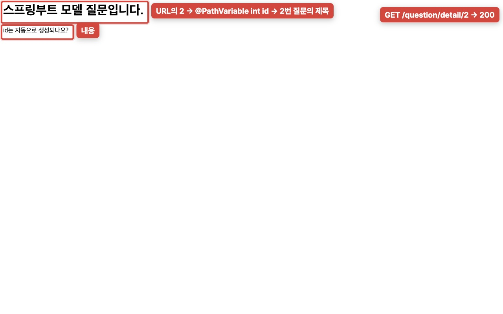

> **확인해 볼 것** 없는 번호(`/question/detail/999`)로 접속하면 어떻게 될까요? 010-03에서 다룹니다.

### 010-02 상세 페이지, 목록 제목을 상세로 연결
[이 시점의 코드](https://github.com/jhs512/jsb-plus-2/tree/010-02) · [변경 내용](https://github.com/jhs512/jsb-plus-2/commit/010-02)

**무엇을** 목록의 제목을 상세 페이지 링크로 만들었습니다.

**왜** 목록에서 클릭해 상세로 이동합니다(교재 2-10, 14163 35강 2단계). 타임리프에서 링크를 만드는 두 문법(`@{}`와 `||`)을 함께 씁니다.

`question_list.html`
```diff
- <td th:text="${question.subject}">제목</td>
+ <td>
+     <a th:href="@{|/question/detail/${question.id}|}" th:text="${question.subject}">제목</a>
+ </td>
```

| 문법 | 용도 |
|---|---|
| `@{...}` | URL 만들기. 앱 경로(context path)가 있으면 자동으로 앞에 붙인다 |
| `\|...\|` | 문자열 안에 변수 끼워 넣기 (`"/question/detail/" + id` 대신) |

**결과**
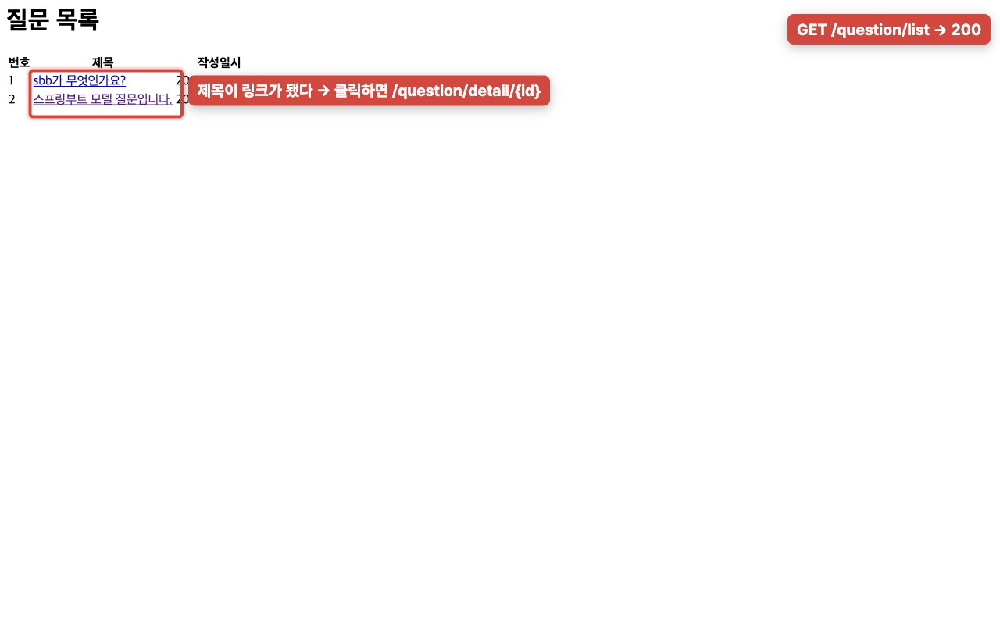

### 010-03 상세 페이지, 없는 질문에 404 응답
[이 시점의 코드](https://github.com/jhs512/jsb-plus-2/tree/010-03) · [변경 내용](https://github.com/jhs512/jsb-plus-2/commit/010-03)

**무엇을** 없는 질문 번호로 접속하면 500 대신 **404**를 응답합니다.

**왜** `findById(id).get()`은 값이 없으면 `NoSuchElementException: No value present`를 던져 **500**이 됩니다. 원인을 알기 어렵고, "없는 자원"이라는 의미에도 맞지 않습니다. 커스텀 예외를 만들어 404로 바꿉니다(14163 35강 3단계).

`DataNotFoundException.java` (새 파일)
```java
// 이 예외가 컨트롤러 밖으로 던져지면 스프링이 404 응답으로 바꿔 준다.
@ResponseStatus(value = HttpStatus.NOT_FOUND, reason = "entity not found")
public class DataNotFoundException extends RuntimeException {
    public DataNotFoundException(String message) { super(message); }
}
```

`QuestionService.java`
```diff
  public Question getQuestion(int id) {
-     return questionRepository.findById(id).get();
+     return questionRepository.findById(id)
+             .orElseThrow(() -> new DataNotFoundException("question not found"));
  }
```

**결과**

| 변경 전: 500 | 변경 후: 404 |
|---|---|
| 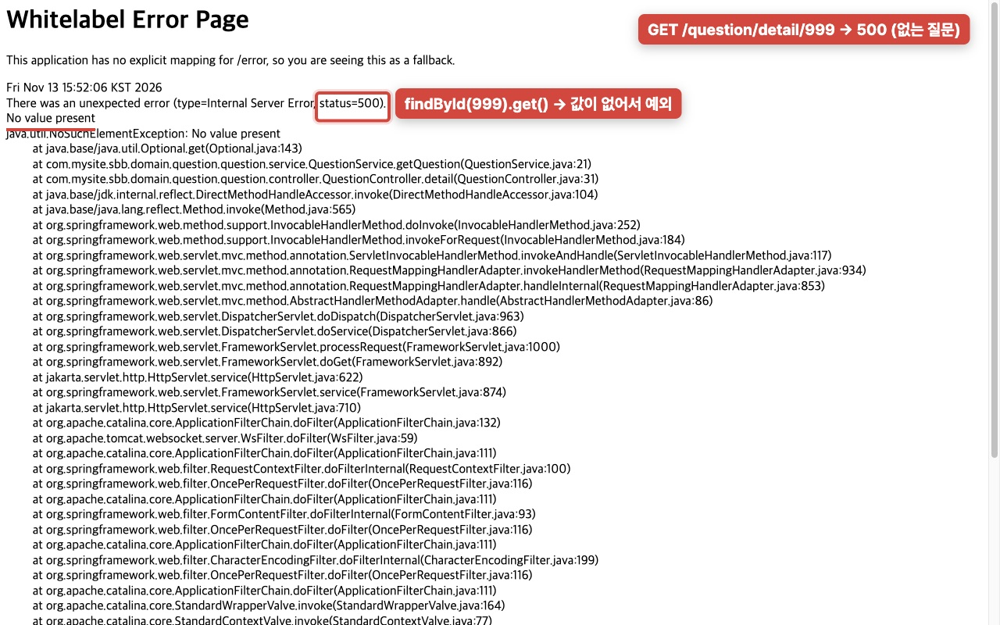 | 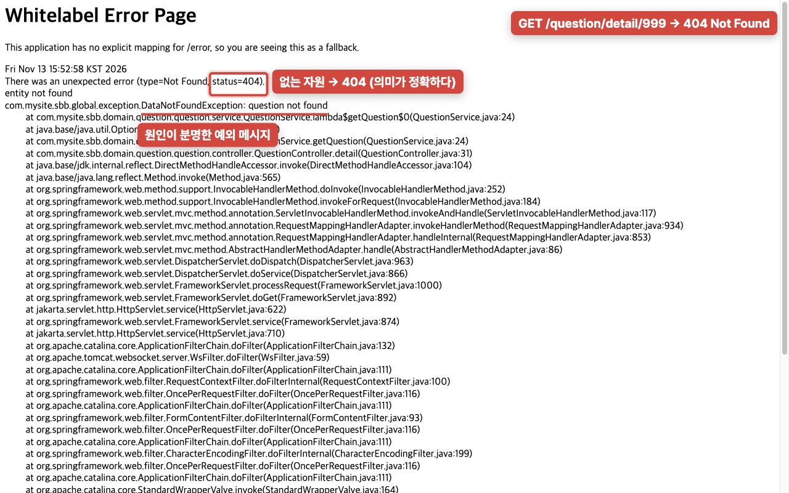 |

### 011-01 URL 프리픽스, @RequestMapping("/question")
[이 시점의 코드](https://github.com/jhs512/jsb-plus-2/tree/011-01) · [변경 내용](https://github.com/jhs512/jsb-plus-2/commit/011-01)

**무엇을** `QuestionController`에 `@RequestMapping("/question")`을 붙이고, 메서드에는 나머지 경로만 적었습니다.

**왜** 이 컨트롤러의 URL은 모두 `/question`으로 시작합니다. 공통 앞부분을 한 곳에서 관리합니다(교재 2-11).

```diff
  @Controller
+ @RequestMapping("/question")
  @RequiredArgsConstructor
  public class QuestionController {
-     @GetMapping("/question/list")
+     @GetMapping("/list")
      ...
-     @GetMapping("/question/detail/{id}")
+     @GetMapping("/detail/{id}")
```

> **결과** 실제 URL은 그대로라서 화면과 테스트 결과가 같습니다.

### 012-01 답변 기능, 상세 화면에 답변 폼
[이 시점의 코드](https://github.com/jhs512/jsb-plus-2/tree/012-01) · [변경 내용](https://github.com/jhs512/jsb-plus-2/commit/012-01)

**무엇을** 상세 화면에 답변 작성 폼을 추가했습니다.

**왜** 폼은 사용자가 입력한 값으로 요청(URL + 파라미터)을 만들어 주는 도구입니다(14168 3강). 데이터를 새로 만드는 요청이므로 GET이 아니라 **POST**로 보냅니다(14168 7강).

`question_detail.html`
```diff
  <div th:text="${question.content}">내용</div>
+
+ <form th:action="@{|/answer/create/${question.id}|}" method="post">
+     <textarea name="content" id="content" rows="15"></textarea>
+     <input type="submit" value="답변등록">
+ </form>
```

**결과** 아직 `/answer/create/2`를 처리하는 컨트롤러가 없어서, 지금 전송하면 404입니다. 다음 커밋에서 만듭니다.
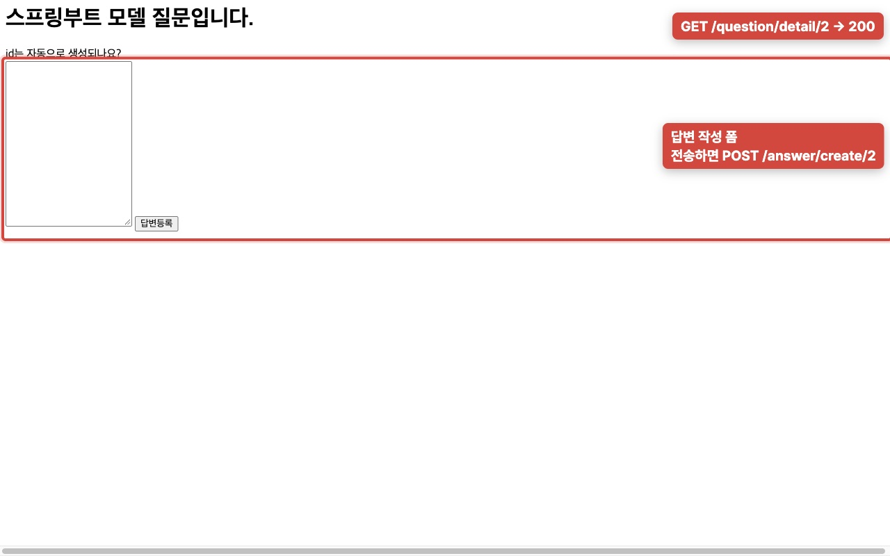

### 012-02 답변 기능, 답변 저장과 리다이렉트
[이 시점의 코드](https://github.com/jhs512/jsb-plus-2/tree/012-02) · [변경 내용](https://github.com/jhs512/jsb-plus-2/commit/012-02)

**무엇을** `POST /answer/create/{id}`를 처리하는 `AnswerController`를 만들었습니다. 답변은 `question.addAnswer()`로 추가하고, 저장 후에는 상세 페이지로 **리다이렉트**합니다.

**왜** 교재는 `answerRepository.save()`를 쓰지만, 강사처럼 질문의 답변 목록에 추가하는 방식으로 만듭니다(14163 37강). 처리 후 화면을 직접 그리지 않고 리다이렉트하면, 사용자가 새로고침해도 답변이 **중복 등록되지 않습니다**(POST-Redirect-GET, 14168 28강).

`AnswerController.java` (새 파일, 핵심)
```java
@PostMapping("/create/{id}")
@Transactional   // 조회 + 답변 추가를 하나의 트랜잭션으로 → 메서드가 끝날 때 INSERT
public String createAnswer(@PathVariable int id, @RequestParam("content") String content) {
    Question question = questionService.getQuestion(id);
    answerService.create(question, content);   // = question.addAnswer(content)

    return "redirect:/question/detail/%d".formatted(id);
}
```

**결과** 네트워크 탭을 보면 POST가 302를 받고, 브라우저가 상세 페이지를 GET으로 다시 요청했습니다. DB에는 답변이 들어갔습니다. 화면에 답변 목록은 다음 커밋에서 보여 줍니다.
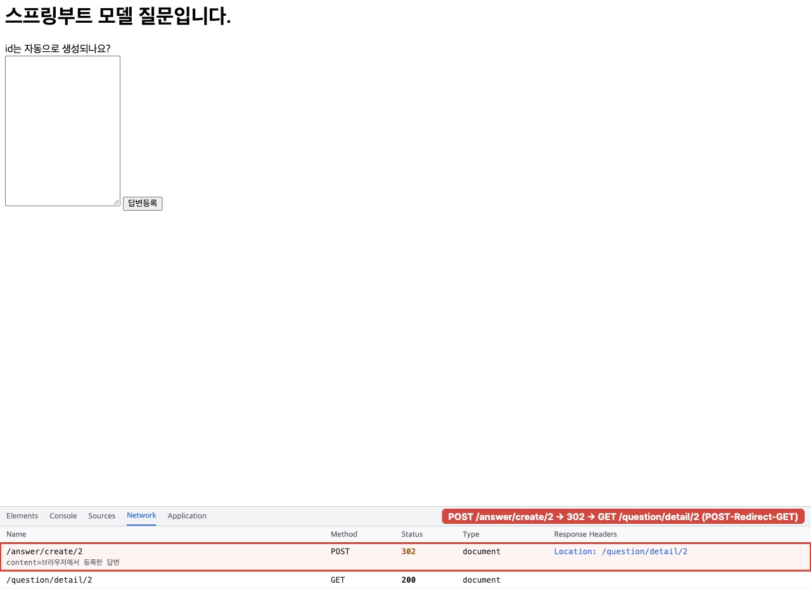
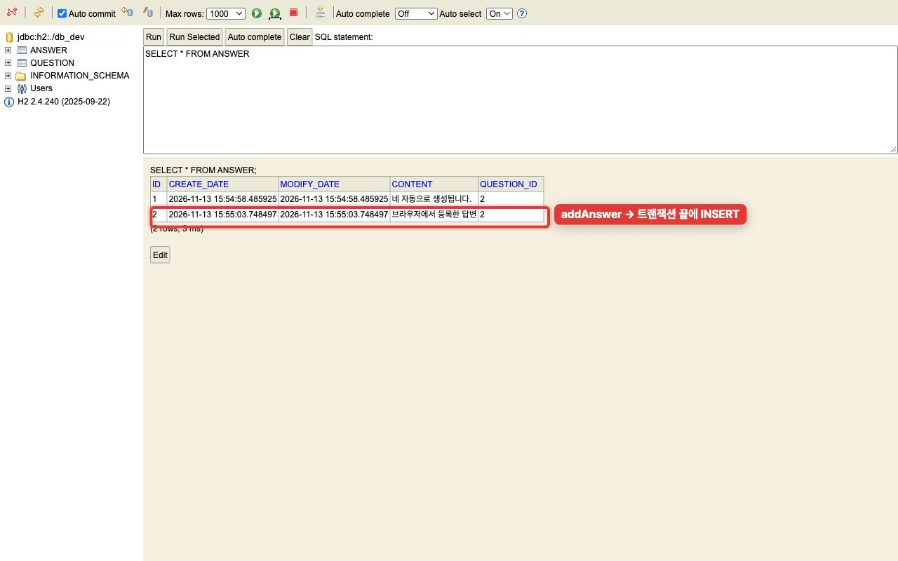

> **확인해 볼 것** 리다이렉트 없이 `return "question_detail";`로 화면을 바로 그리면, 새로고침할 때 브라우저가 POST를 다시 보내 답변이 또 등록됩니다.

### 012-03 답변 기능, 답변 개수와 목록 표시
[이 시점의 코드](https://github.com/jhs512/jsb-plus-2/tree/012-03) · [변경 내용](https://github.com/jhs512/jsb-plus-2/commit/012-03)

**무엇을** 상세 화면에 답변 개수와 답변 목록을 보여 줍니다.

**왜** `@OneToMany` 필드 덕분에 리포지터리 없이 `question.answers`로 답변 목록을 바로 꺼낼 수 있습니다(14163 9강, 교재 2-12).

`question_detail.html`
```diff
  <div th:text="${question.content}">내용</div>
+
+ <h5 th:text="|${#lists.size(question.answers)}개의 답변이 있습니다.|">0개의 답변이 있습니다.</h5>
+ <ul>
+     <li th:each="answer : ${question.answers}" th:text="${answer.content}">답변 내용</li>
+ </ul>
```

**결과**
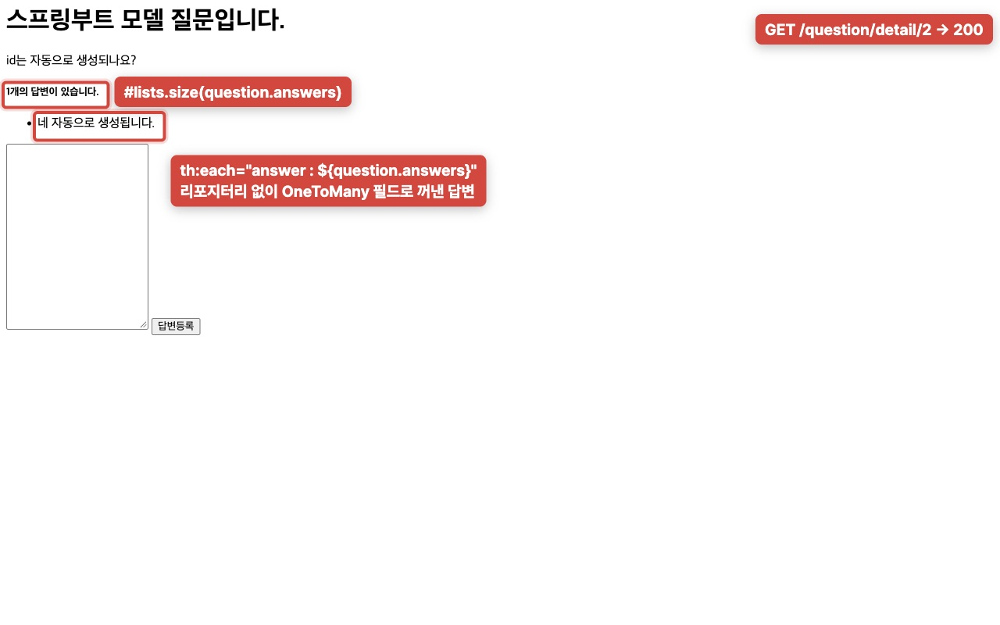

> **확인해 볼 것** `question.answers`는 LAZY입니다. 그런데도 템플릿에서 읽을 수 있는 이유는 스프링부트가 기본으로 켜 두는 OSIV(Open Session In View) 덕분에 화면을 그리는 동안 DB 연결이 유지되기 때문입니다.

### 013-01 웹 페이지 디자인, 스타일시트 적용
[이 시점의 코드](https://github.com/jhs512/jsb-plus-2/tree/013-01) · [변경 내용](https://github.com/jhs512/jsb-plus-2/commit/013-01)

**무엇을** 스타일시트(`style.css`)를 만들어 목록과 상세 화면에 연결했습니다.

**왜** CSS, JS, 이미지 같은 정적 파일은 `src/main/resources/static`에 두면 그대로 제공됩니다(교재 2-13). 처음부터 `static/resource/` 아래에 두는 이유는, 나중에 스프링 시큐리티에서 `/resource/**` 한 줄로 정적 파일을 허용하기 위해서입니다(14168 46강).

`static/resource/style.css` (새 파일)
```css
textarea { width: 100%; }
input[type=submit] { margin-top: 10px; }
```

`question_detail.html`, `question_list.html`
```diff
+ <link rel="stylesheet" type="text/css" th:href="@{/resource/style.css}">
```

**결과** 답변 입력칸이 화면 폭만큼 넓어졌습니다.
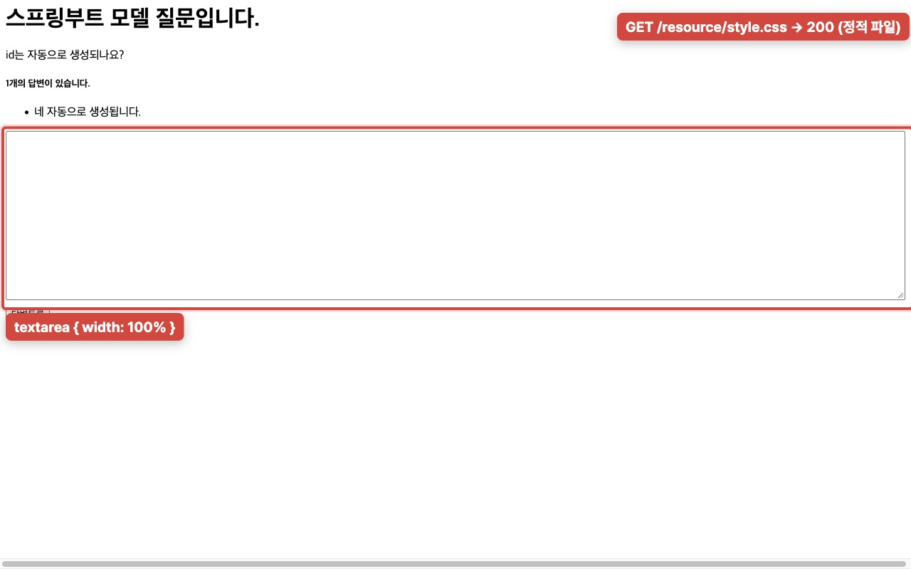

### 014-01 부트스트랩, cdnjs로 부트스트랩과 Pretendard 적용
[이 시점의 코드](https://github.com/jhs512/jsb-plus-2/tree/014-01) · [변경 내용](https://github.com/jhs512/jsb-plus-2/commit/014-01)

**무엇을** 부트스트랩과 Pretendard 폰트를 적용해 목록은 표(`table`), 상세는 카드(`card`) 모양으로 꾸몄습니다.

**왜** 교재는 부트스트랩 파일을 내려받아 `static`에 넣지만, 강사처럼 **CDN 주소**로 가져와 저장소를 가볍게 유지합니다(14163 39강). 입력한 줄바꿈이 화면에서 사라지지 않도록 `white-space: pre-line`도 넣었습니다(14168 29강).

`question_list.html`
```diff
+ <link rel="stylesheet" href="https://cdnjs.cloudflare.com/ajax/libs/bootstrap/5.3.8/css/bootstrap.min.css">
+ <link rel="stylesheet" href="https://cdn.jsdelivr.net/gh/orioncactus/pretendard@v1.3.9/dist/web/static/pretendard.min.css">
- <table>
-     <thead>
+ <div class="container my-3">
+ <table class="table">
+     <thead class="table-dark">
```

`question_detail.html` (핵심)
```html
<div class="card my-3">
    <div class="card-body">
        <div class="card-text" style="white-space: pre-line;" th:text="${question.content}">내용</div>
        <div class="badge bg-light text-dark p-2"
             th:text="${#temporals.format(question.createDate, 'yyyy-MM-dd HH:mm')}"></div>
    </div>
</div>
```

**결과**

| 변경 전 (013-01) | 변경 후 |
|---|---|
|  | 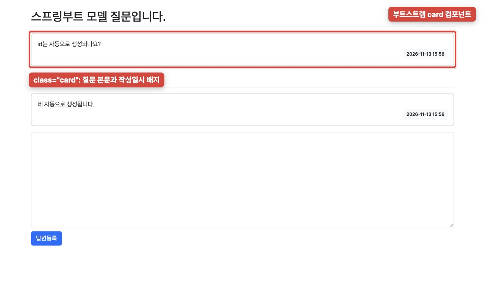 |

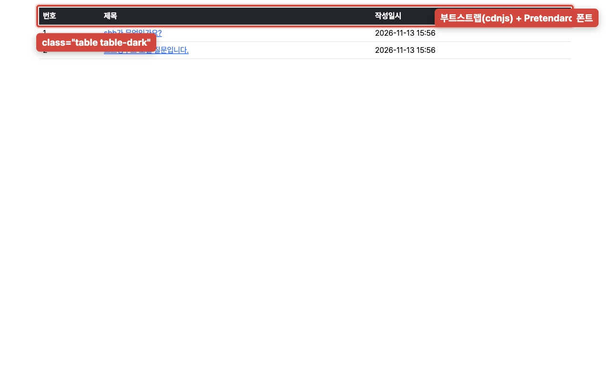

### 015-01 표준 HTML 구조, 레이아웃 템플릿
[이 시점의 코드](https://github.com/jhs512/jsb-plus-2/tree/015-01) · [변경 내용](https://github.com/jhs512/jsb-plus-2/commit/015-01)

**무엇을** 공통 HTML 뼈대(`layout.html`)를 만들고, 각 페이지는 본문(`layout:fragment="content"`)만 쓰도록 바꿨습니다. 탭 제목은 페이지마다 다르게 붙입니다.

**왜** 모든 페이지가 `<!doctype html>`, `<head>`, CDN 링크를 갖춘 표준 HTML이어야 합니다. 공통 부분은 한 곳에서 관리합니다(교재 2-15). `layout:title-pattern`으로 "질문 목록 | SBB"처럼 페이지별 제목을 만듭니다(14168 45강).

`layout.html` (새 파일, 핵심)
```html
<!doctype html>
<html lang="ko">
<head>
    <title layout:title-pattern="$CONTENT_TITLE | $LAYOUT_TITLE">SBB</title>
    <link rel="stylesheet" href="https://cdnjs.cloudflare.com/ajax/libs/bootstrap/5.3.8/css/bootstrap.min.css">
    <!-- ... -->
</head>
<body>
<th:block layout:fragment="content"></th:block>
</body>
</html>
```

`question_list.html`
```diff
- <link rel="stylesheet" href="...bootstrap.min.css">
- <div class="container my-3">
+ <html layout:decorate="~{layout}">
+ <head><title>질문 목록</title></head>
+ <div layout:fragment="content" class="container my-3">
```

`build.gradle.kts`
```diff
+ implementation("nz.net.ultraq.thymeleaf:thymeleaf-layout-dialect")
```

**결과** 화면은 같지만, 응답 HTML이 레이아웃으로 감싸지고 탭 제목이 "질문 목록 | SBB"가 됩니다.
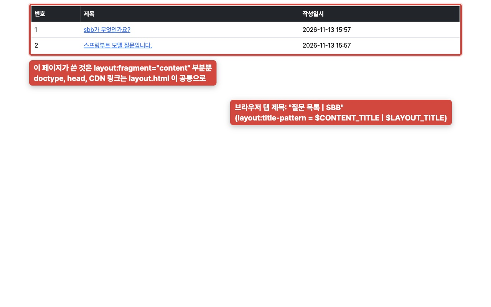

### 016-01 질문 등록, 등록 폼과 저장
[이 시점의 코드](https://github.com/jhs512/jsb-plus-2/tree/016-01) · [변경 내용](https://github.com/jhs512/jsb-plus-2/commit/016-01)

**무엇을** 질문 등록 폼(`GET /question/create`)과 저장 처리(`POST /question/create`)를 만들었습니다.

**왜** 교재 2-16. 같은 URL을 **GET은 폼 보여주기, POST는 처리**로 구분합니다(14168 26강). 폼의 `action`을 생략하면 현재 URL로 전송됩니다.

`QuestionController.java`
```java
@GetMapping("/create")
public String showCreate() {
    return "question_form";
}

@PostMapping("/create")
public String create(@RequestParam("subject") String subject,
                     @RequestParam("content") String content) {
    questionService.create(subject, content);
    return "redirect:/question/list";
}
```

`question_form.html` (새 파일, 핵심)
```html
<!-- action 생략 → 현재 URL(/question/create)로 POST -->
<form method="post">
    <label class="form-label">제목 <input type="text" name="subject" class="form-control"></label>
    <label class="form-label w-100">내용 <textarea name="content" class="form-control" rows="10"></textarea></label>
    <input type="submit" value="저장하기" class="btn btn-primary my-2">
</form>
```

**결과**
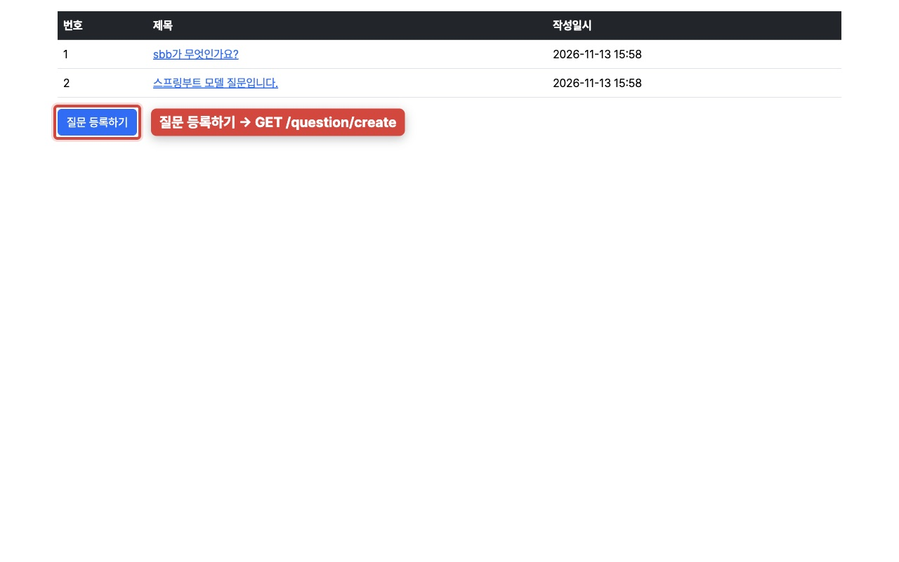
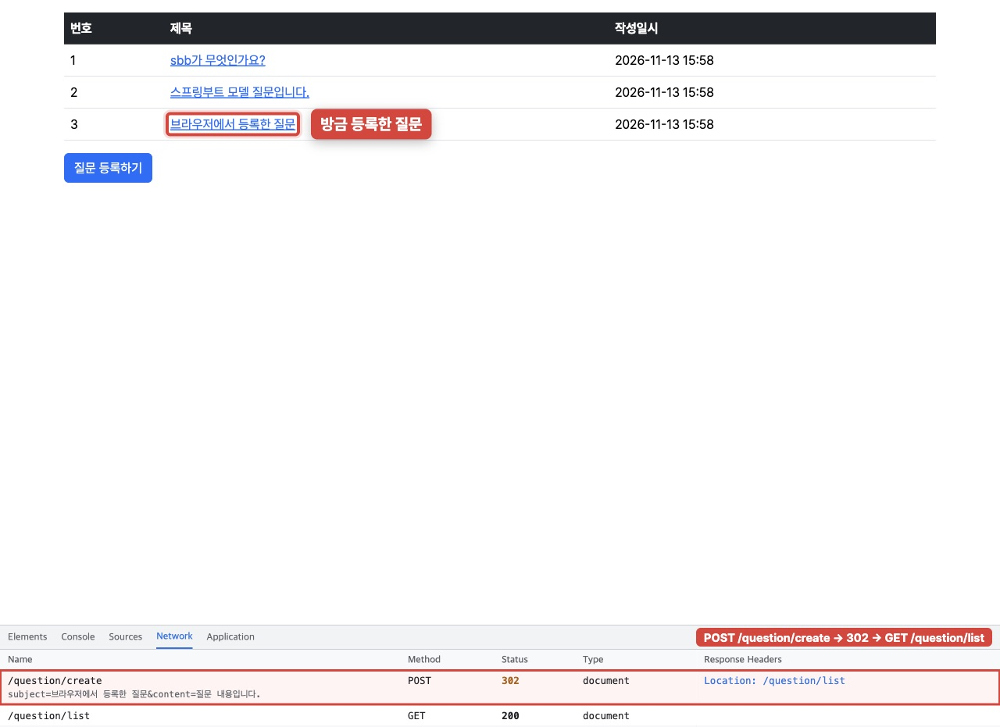

> **확인해 볼 것** 지금은 제목을 비워도 저장됩니다. 다음 커밋에서 검증을 넣습니다.

### 016-02 질문 등록, record 폼과 @Valid 검증
[이 시점의 코드](https://github.com/jhs512/jsb-plus-2/tree/016-02) · [변경 내용](https://github.com/jhs512/jsb-plus-2/commit/016-02)

**무엇을** 폼 데이터를 `record QuestionForm`으로 받고, `@NotBlank`, `@Size`로 검증합니다. 검증에 실패하면 저장하지 않고 폼을 다시 보여 줍니다.

**왜** 교재는 Getter/Setter가 있는 클래스를 쓰지만 `record`로 코드를 줄입니다(14168 40강). `BindingResult`가 없으면 검증 실패 시 바로 400 예외가 나므로, `@Valid` 바로 뒤에 둬서 실패 후의 처리를 직접 정합니다(14168 13강). 에러 메시지 앞에 붙인 `01-subject-`는 다음 커밋에서 정렬과 포커스에 씁니다.

`QuestionController.java`
```java
public record QuestionForm(
        @NotBlank(message = "01-subject-제목은 필수항목입니다.")
        @Size(max = 200, message = "02-subject-제목은 200자 이하로 입력해주세요.")
        String subject,

        @NotBlank(message = "03-content-내용은 필수항목입니다.")
        String content
) {}

@PostMapping("/create")
public String create(@ModelAttribute("form") @Valid QuestionForm form,
                     BindingResult bindingResult) {     // 꼭 @Valid 바로 뒤
    if (bindingResult.hasErrors()) return "question_form"; // 폼 다시 보여주기
    questionService.create(form.subject(), form.content());
    return "redirect:/question/list";
}
```

`question_form.html`
```diff
- <form method="post">
+ <form th:object="${form}" method="post">
+     <ul th:if="${#fields.hasAnyErrors()}" class="alert alert-danger">
+         <li th:each="err : ${#fields.allErrors()}" th:text="${err}">에러</li>
+     </ul>
-     <input type="text" name="subject" class="form-control">
+     <input type="text" th:field="*{subject}" class="form-control">   <!-- name, id, value 자동 -->
```

**결과** 제목을 비우면 저장되지 않고, 입력했던 내용은 그대로 남습니다.
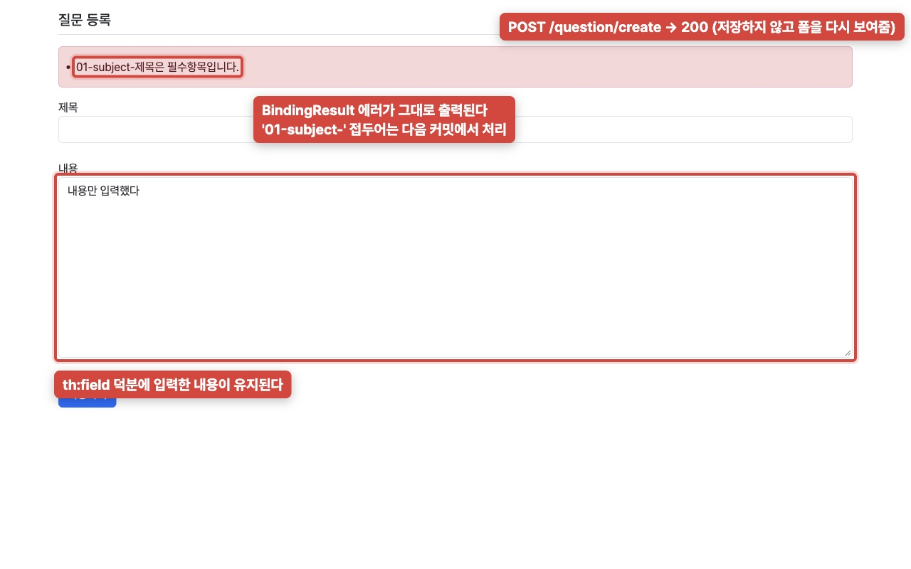

### 016-03 질문 등록, 에러 프래그먼트와 정렬
[이 시점의 코드](https://github.com/jhs512/jsb-plus-2/tree/016-03) · [변경 내용](https://github.com/jhs512/jsb-plus-2/commit/016-03)

**무엇을** 에러 출력 부분을 공통 프래그먼트(`form_errors.html`)로 빼고, 메시지를 **순번대로 정렬**하고 `01-subject-` 접두어를 떼서 보여 줍니다.

**왜** 여러 폼에서 같은 방식으로 에러를 보여 주기 위해서입니다(14168 23·24강). 검증 에러는 순서가 보장되지 않아서, 메시지 앞에 붙인 순번으로 정렬합니다. 필드 이름(`subject`)은 `data-error-field-name` 속성에 남겨 두었다가 다음 단계에서 포커스에 씁니다.

`form_errors.html` (새 파일)
```html
<th:block th:fragment="formErrorsFragment">
    <ul th:if="${#fields.hasAnyErrors()}" class="alert alert-danger ps-4">
        <li th:each="err : ${#fields.allErrors().stream().sorted()}"
            th:with="errStrs = ${err.split('-', 3)},
                     errFieldName = ${errStrs[1]},
                     errMsg = ${errStrs[2]}"
            th:data-error-field-name="${errFieldName}"
            th:text="${errMsg}"></li>
    </ul>
</th:block>
```

`question_form.html`
```diff
- <ul th:if="${#fields.hasAnyErrors()}" class="alert alert-danger ps-4">
-     <li th:each="err : ${#fields.allErrors()}" th:text="${err}">에러</li>
- </ul>
+ <th:block th:replace="~{form_errors :: formErrorsFragment}"></th:block>
```

**결과**
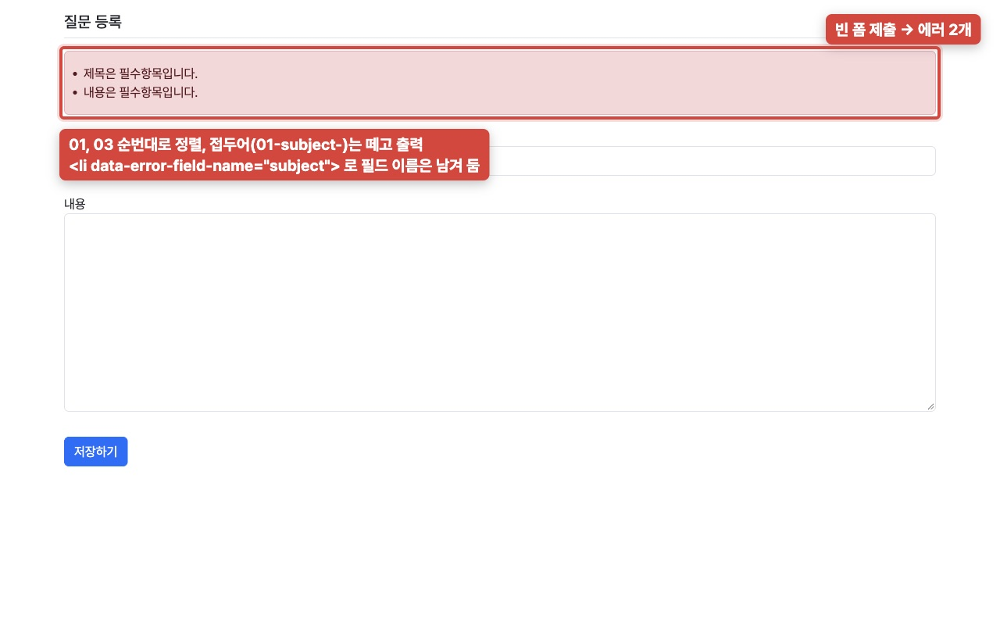

### 016-04 질문 등록, [실험] 강사 방식 focus 스크립트는 콘솔 에러
[이 시점의 코드](https://github.com/jhs512/jsb-plus-2/tree/016-04) · [변경 내용](https://github.com/jhs512/jsb-plus-2/commit/016-04)

**무엇을** 첫 번째 에러 칸으로 커서를 옮기는 스크립트를 **강사 방식 그대로** 넣었습니다. **(실험 커밋)**

**왜** 강사(14168 25강)는 "현재까지 나온 마지막 form"을 찾고 `setTimeout`으로 조금 늦게 focus 합니다. 그런데 이 프로젝트에서는 에러 프래그먼트가 **폼 맨 위**에 있습니다. 실제로 동작하는지 확인합니다.

`form_errors.html`
```html
<script>
    const forms = document.querySelectorAll('form');
    const lastForm = forms[forms.length - 1];
    const errorFieldName = lastForm.querySelector('ul > li')?.dataset?.errorFieldName || '';
    if (errorFieldName.length > 0) {
        setTimeout(() => lastForm[errorFieldName].focus());
    }
</script>
```

**결과** 제목만 쓰고 저장하면 '내용' 칸에 에러가 나는데, 커서는 이동하지 않고 콘솔에 에러가 납니다.
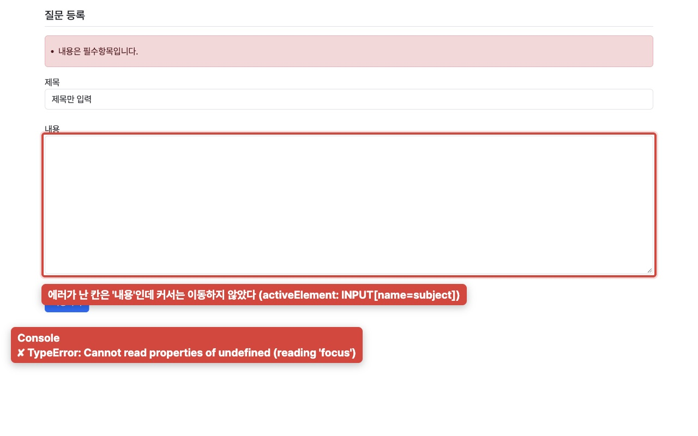

> **왜 실패할까?** 이 스크립트는 폼 맨 위(에러 목록 바로 아래)에서 실행됩니다. 그 순간 브라우저는 아직 아래쪽 `<textarea name="content">`를 읽지 않았습니다. 그래서 `lastForm["content"]`가 `undefined`입니다. `setTimeout`으로 조금 늦춰도, 그때까지 문서를 다 읽었다는 보장이 없습니다.

### 016-05 질문 등록, 첫 에러 필드 focus 개선(currentScript + DOMContentLoaded)
[이 시점의 코드](https://github.com/jhs512/jsb-plus-2/tree/016-05) · [변경 내용](https://github.com/jhs512/jsb-plus-2/commit/016-05)

**무엇을** 포커스 스크립트를 고쳤습니다. 스크립트가 들어 있는 폼을 `document.currentScript.closest('form')`으로 정확히 찾고, 문서를 다 읽은 뒤(`DOMContentLoaded`)에 focus 합니다.

**왜** 앞 실험에서 본 것처럼, 폼 맨 위에서 실행되는 시점에는 아래쪽 입력칸이 아직 없습니다. "마지막 form"으로 추측하는 대신 자기가 속한 폼을 직접 찾고, 입력칸이 다 만들어진 다음에 실행되도록 순서를 보장합니다(14168 25강 개선).

`form_errors.html`
```diff
- const forms = document.querySelectorAll('form');
- const lastForm = forms[forms.length - 1];
- const errorFieldName = lastForm.querySelector('ul > li')?.dataset?.errorFieldName || '';
- if (errorFieldName.length > 0) {
-     setTimeout(() => lastForm[errorFieldName].focus());
- }
+ (() => {
+     const form = document.currentScript.closest('form');   // 이 스크립트가 들어 있는 form
+     const errorFieldName = form.querySelector('ul > li')?.dataset?.errorFieldName || '';
+     if (errorFieldName.length === 0) return;
+
+     document.addEventListener('DOMContentLoaded', () => form[errorFieldName]?.focus());
+ })();
```

**결과**

| 변경 전 (016-04) | 변경 후 |
|---|---|
|  | 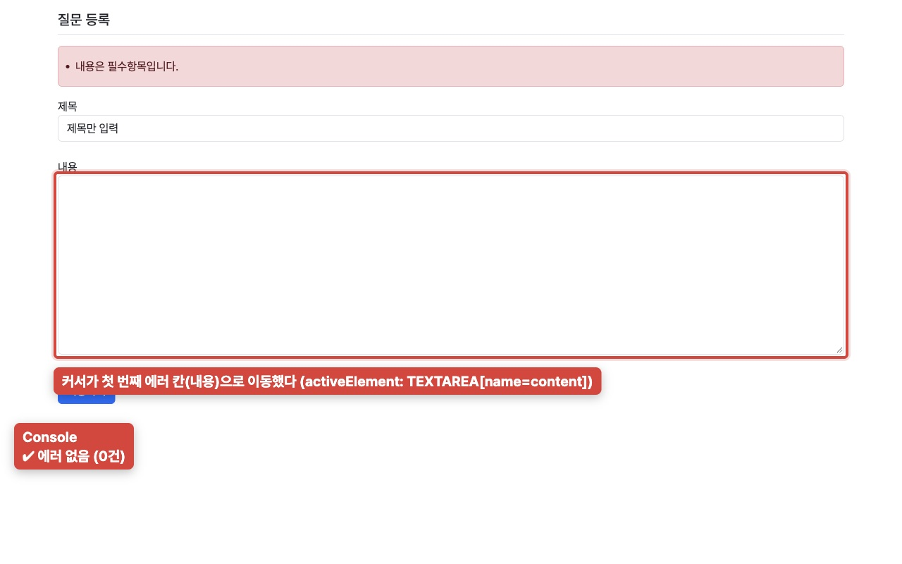 |

> **교재와 다른 점** 교재에는 없는 기능입니다. 강사 방식을 이 구조에 맞게 고쳤습니다. 1차 구현에서는 고친 결과만 남겼는데, 이번에는 실패(016-04)와 개선(016-05)을 나눠 남겼습니다.

### 016-06 질문 등록, 답변 폼에도 검증
[이 시점의 코드](https://github.com/jhs512/jsb-plus-2/tree/016-06) · [변경 내용](https://github.com/jhs512/jsb-plus-2/commit/016-06)

**무엇을** 답변 폼에도 같은 방식(`record AnswerForm` + `@Valid` + 에러 프래그먼트)으로 검증을 넣었습니다.

**왜** 빈 답변이 저장되지 않도록 서버에서 반드시 검증합니다(14168 35강). 검증에 실패하면 상세 화면을 다시 그려야 해서 `question`도 모델에 담습니다.

`AnswerController.java`
```diff
+ public record AnswerForm(
+         @NotBlank(message = "01-content-내용은 필수항목입니다.")
+         String content
+ ) {}

  public String createAnswer(@PathVariable int id,
-                            @RequestParam("content") String content) {
+                            @ModelAttribute("answerForm") @Valid AnswerForm answerForm,
+                            BindingResult bindingResult, Model model) {
      Question question = questionService.getQuestion(id);
+     if (bindingResult.hasErrors()) {
+         model.addAttribute("question", question);   // 상세 화면을 다시 그리려면 필요
+         return "question_detail";
+     }
```

`question_detail.html`
```diff
- <form th:action="@{|/answer/create/${question.id}|}" method="post" class="my-3">
-     <textarea name="content" id="content" rows="10" class="form-control"></textarea>
+ <form th:action="@{|/answer/create/${question.id}|}" th:object="${answerForm}" method="post" class="my-3">
+     <th:block th:replace="~{form_errors :: formErrorsFragment}"></th:block>
+     <textarea th:field="*{content}" rows="10" class="form-control"></textarea>
```

**결과**
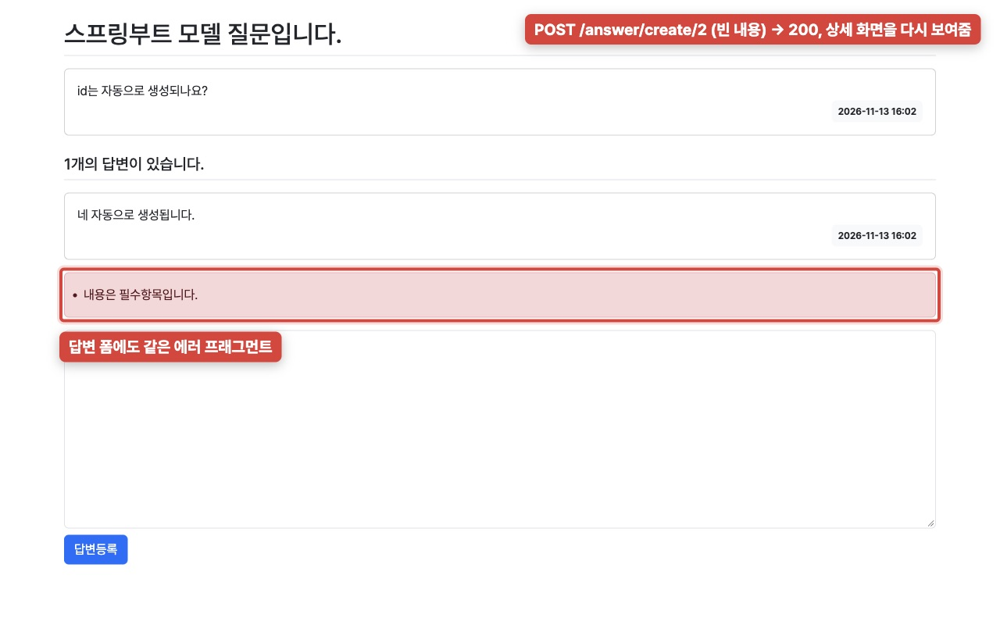

### 017-01 내비게이션 바, navbar 프래그먼트
[이 시점의 코드](https://github.com/jhs512/jsb-plus-2/tree/017-01) · [변경 내용](https://github.com/jhs512/jsb-plus-2/commit/017-01)

**무엇을** 모든 페이지 위에 내비게이션 바를 넣었습니다.

**왜** 공통 메뉴를 한 파일(`navbar.html`)에서 관리하고, 레이아웃에서 한 번만 포함합니다(교재 3-01). 화면이 좁으면 메뉴가 햄버거 버튼으로 접힙니다(부트스트랩 JS 필요).

`navbar.html` (새 파일, 핵심)
```html
<nav th:fragment="navbarFragment" class="navbar navbar-expand-lg navbar-light bg-light border-bottom">
    <a class="navbar-brand" th:href="@{/}">SBB</a>
    <!-- ... 질문 목록 링크, 토글 버튼 -->
</nav>
```

`layout.html`
```diff
  <body>
+ <nav th:replace="~{navbar :: navbarFragment}"></nav>
  <th:block layout:fragment="content"></th:block>
+ <script src="https://cdnjs.cloudflare.com/ajax/libs/bootstrap/5.3.8/js/bootstrap.bundle.min.js"></script>
```

**결과**
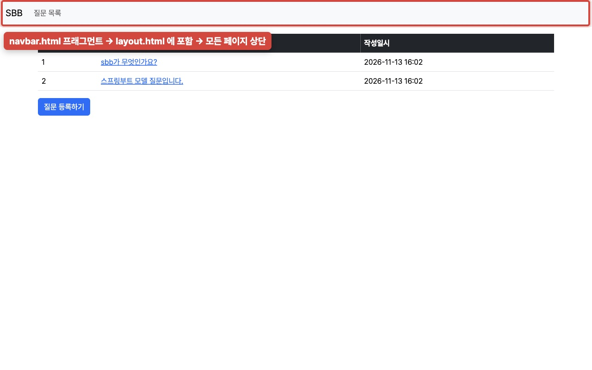

### 018-01 페이징, Pageable로 질문 목록 페이징
[이 시점의 코드](https://github.com/jhs512/jsb-plus-2/tree/018-01) · [변경 내용](https://github.com/jhs512/jsb-plus-2/commit/018-01)

**무엇을** 질문 목록을 한 페이지에 10개씩, 최신 글부터 보여 줍니다.

**왜** 글이 많아져도 한 번에 전부 조회하지 않고 필요한 만큼만 가져옵니다(교재 3-02).

`QuestionService.java`
```diff
- public List<Question> getList() {
-     return questionRepository.findAll();
+ // page: 0부터 시작. 한 페이지에 10개, 최신 글이 먼저
+ public Page<Question> getList(int page) {
+     Pageable pageable = PageRequest.of(page, 10, Sort.by(Sort.Order.desc("createDate"), Sort.Order.desc("id")));
+     return questionRepository.findAll(pageable);
  }
```

`QuestionController.java`
```diff
- public String list(Model model) {
-     List<Question> questionList = questionService.getList();
-     model.addAttribute("questionList", questionList);
+ public String list(Model model, @RequestParam(defaultValue = "0") int page) {
+     Page<Question> paging = questionService.getList(page);
+     model.addAttribute("paging", paging);   // 목록 + 총 페이지 수, 현재 페이지 등
```

`question_list.html` (페이지 번호, 핵심)
```html
<li th:each="page : ${#numbers.sequence(0, paging.totalPages - 1)}"
    th:if="${page >= paging.number - 5 and page <= paging.number + 5}"
    th:classappend="${page == paging.number} ? 'active'" class="page-item">
    <a th:text="${page + 1}" class="page-link" th:href="@{|?page=${page}|}">1</a>
</li>
```

**결과** SQL 로그를 보면 `offset ? rows fetch first ? rows only`로 10개만 가져옵니다. 데이터가 2건뿐이라 화면에는 1페이지만 보입니다.
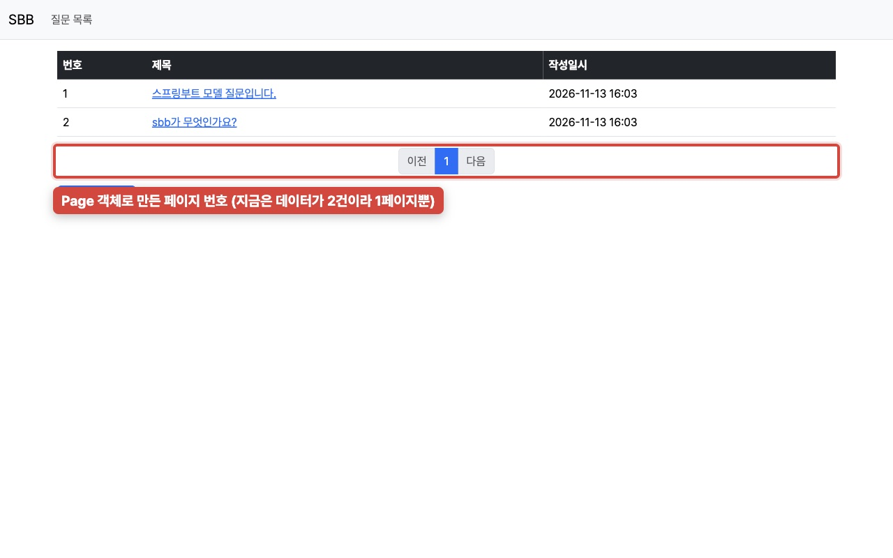
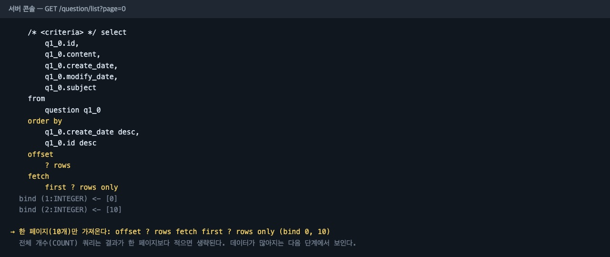

### 018-02 페이징, 개발용 대량 데이터(DevInitData)
[이 시점의 코드](https://github.com/jhs512/jsb-plus-2/tree/018-02) · [변경 내용](https://github.com/jhs512/jsb-plus-2/commit/018-02)

**무엇을** 개발(dev) 환경에서만 질문 300개를 자동으로 만드는 `DevInitData`를 추가했습니다.

**왜** 페이징은 데이터가 많아야 눈으로 확인됩니다(교재 3-02). 교재는 테스트 코드로 개발 DB에 300개를 넣지만, 이 프로젝트는 test와 dev 프로파일을 나눴으므로 **dev 전용 초기 데이터**로 만듭니다. 테스트(test)는 그대로 샘플 2건만 씁니다.

`DevInitData.java` (새 파일, 핵심)
```java
@Profile("dev")   // dev 프로파일에서만 등록되는 빈
@Configuration
public class DevInitData {
    @Bean
    @Order(2)     // BaseInitData(샘플 2개, @Order(1)) 다음에 실행
    public ApplicationRunner devInitDataApplicationRunner() {
        return args -> self.work1();
    }

    @Transactional
    public void work1() {
        if (questionRepository.count() > 2) return;
        for (int i = 1; i <= 300; i++) {
            questionRepository.save(new Question("테스트 데이터입니다:[%03d]".formatted(i), "내용무"));
        }
    }
}
```

**결과** 목록에 최신 10건이 보이고, 페이지 번호가 생겼습니다. 이제 전체 개수를 세는 COUNT 쿼리도 실행됩니다.
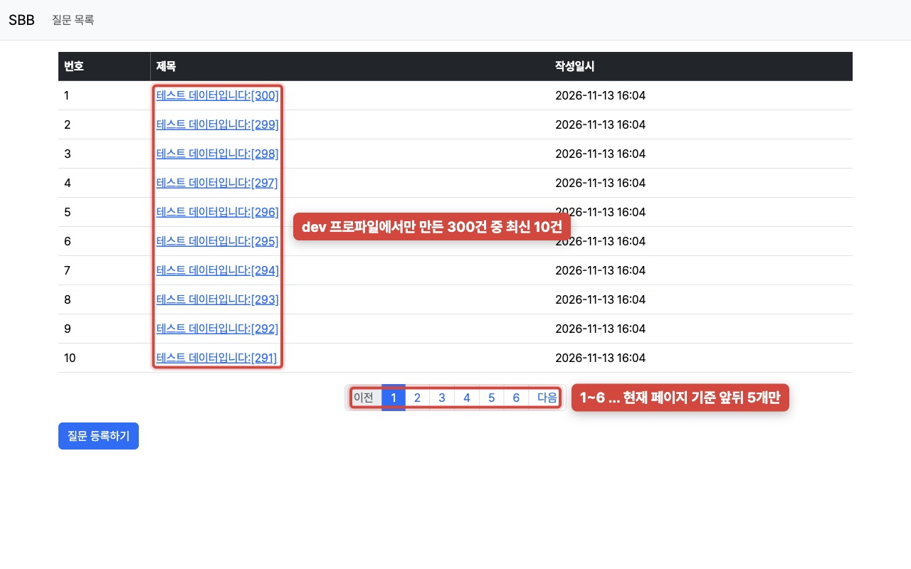
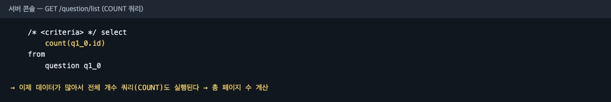

> **확인해 볼 것** 번호 열이 페이지마다 1부터 다시 시작합니다. 다음 커밋에서 전체 기준 번호로 바꿉니다.

### 019-01 게시물 번호, 전체 개수 기준 역순 번호
[이 시점의 코드](https://github.com/jhs512/jsb-plus-2/tree/019-01) · [변경 내용](https://github.com/jhs512/jsb-plus-2/commit/019-01)

**무엇을** 목록의 번호를 페이지마다 1부터 다시 세지 않고, **전체 개수 기준 역순**으로 바꿨습니다.

**왜** `loop.count`는 페이지마다 1부터 시작합니다. 최신 글이 가장 큰 번호를 갖도록 계산합니다(교재 3-03).

`question_list.html`
```diff
- <td th:text="${loop.count}">1</td>
+ <!-- 번호 = 전체 개수 - (현재 페이지 × 페이지 크기) - 페이지 안에서의 인덱스 -->
+ <td th:text="${paging.totalElements - (paging.number * paging.size) - loop.index}">1</td>
```

**결과** 1페이지 첫 줄은 302, 마지막 페이지 마지막 줄은 1입니다.

| 1페이지 | 마지막 페이지 |
|---|---|
| 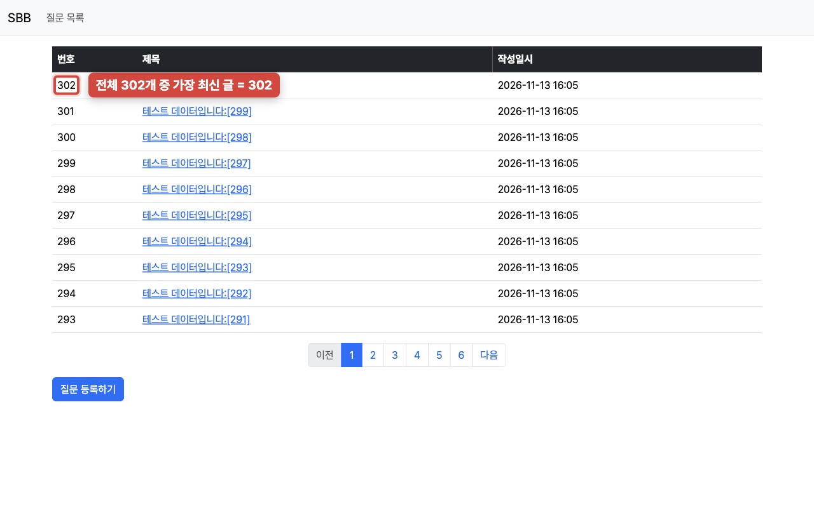 | 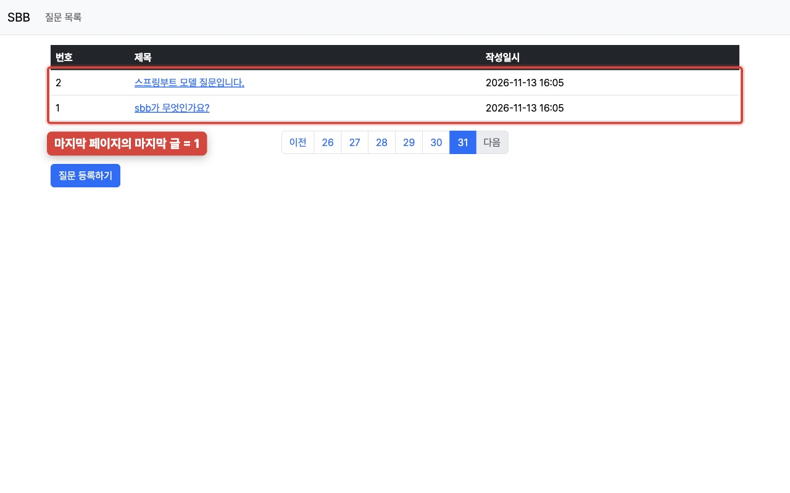 |

### 020-01 답변 개수, 목록에 답변 개수 표시
[이 시점의 코드](https://github.com/jhs512/jsb-plus-2/tree/020-01) · [변경 내용](https://github.com/jhs512/jsb-plus-2/commit/020-01)

**무엇을** 목록에서 질문 제목 옆에 답변 개수를 보여 줍니다(답변이 있을 때만).

**왜** 답변이 달린 질문을 목록에서 바로 알아볼 수 있습니다(교재 3-04).

`question_list.html`
```diff
  <a th:href="@{|/question/detail/${question.id}|}" th:text="${question.subject}">제목</a>
+ <span class="text-danger small ms-2"
+       th:if="${#lists.size(question.answers) > 0}"
+       th:text="${#lists.size(question.answers)}">2</span>
```

**결과** 배지는 잘 나오지만, SQL 로그를 보면 문제가 있습니다. `question.answers`는 LAZY라서, 목록의 질문 10개마다 answer 조회가 **한 번씩 따로** 실행됩니다. 질문 조회 1번 + 답변 조회 N번, 이른바 **N+1 문제**입니다.
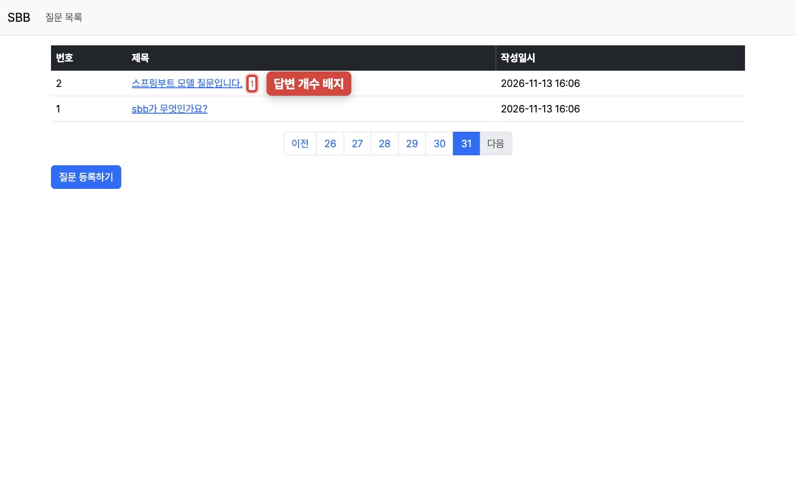
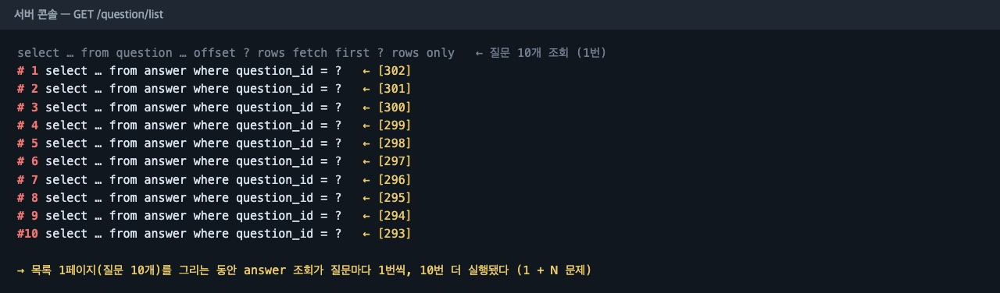

> **확인해 볼 것** 한 페이지에 100개를 보여 주면 쿼리가 101번 실행됩니다. 다음 커밋에서 줄입니다.

### 020-02 답변 개수, default_batch_fetch_size로 N+1 완화
[이 시점의 코드](https://github.com/jhs512/jsb-plus-2/tree/020-02) · [변경 내용](https://github.com/jhs512/jsb-plus-2/commit/020-02)

**무엇을** `default_batch_fetch_size: 100`을 설정해 N+1 문제를 줄였습니다.

**왜** LAZY 컬렉션을 하나씩 조회하는 대신, 지금 필요한 질문들의 답변을 `IN (?, ?, …)`으로 **묶어서 한 번에** 조회합니다. 강의에는 없는 추가 개선입니다. 14163 13강에서 말한 "OneToMany는 유용하면 쓰되, 양이 많아지면 다른 방법을 고려"와 이어집니다.

`application.yaml`
```diff
      use_sql_comments: true
+     default_batch_fetch_size: 100   # LAZY 컬렉션을 IN 절로 최대 100개씩 묶어서 조회
```

**결과**

| 변경 전: answer 조회 10번 | 변경 후: 1번 |
|---|---|
|  | 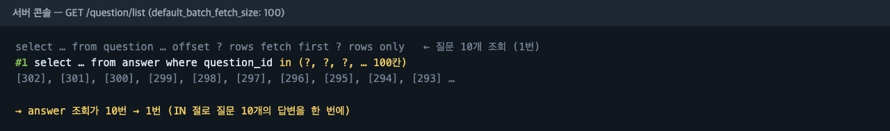 |

> **확인해 볼 것** 코드는 한 줄도 바꾸지 않았습니다. 같은 `question.answers`를 읽어도 설정 하나로 SQL이 달라집니다.

### 021-01 스프링 시큐리티, [실험] 의존성만 추가하면 모든 요청이 막힌다
[이 시점의 코드](https://github.com/jhs512/jsb-plus-2/tree/021-01) · [변경 내용](https://github.com/jhs512/jsb-plus-2/commit/021-01)

**무엇을** `spring-boot-starter-security` 의존성**만** 추가했습니다. 설정은 아직 없습니다. **(실험 커밋, 이 커밋에서는 컨트롤러 테스트 12건이 일부러 실패합니다)**

**왜** 스프링 시큐리티는 컨트롤러보다 앞(필터)에서 동작합니다. 설정이 없을 때의 기본값 두 가지를 먼저 눈으로 확인합니다(14168 46강).
1. 로그인하지 않은 요청은 **모두 거절**하고 로그인 화면으로 보낸다.
2. POST, PUT, DELETE 요청은 **CSRF 토큰**을 검사한다.

`build.gradle.kts`
```diff
+ implementation("org.springframework.boot:spring-boot-starter-security")
+ testImplementation("org.springframework.boot:spring-boot-starter-security-test")
```

**결과** 질문 목록에 들어가면 만든 적 없는 로그인 화면으로 302 리다이렉트됩니다. 기본 계정은 `user`, 비밀번호는 실행할 때마다 콘솔에 찍힙니다.
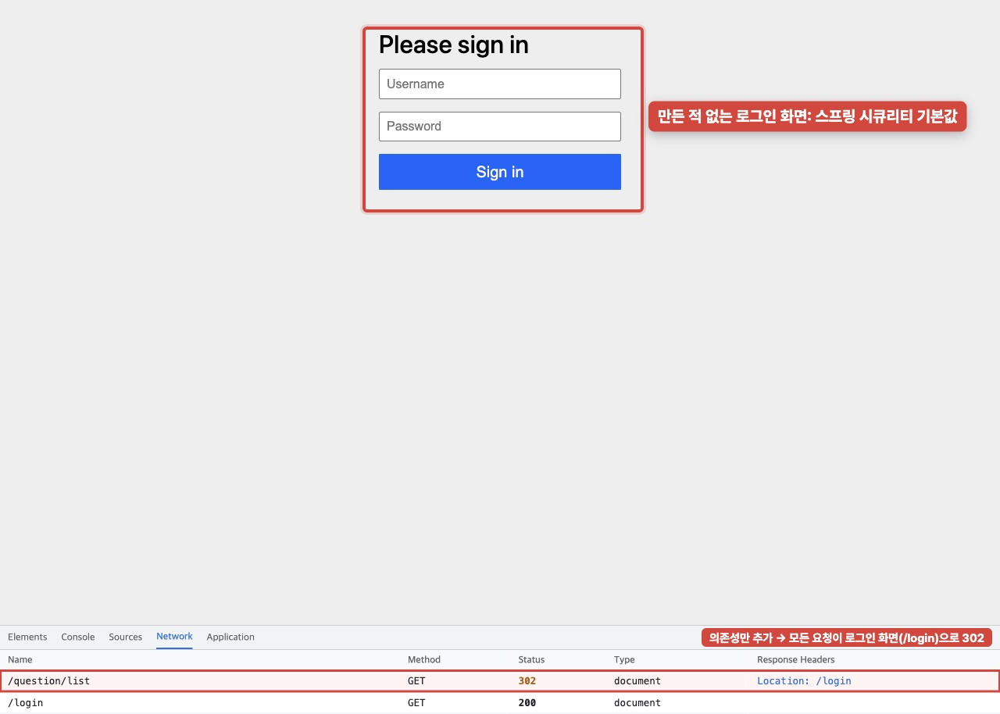
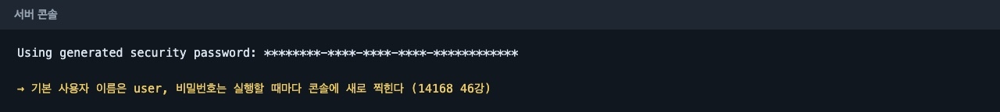
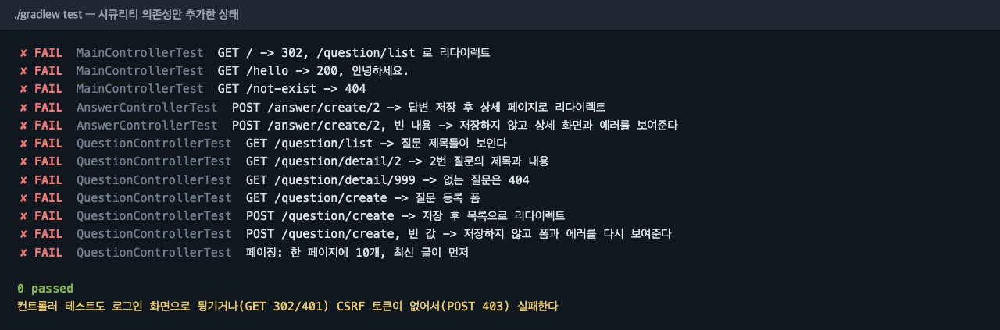

> **확인해 볼 것** 다음 커밋에서 `SecurityFilterChain`을 직접 설정해 모든 요청을 허용하고, 테스트를 다시 통과시킵니다.

### 021-02 스프링 시큐리티, SecurityFilterChain 설정
[이 시점의 코드](https://github.com/jhs512/jsb-plus-2/tree/021-02) · [변경 내용](https://github.com/jhs512/jsb-plus-2/commit/021-02)

**무엇을** `SecurityFilterChain`을 직접 설정했습니다. 지금은 모든 요청을 허용하고, H2 콘솔이 동작하도록 예외를 둡니다. 테스트의 POST 요청에는 `.with(csrf())`를 붙였습니다.

**왜** 로그인 기능을 만들기 전까지는 모두 허용하고, 나중에 필요한 곳만 막습니다. 정적 파일은 `/resource/**` 한 줄로 허용합니다(013에서 미리 `resource` 폴더에 둔 이유). 교재의 `AntPathRequestMatcher`는 Spring Security 7(Boot 4)에서 **제거**되어 문자열 패턴을 씁니다.

`SecurityConfig.java` (새 파일)
```java
@Bean
public SecurityFilterChain filterChain(HttpSecurity http) {
    http
        .authorizeHttpRequests(auth -> auth
            .requestMatchers("/resource/**").permitAll()     // 정적 파일 (14168 46강)
            .requestMatchers("/h2-console/**").permitAll()
            .anyRequest().permitAll())                       // 지금은 모두 허용
        .headers(h -> h.frameOptions(FrameOptionsConfig::sameOrigin))   // H2 콘솔은 iframe 사용
        .csrf(csrf -> csrf.ignoringRequestMatchers("/h2-console/**"));  // H2 콘솔 폼엔 토큰 없음
    return http.build();
}
```

`QuestionControllerTest.java` 등
```diff
- mvc.perform(post("/question/create")
+ mvc.perform(post("/question/create").with(csrf())   // 테스트용 CSRF 토큰
```

**결과** 다시 목록이 200으로 열리고, 테스트 29건이 모두 통과합니다.
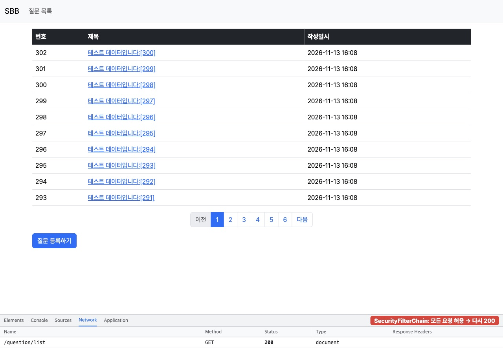

> **교재와 다른 점** `new AntPathRequestMatcher("/**")` → `"/**"` 문자열. 교재 코드를 그대로 쓰면 컴파일되지 않습니다.

### 021-03 스프링 시큐리티, [실험] action 없는 폼은 CSRF 토큰이 없어 403
[이 시점의 코드](https://github.com/jhs512/jsb-plus-2/tree/021-03) · [변경 내용](https://github.com/jhs512/jsb-plus-2/commit/021-03)

**무엇을** 질문 등록 폼으로 실제로 POST를 보내 봤습니다. 코드는 바꾸지 않은 관찰용 커밋입니다. **(실험 커밋)**

**왜** CSRF 보호가 켜지면 POST에 `_csrf` 토큰이 꼭 있어야 합니다. 타임리프는 `th:action`이 붙은 폼에만 토큰을 자동으로 넣습니다. 질문 폼은 등록·수정 화면에서 같이 쓰려고 `action`을 생략했는데, 그 결과가 어떤지 확인합니다(14168 46강).

| 폼 | 코드 | 토큰 |
|---|---|---|
| 답변 폼 | `<form th:action="@{...}" method="post">` | 자동으로 들어감 |
| 질문 폼 | `<form th:object="${form}" method="post">` (action 생략) | **없음** |

**결과** 질문 등록은 **403**, 답변 등록은 302로 성공합니다. 네트워크 탭의 폼 데이터를 보면 차이가 `_csrf` 하나입니다.
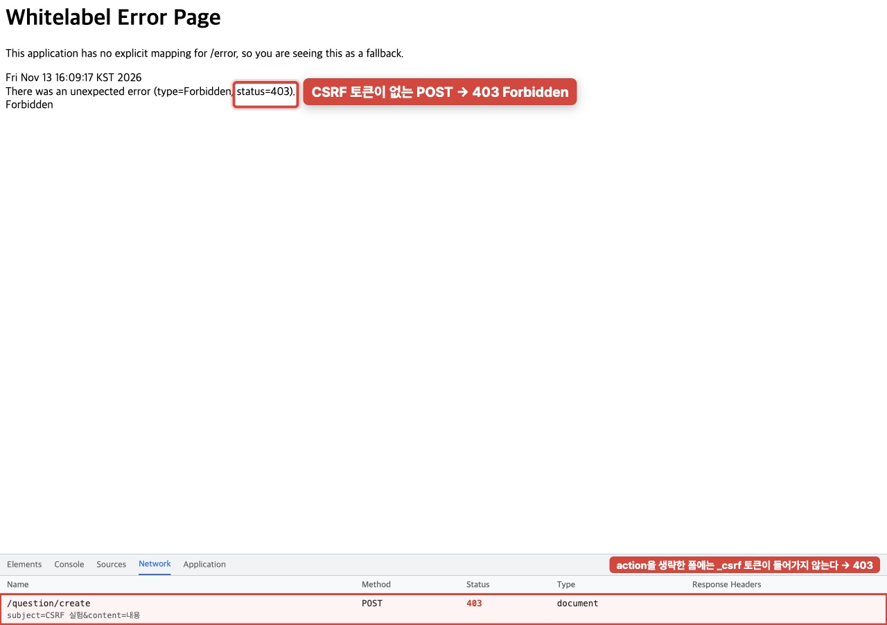
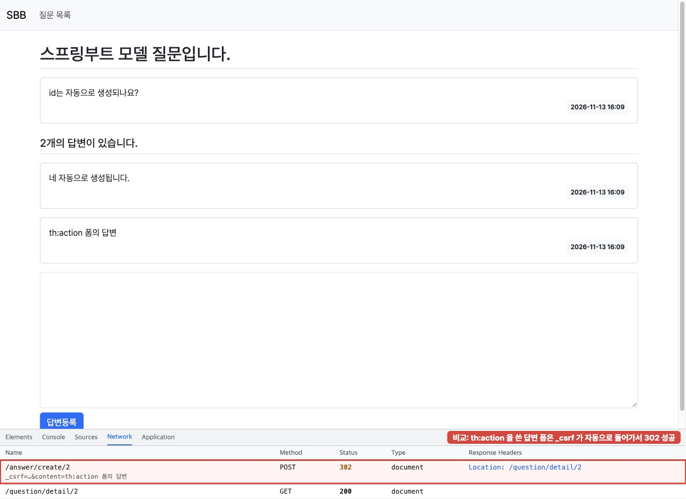

> **CSRF란?** 다른 사이트가 로그인한 사용자 몰래 우리 사이트로 POST를 보내는 공격입니다. 우리 사이트가 발급한 토큰이 있는 요청만 받아서 막습니다.

### 021-04 스프링 시큐리티, action 없는 폼에 CSRF 토큰
[이 시점의 코드](https://github.com/jhs512/jsb-plus-2/tree/021-04) · [변경 내용](https://github.com/jhs512/jsb-plus-2/commit/021-04)

**무엇을** `action`을 생략한 질문 폼에 CSRF 토큰을 직접 넣었습니다. 레이아웃 `<head>`에도 토큰을 `<meta>`로 넣어 두었습니다(이후 자바스크립트로 요청을 만들 때 사용).

**왜** 앞 실험에서 본 403을 해결합니다(14168 46강).

`question_form.html`
```diff
  <form th:object="${form}" method="post">
+     <!-- th:action이 없는 폼은 토큰이 자동으로 들어가지 않으므로 직접 넣는다 -->
+     <input type="hidden" th:name="${_csrf.parameterName}" th:value="${_csrf.token}">
```

`layout.html`
```diff
  <meta name="viewport" content="width=device-width, initial-scale=1">
+ <meta name="_csrf" th:content="${_csrf.token}">
```

**결과** 폼 데이터에 `_csrf`가 실려 가고 302로 성공합니다.

| 변경 전: 403 (021-03) | 변경 후: 302 |
|---|---|
|  | 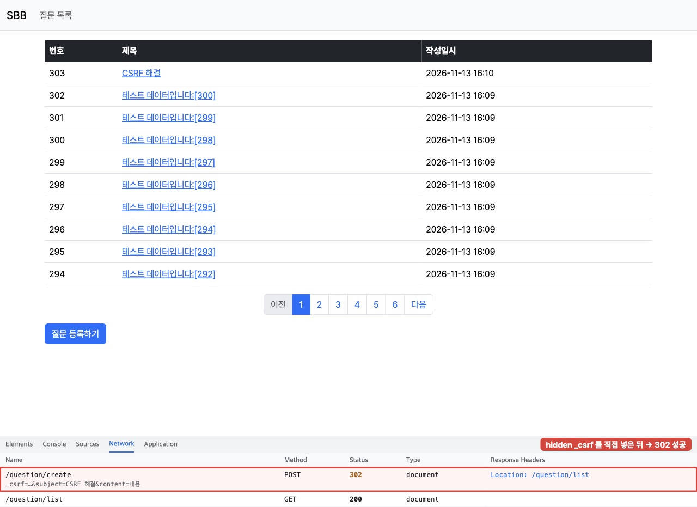 |

### 022-01 회원가입, SiteUser 엔티티와 UserRepository
[이 시점의 코드](https://github.com/jhs512/jsb-plus-2/tree/022-01) · [변경 내용](https://github.com/jhs512/jsb-plus-2/commit/022-01)

**무엇을** 회원 정보를 저장할 `SiteUser` 엔티티와 `UserRepository`를 만들었습니다.

**왜** 회원가입의 첫 단계입니다(교재 3-06). `user`는 많은 DB에서 예약어라서 테이블 이름이 충돌하지 않도록 `SiteUser`로 짓습니다. 아이디와 이메일은 중복될 수 없도록 DB에 UNIQUE 제약을 겁니다.

`SiteUser.java` (새 파일)
```java
@Entity
@Getter
@NoArgsConstructor(access = PROTECTED)
public class SiteUser extends BaseEntity {
    @Column(unique = true)   // 같은 아이디로 두 번 가입할 수 없다 (DB 제약)
    private String username;

    private String password; // 암호화된 값만 저장한다

    @Column(unique = true)
    private String email;
    // 생성자 ...
}
```

`UserRepository.java` (새 파일)
```java
public interface UserRepository extends JpaRepository<SiteUser, Integer> {
    Optional<SiteUser> findByUsername(String username);
    boolean existsByUsername(String username);
    boolean existsByEmail(String email);
}
```

**결과**
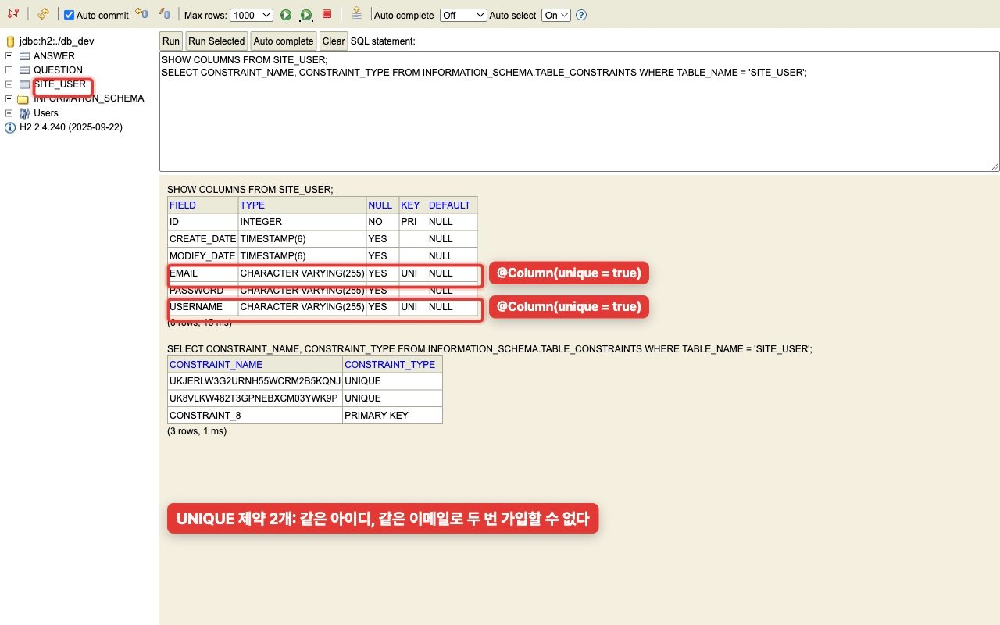

### 022-02 회원가입, BCrypt 암호화와 UserService
[이 시점의 코드](https://github.com/jhs512/jsb-plus-2/tree/022-02) · [변경 내용](https://github.com/jhs512/jsb-plus-2/commit/022-02)

**무엇을** 비밀번호를 BCrypt로 암호화해서 저장하는 `UserService`를 만들었습니다.

**왜** 비밀번호 원문을 저장하면 DB가 유출됐을 때 그대로 노출됩니다(교재 3-06). BCrypt는 무작위 값(salt)을 섞기 때문에 같은 비밀번호도 매번 다른 해시가 됩니다. 원래 비밀번호는 해시에서 되돌릴 수 없고, `matches()`로 "맞는지"만 확인할 수 있습니다.

`SecurityConfig.java`
```diff
+ @Bean
+ public PasswordEncoder passwordEncoder() {
+     return new BCryptPasswordEncoder();
+ }
```

`UserService.java` (새 파일)
```java
public SiteUser create(String username, String email, String password) {
    SiteUser user = new SiteUser(username, passwordEncoder.encode(password), email);
    return userRepository.save(user);
}
```

**결과**
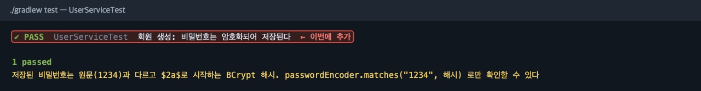

### 022-03 회원가입, 회원가입 폼과 기본 검증
[이 시점의 코드](https://github.com/jhs512/jsb-plus-2/tree/022-03) · [변경 내용](https://github.com/jhs512/jsb-plus-2/commit/022-03)

**무엇을** 회원가입 폼(`/user/signup`)을 만들었습니다. 입력값은 `record UserCreateForm`과 검증 어노테이션으로 확인합니다.

**왜** 교재 3-06. 질문 폼과 같은 방식(record + `@Valid` + 에러 프래그먼트)을 재사용합니다.

`UserController.java` (새 파일, 핵심)
```java
public record UserCreateForm(
        @NotBlank(message = "01-username-사용자ID는 필수항목입니다.")
        @Size(min = 3, max = 25, message = "02-username-사용자ID는 3자 이상 25자 이하로 입력해주세요.")
        String username,
        @NotBlank(message = "04-password1-비밀번호는 필수항목입니다.")
        String password1,
        @NotBlank(message = "05-password2-비밀번호 확인은 필수항목입니다.")
        String password2,
        @NotBlank(message = "07-email-이메일은 필수항목입니다.")
        @Email(message = "08-email-이메일 형식이 올바르지 않습니다.")
        String email
) {}

@PostMapping("/signup")
public String signup(@ModelAttribute("form") @Valid UserCreateForm form, BindingResult bindingResult) {
    if (bindingResult.hasErrors()) return "signup_form";
    userService.create(form.username(), form.email(), form.password1());
    return "redirect:/";
}
```

> 순번에 03, 06, 09가 비어 있는 이유: 다음 커밋에서 "중복 아이디(03)", "비밀번호 불일치(06)", "중복 이메일(09)" 검사를 그 자리에 넣습니다.

**결과**
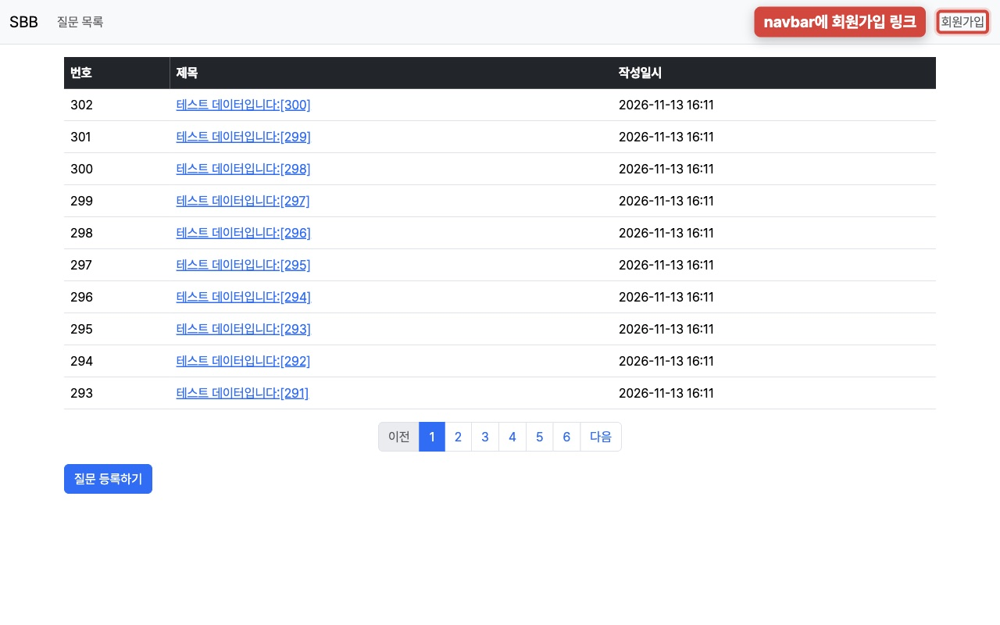
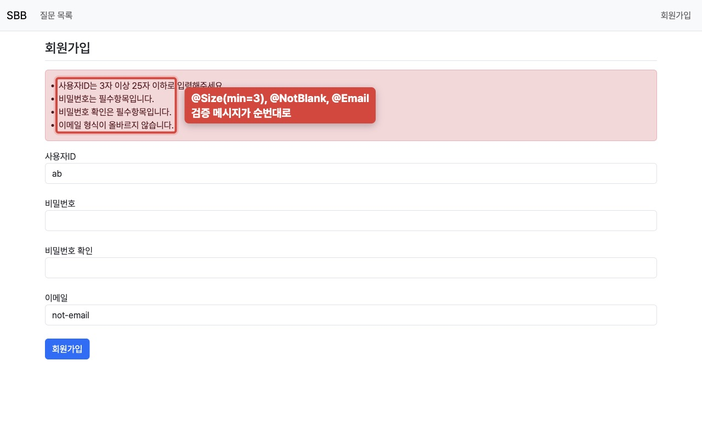

### 022-04 회원가입, 비밀번호 불일치와 중복 검사
[이 시점의 코드](https://github.com/jhs512/jsb-plus-2/tree/022-04) · [변경 내용](https://github.com/jhs512/jsb-plus-2/commit/022-04)

**무엇을** 어노테이션으로는 표현하기 어려운 검증 세 가지를 직접 넣었습니다. 비밀번호 확인 불일치, 아이디 중복, 이메일 중복입니다.

**왜** 교재는 저장할 때 나는 DB 예외(`DataIntegrityViolationException`)를 잡아 "이미 등록된 사용자"라고 한 줄로 알려 줍니다. 그러면 어느 칸이 문제인지 알 수 없습니다. 저장 **전에** 확인해서 칸마다 에러를 붙입니다. 메시지는 같은 "순번-필드명-내용" 형식이라 정렬과 포커스가 그대로 동작합니다.

`UserController.java`
```java
if (form.password1() != null && !form.password1().equals(form.password2())) {
    bindingResult.rejectValue("password2", "passwordInCorrect", "06-password2-2개의 비밀번호가 일치하지 않습니다.");
}
if (!bindingResult.hasFieldErrors("username") && userService.existsByUsername(form.username())) {
    bindingResult.rejectValue("username", "duplicate", "03-username-이미 사용 중인 사용자ID입니다.");
}
if (!bindingResult.hasFieldErrors("email") && userService.existsByEmail(form.email())) {
    bindingResult.rejectValue("email", "duplicate", "09-email-이미 사용 중인 이메일입니다.");
}
```

**결과**
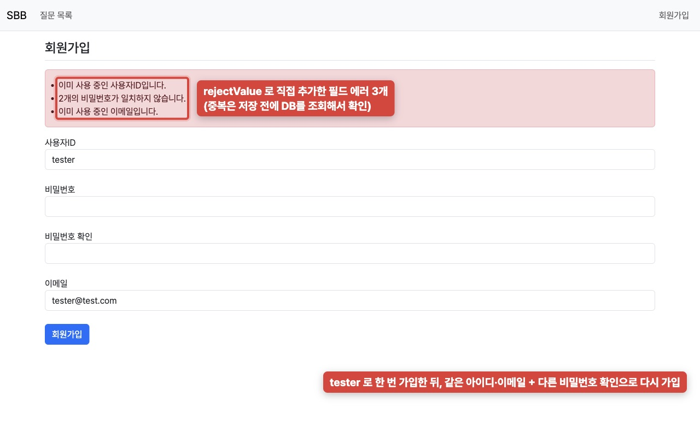

### 023-01 로그인과 로그아웃, 폼 로그인
[이 시점의 코드](https://github.com/jhs512/jsb-plus-2/tree/023-01) · [변경 내용](https://github.com/jhs512/jsb-plus-2/commit/023-01)

**무엇을** 로그인을 만들었습니다. 로그인 화면(`/user/login`)은 직접 만들고, 로그인 **처리**는 스프링 시큐리티에 맡깁니다. 개발용 계정(`admin`, `user1`, `user2`)도 샘플 데이터에 넣었습니다.

**왜** 교재 3-07. 로그인 폼이 전송되면 시큐리티 필터가 `UserSecurityService.loadUserByUsername()`으로 회원을 찾고, 저장된 해시와 입력한 비밀번호를 `PasswordEncoder.matches()`로 비교합니다.

`SecurityConfig.java`
```diff
+ .formLogin(formLogin -> formLogin
+         .loginPage("/user/login")    // 화면은 우리가 만든 것
+         .defaultSuccessUrl("/"))     // 처리(POST /user/login)는 시큐리티가
+ .logout(logout -> logout
+         .logoutUrl("/user/logout")   // 교재는 GET 로그아웃, 여기서는 기본값대로 POST
+         .logoutSuccessUrl("/")
+         .invalidateHttpSession(true));
```

`UserSecurityService.java` (새 파일, 핵심)
```java
@Override
public UserDetails loadUserByUsername(String username) {
    SiteUser siteUser = userRepository.findByUsername(username)
            .orElseThrow(() -> new UsernameNotFoundException("사용자를 찾을 수 없습니다."));
    UserRole role = "admin".equals(username) ? UserRole.ADMIN : UserRole.USER;
    return new User(siteUser.getUsername(), siteUser.getPassword(),
            List.of(new SimpleGrantedAuthority(role.getValue())));
}
```

**결과** 실패하면 `?error`, 성공하면 `/`로 302 됩니다. 아직 내비게이션 바는 로그인 여부를 모르고 계속 "회원가입"을 보여 줍니다(다음 커밋).
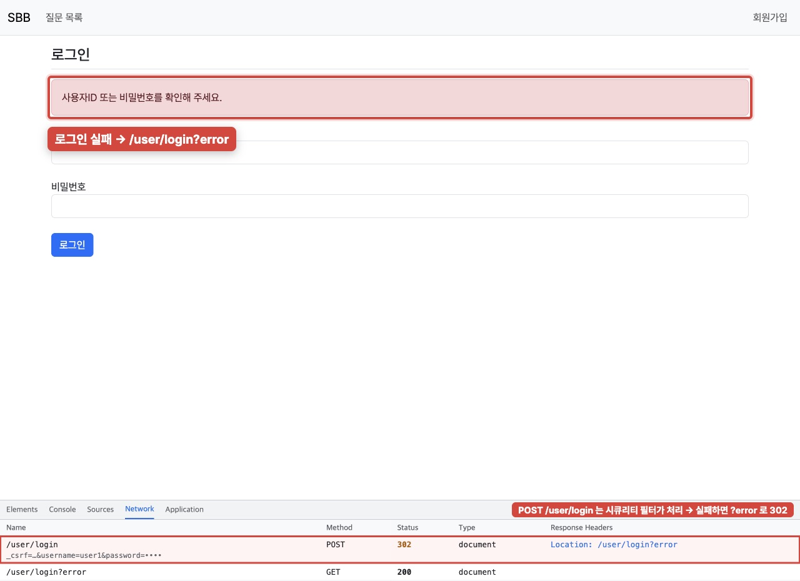
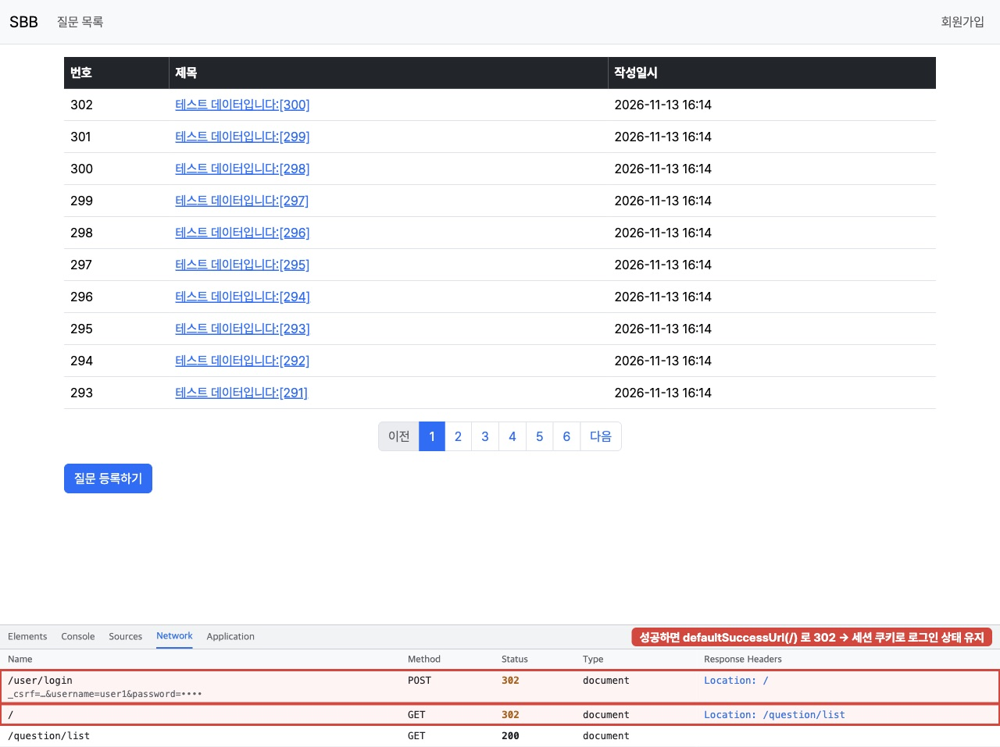

### 023-02 로그인과 로그아웃, 로그인 상태별 메뉴와 POST 로그아웃
[이 시점의 코드](https://github.com/jhs512/jsb-plus-2/tree/023-02) · [변경 내용](https://github.com/jhs512/jsb-plus-2/commit/023-02)

**무엇을** 내비게이션 바가 로그인 상태에 따라 다른 메뉴를 보여 줍니다. 로그인하지 않았으면 "로그인·회원가입", 로그인했으면 "사용자 이름·로그아웃"입니다. 로그아웃은 POST 요청이어야 해서 폼 버튼으로 만들었습니다.

**왜** 타임리프에서 로그인 정보를 쓰려면 `thymeleaf-extras-springsecurity`가 필요합니다.

`build.gradle.kts`
```diff
+ implementation("org.thymeleaf.extras:thymeleaf-extras-springsecurity6")
```

`navbar.html`
```html
<li sec:authorize="isAnonymous()"><a th:href="@{/user/login}">로그인</a></li>
<li sec:authorize="isAnonymous()"><a th:href="@{/user/signup}">회원가입</a></li>
<li sec:authorize="isAuthenticated()"><span sec:authentication="name">user1</span></li>
<li sec:authorize="isAuthenticated()">
    <form th:action="@{/user/logout}" method="post">   <!-- 로그아웃은 POST -->
        <button type="submit" class="nav-link">로그아웃</button>
    </form>
</li>
```

**결과**

| 로그인 전 | 로그인 후 |
|---|---|
| 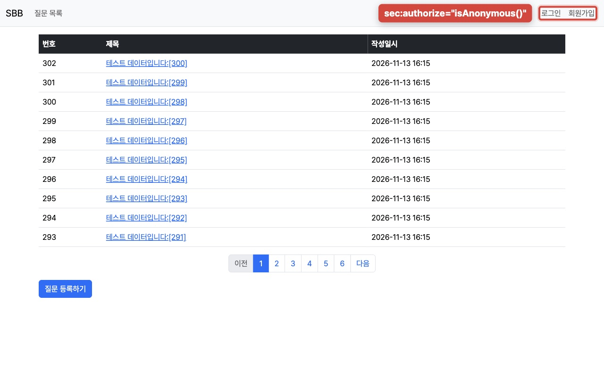 | 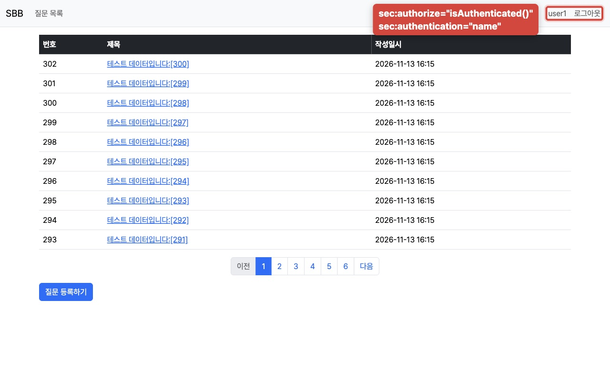 |

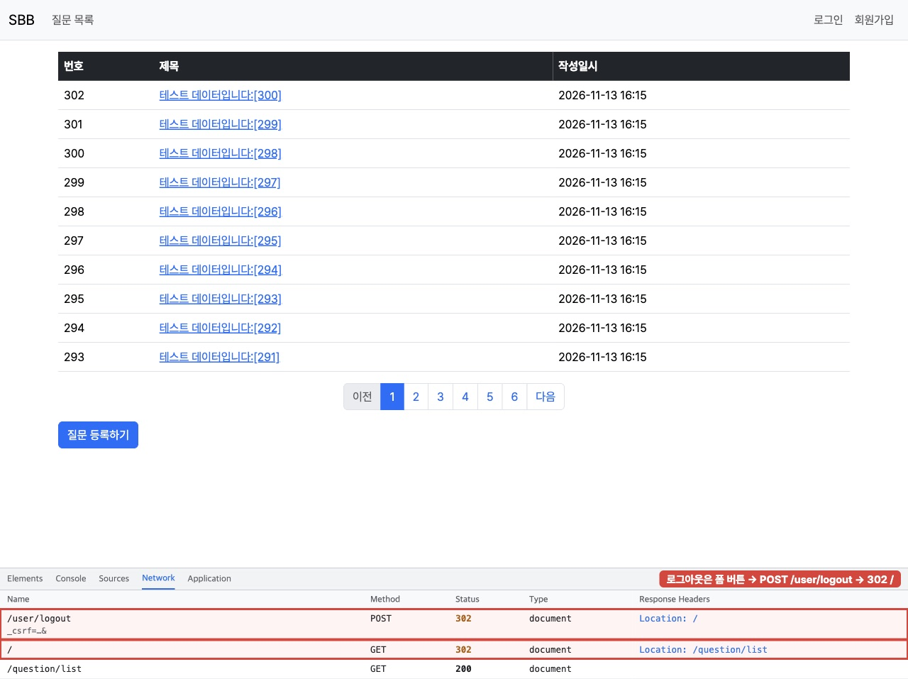

> **확인해 볼 것** 로그아웃 링크를 `<a href="/user/logout">`(GET)으로 만들면 로그아웃이 되지 않습니다. 025-01에서 링크로도 POST를 보낼 수 있게 만듭니다.

### 024-01 글쓴이, 질문·답변에 author 저장과 로그인 필수
[이 시점의 코드](https://github.com/jhs512/jsb-plus-2/tree/024-01) · [변경 내용](https://github.com/jhs512/jsb-plus-2/commit/024-01)

**무엇을** 질문과 답변에 글쓴이(`author`)를 저장합니다. 질문·답변 등록은 로그인해야만 할 수 있습니다.

**왜** 누가 쓴 글인지 기록하고, 로그인하지 않은 사용자는 글을 쓰지 못하게 합니다(교재 3-08).

`Question.java`, `Answer.java`
```diff
+ @ManyToOne(fetch = LAZY)
+ private SiteUser author;   // 질문(N) : 회원(1)

- public Question(String subject, String content) {
+ public Question(SiteUser author, String subject, String content) {
```

`SecurityConfig.java`
```diff
  @Configuration
+ @EnableMethodSecurity   // @PreAuthorize 동작
```

`QuestionController.java`
```diff
+ @PreAuthorize("isAuthenticated()")   // 로그인 안 했으면 로그인 페이지로
  @PostMapping("/create")
  public String create(@ModelAttribute("form") @Valid QuestionForm form, BindingResult bindingResult,
+                      Principal principal) {   // 현재 로그인한 사용자
      // ...
-     questionService.create(form.subject(), form.content());
+     questionService.create(userService.getUser(principal.getName()), form.subject(), form.content());
```

**결과** 로그인하지 않고 등록 화면에 가면 로그인 화면으로 302 됩니다. 로그인하고 등록하면 `AUTHOR_ID`에 로그인한 회원이 연결됩니다.
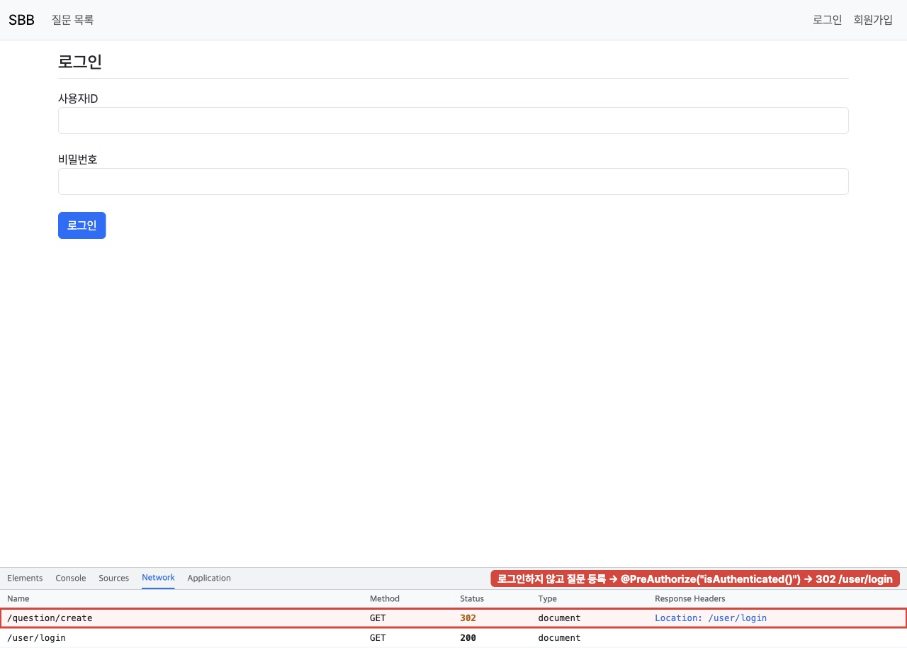
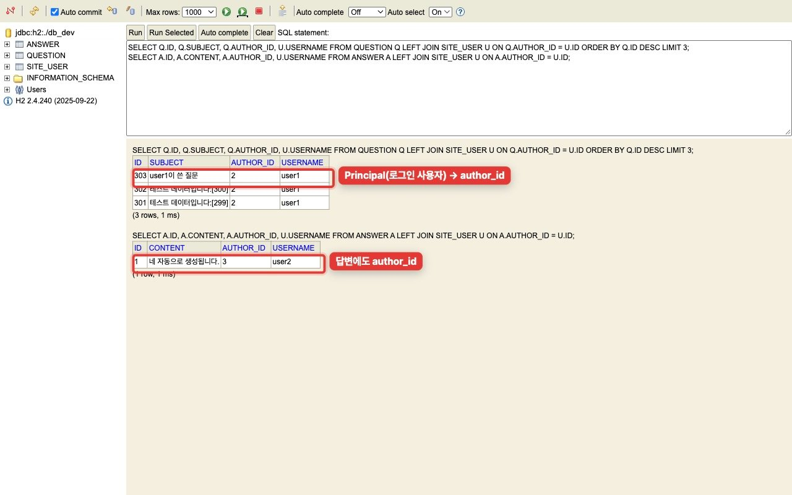

### 024-02 글쓴이, 목록과 상세에 글쓴이 표시
[이 시점의 코드](https://github.com/jhs512/jsb-plus-2/tree/024-02) · [변경 내용](https://github.com/jhs512/jsb-plus-2/commit/024-02)

**무엇을** 목록과 상세에 글쓴이를 표시하고, 로그인하지 않은 사용자에게는 답변 입력칸을 비활성화했습니다.

**왜** 누가 쓴 글인지 화면에 보여 줍니다(교재 3-08). 글쓴이가 없는 예전 데이터가 있어도 에러가 나지 않도록 `?.`(안전 접근)를 씁니다(14168 16강).

`question_list.html`
```diff
+ <th>글쓴이</th>
  ...
+ <td th:text="${question.author?.username}">user1</td>
```

`question_detail.html`
```diff
+ <div class="mb-2" th:text="${question.author?.username}">user1</div>
  ...
- <textarea th:field="*{content}" rows="10" class="form-control"></textarea>
+ <textarea sec:authorize="isAnonymous()" disabled class="form-control" rows="10">로그인 후 답변을 작성할 수 있습니다.</textarea>
+ <textarea sec:authorize="isAuthenticated()" th:field="*{content}" rows="10" class="form-control"></textarea>
```

**결과**
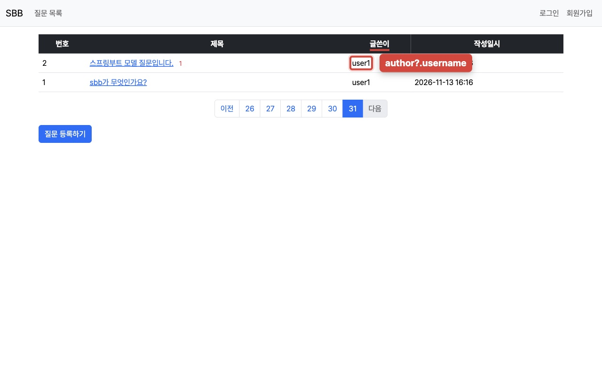
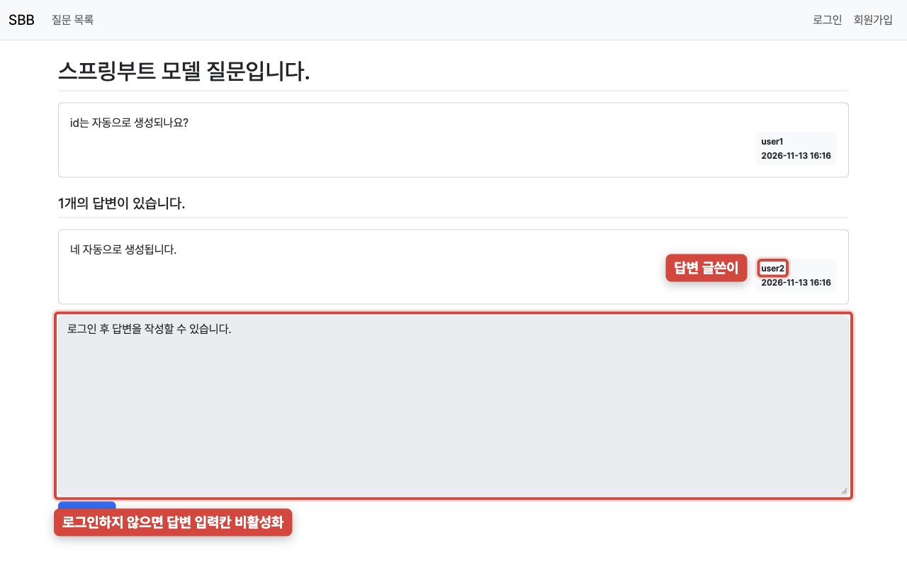

### 025-01 수정과 삭제, _method 필터와 global.js
[이 시점의 코드](https://github.com/jhs512/jsb-plus-2/tree/025-01) · [변경 내용](https://github.com/jhs512/jsb-plus-2/commit/025-01)

**무엇을** `_method` 파라미터를 PUT/DELETE로 바꿔 주는 필터를 켜고, `<a method="POST|PUT|DELETE">` 링크를 숨은 폼 전송으로 바꿔 주는 공통 스크립트(`global.js`)를 만들었습니다. 첫 사용처로 로그아웃을 링크로 바꿨습니다.

**왜** 교재는 삭제와 추천을 **GET 링크**로 처리합니다. GET은 조회용이라서, 링크 미리보기나 다른 사이트의 `` 같은 요청만으로 데이터가 바뀔 수 있습니다. 그래서 상태를 바꾸는 요청은 PUT, DELETE, POST로 보냅니다. 그런데 HTML 폼과 링크는 GET과 POST만 보낼 수 있어서, POST에 `_method`를 실어 보내는 방식을 씁니다(14168 41~44강).

`application.yaml`
```diff
+ mvc:
+   hiddenmethod:
+     filter:
+       enabled: true   # POST + _method=PUT/DELETE → PUT/DELETE 요청으로 바꿔 준다
```

`global.js` (새 파일, 핵심)
```js
document.querySelectorAll("a[method]").forEach((anchor) => {
    anchor.addEventListener("click", (e) => {
        e.preventDefault();                          // 기본 링크 이동(GET) 막기
        // onclick(confirm)이 있으면 먼저 실행, 취소하면 중단
        const form = document.createElement("form");
        form.action = new URL(anchor.href).pathname;
        form.method = "POST";
        addHidden("_csrf", document.querySelector('meta[name="_csrf"]').content);
        if (method !== "POST") addHidden("_method", method);   // PUT, DELETE
        document.body.appendChild(form);
        form.submit();
    });
});
```

`navbar.html`
```diff
- <form th:action="@{/user/logout}" method="post">
-     <button type="submit" class="nav-link">로그아웃</button>
- </form>
+ <a class="nav-link" method="POST" th:href="@{/user/logout}">로그아웃</a>
```

**결과** 로그아웃은 링크인데도 네트워크 탭에는 `POST /user/logout`(폼 데이터 `_csrf`)으로 나갑니다.


### 025-02 수정과 삭제, 질문 수정(PUT)과 403
[이 시점의 코드](https://github.com/jhs512/jsb-plus-2/tree/025-02) · [변경 내용](https://github.com/jhs512/jsb-plus-2/commit/025-02)

**무엇을** 질문 수정을 만들었습니다. 수정 폼(`GET /question/modify/{id}`)은 등록 폼을 재사용하고, 저장은 **PUT**(`PUT /question/modify/{id}`)으로 받습니다. 본인 글이 아니면 **403**입니다.

**왜** 교재 3-09. 교재는 수정을 POST로 받지만, "수정"의 의미에 맞는 PUT을 씁니다(14168 41강). 권한이 없을 때 교재는 400(BAD_REQUEST)을 주지만, "권한 없음"은 403(FORBIDDEN)이 정확합니다(강의 외 추가 개선).

`QuestionController.java` (핵심)
```java
private Question getQuestionForAuthor(int id, Principal principal) {
    Question question = questionService.getQuestion(id);
    if (!question.isAuthor(userService.getUser(principal.getName()))) {
        throw new ResponseStatusException(HttpStatus.FORBIDDEN, "권한이 없습니다.");
    }
    return question;
}

@PreAuthorize("isAuthenticated()")
@PutMapping("/modify/{id}")
@Transactional   // 메서드가 끝날 때 변경 감지로 UPDATE
public String modify(@PathVariable int id, @ModelAttribute("form") @Valid QuestionForm form,
                     BindingResult bindingResult, Principal principal, Model model) {
    Question question = getQuestionForAuthor(id, principal);
    // ...
    questionService.modify(question, form.subject(), form.content());   // question.modify(...)
    return "redirect:/question/detail/%d".formatted(id);
}
```

`question_form.html`
```diff
+ <!-- 수정 화면일 때만 _method=PUT (등록과 수정이 같은 템플릿) -->
+ <input type="hidden" name="_method" th:if="${method}" th:value="${method}">
```

**결과**


### 025-03 수정과 삭제, 질문 삭제(DELETE)
[이 시점의 코드](https://github.com/jhs512/jsb-plus-2/tree/025-03) · [변경 내용](https://github.com/jhs512/jsb-plus-2/commit/025-03)

**무엇을** 질문 삭제를 **DELETE**(`DELETE /question/delete/{id}`)로 만들었습니다. 상세 화면의 삭제 버튼은 `<a method="DELETE">` 링크이고, 누르기 전에 확인 창을 띄웁니다.

**왜** 교재는 `GET /question/delete/{id}` 링크로 삭제합니다. GET으로 데이터를 지우면 링크 미리보기나 크롤러, 다른 사이트의 이미지 태그만으로도 삭제될 수 있습니다. 삭제는 DELETE로만 받습니다(14168 44강).

`QuestionController.java`
```java
@PreAuthorize("isAuthenticated()")
@DeleteMapping("/delete/{id}")   // 교재: @GetMapping
@Transactional
public String delete(@PathVariable int id, Principal principal) {
    Question question = getQuestionForAuthor(id, principal);   // 본인 글이 아니면 403
    questionService.delete(question);   // cascade REMOVE로 답변도 함께 삭제
    return "redirect:/";
}
```

`question_detail.html`
```html
<a th:href="@{|/question/delete/${question.id}|}" method="DELETE"
   onclick="return confirm('정말로 삭제하시겠습니까?');"
   class="btn btn-sm btn-outline-secondary">삭제</a>
```

**결과** 주소창으로 GET 요청을 보내면 **405**, 삭제 버튼을 누르고 확인 창에서 "확인"을 누르면 `POST(_method=DELETE)` → 302입니다. 목록의 전체 개수가 302에서 301로 줄었습니다.


### 025-04 수정과 삭제, 답변 수정(PUT)
[이 시점의 코드](https://github.com/jhs512/jsb-plus-2/tree/025-04) · [변경 내용](https://github.com/jhs512/jsb-plus-2/commit/025-04)

**무엇을** 답변 수정을 **PUT**으로 만들었습니다. 본인 답변에만 수정 버튼이 보이고, 남의 답변을 수정하려 하면 403입니다.

**왜** 교재 3-09. 질문 수정과 같은 방식입니다.

`AnswerController.java` (핵심)
```java
@PreAuthorize("isAuthenticated()")
@PutMapping("/modify/{id}")
@Transactional
public String modify(@PathVariable int id, @ModelAttribute("answerForm") @Valid AnswerForm answerForm,
                     BindingResult bindingResult, Principal principal) {
    Answer answer = getAnswerForAuthor(id, principal);   // 본인이 아니면 403
    if (bindingResult.hasErrors()) return "answer_form";
    answerService.modify(answer, answerForm.content());  // answer.modify(content)
    return "redirect:/question/detail/%d".formatted(answer.getQuestion().getId());
}
```

`answer_form.html` (새 파일, 핵심)
```html
<form th:object="${answerForm}" method="post">
    <input type="hidden" th:name="${_csrf.parameterName}" th:value="${_csrf.token}">
    <input type="hidden" name="_method" value="PUT">
    <th:block th:replace="~{form_errors :: formErrorsFragment}"></th:block>
    <textarea th:field="*{content}" class="form-control" rows="10"></textarea>
    <!-- ... -->
```

**결과**


### 025-05 수정과 삭제, [실험] 목록에서 빼기만 하면 답변이 지워지지 않는다
[이 시점의 코드](https://github.com/jhs512/jsb-plus-2/tree/025-05) · [변경 내용](https://github.com/jhs512/jsb-plus-2/commit/025-05)

**무엇을** 답변 삭제를 `DELETE /answer/delete/{id}`로 만들었습니다. 이때 `answerRepository.delete()`를 쓰지 않고, 질문의 답변 목록에서 **빼기만** 해 봤습니다. **(실험 커밋)**

**왜** 답변 추가를 `question.addAnswer()`(목록에 추가 → cascade PERSIST로 INSERT)로 했듯이, 삭제도 "목록에서 제거"로 하고 싶습니다(14168 37강). 정말 그것만으로 DB에서도 지워지는지 확인합니다.

`Question.java`
```java
public boolean deleteAnswer(Answer answer) {
    return answers.remove(answer);   // 자바 리스트에서만 뺀다
}
```

`AnswerService.java`
```java
public void delete(Answer answer) {
    answer.getQuestion().deleteAnswer(answer);
}
```

**결과** 요청은 302로 성공했지만, 답변은 화면에도 DB에도 **그대로 남아 있습니다.** DELETE SQL이 실행되지 않았습니다.


> **왜?** `cascade = REMOVE`는 "부모(질문)를 삭제할 때 자식도 삭제"입니다. 부모의 목록에서 **자식 하나를 빼는 것**은 다른 이야기입니다. 그건 `orphanRemoval`이 담당합니다. 다음 커밋에서 해결합니다.

### 025-06 수정과 삭제, orphanRemoval과 equals/hashCode로 답변 삭제
[이 시점의 코드](https://github.com/jhs512/jsb-plus-2/tree/025-06) · [변경 내용](https://github.com/jhs512/jsb-plus-2/commit/025-06)

**무엇을** `@OneToMany`에 `orphanRemoval = true`를 넣고, `BaseEntity`에 id 기준 `equals/hashCode`를 만들었습니다.

**왜** `orphanRemoval`은 "부모의 목록에서 빠진 자식(고아)은 DB에서도 지운다"는 뜻입니다(14168 37강). `equals`는 리스트의 `remove(answer)`가 **같은 id를 가진 답변**을 정확히 찾도록 하기 위해서입니다. 기본 `equals`는 메모리 주소가 같아야만 같다고 봅니다(14168 37·38강).

`Question.java`
```diff
- @OneToMany(mappedBy = "question", cascade = {CascadeType.PERSIST, CascadeType.REMOVE})
+ @OneToMany(mappedBy = "question", cascade = {CascadeType.PERSIST, CascadeType.REMOVE}, orphanRemoval = true)
  private List<Answer> answers = new ArrayList<>();
```

`BaseEntity.java`
```java
@Override
public boolean equals(Object o) {
    if (o == this) return true;                    // 동치성(같은 객체)이면 바로 true
    if (o == null || getClass() != o.getClass()) return false;
    return id == ((BaseEntity) o).id;              // 동등성(같은 id)
}

@Override
public int hashCode() { return Objects.hashCode(id); }
```

| 옵션 | 언제 지우나 |
|---|---|
| `cascade = REMOVE` | 부모(질문)를 삭제할 때 자식(답변)도 |
| `orphanRemoval = true` | 부모의 목록에서 **빠진** 자식만 |

**결과** 같은 삭제 버튼으로 이번에는 답변이 지워졌고, 로그에 `delete from answer where id=?`가 찍혔습니다.

| 변경 전 (025-05) | 변경 후 |
|---|---|
|  |  |


### 025-07 수정과 삭제, 수정일시 표시
[이 시점의 코드](https://github.com/jhs512/jsb-plus-2/tree/025-07) · [변경 내용](https://github.com/jhs512/jsb-plus-2/commit/025-07)

**무엇을** 수정된 질문·답변에 "modified at" 수정일시를 표시합니다.

**왜** 교재 3-09는 `modifyDate`가 null이 아니면 표시합니다. 그런데 이 프로젝트는 JPA Auditing이 **생성할 때도** `modifyDate`를 채웁니다(004-05). 그래서 두 시각을 비교해 "생성 후 수정된 적이 있을 때만" 보여 줍니다.

`question_detail.html`
```html
<div class="badge bg-light text-dark p-2 text-start mx-3"
     th:if="${question.modifyDate.isAfter(question.createDate)}">
    <div class="mb-2">modified at</div>
    <div th:text="${#temporals.format(question.modifyDate, 'yyyy-MM-dd HH:mm')}"></div>
</div>
```

**결과**


### 026-01 추천, 추천인 ManyToMany
[이 시점의 코드](https://github.com/jhs512/jsb-plus-2/tree/026-01) · [변경 내용](https://github.com/jhs512/jsb-plus-2/commit/026-01)

**무엇을** 질문과 답변에 추천인 목록(`voters`)을 `@ManyToMany`로 추가했습니다.

**왜** 한 질문을 여러 회원이 추천하고, 한 회원도 여러 질문을 추천합니다(N:N). 이런 관계는 어느 한쪽 테이블에 외래키 하나로 표현할 수 없어서 **중간 테이블이 꼭 필요합니다**(교재 3-10). `Set`을 쓰면 같은 회원이 두 번 들어가지 않습니다.

`Question.java`, `Answer.java`
```diff
+ @ManyToMany
+ private Set<SiteUser> voters = new HashSet<>();
+
+ public void vote(SiteUser voter) {
+     voters.add(voter);   // 이미 있으면 무시 (id 기반 equals 덕분)
+ }
```

**결과** `QUESTION_VOTERS`, `ANSWER_VOTERS` 중간 테이블이 생겼습니다.


> **확인해 볼 것** 004-03 실험에서는 중간 테이블이 **불필요**했습니다(N:1 관계를 mappedBy 없이 선언). 이번에는 N:N이라 **필요**합니다. 같은 "중간 테이블"이라도 관계의 종류에 따라 의미가 다릅니다.

### 026-02 추천, 추천 POST와 버튼
[이 시점의 코드](https://github.com/jhs512/jsb-plus-2/tree/026-02) · [변경 내용](https://github.com/jhs512/jsb-plus-2/commit/026-02)

**무엇을** 질문·답변 추천을 **POST**(`POST /question/vote/{id}`, `POST /answer/vote/{id}`)로 만들고, 상세 화면에 추천 버튼과 추천 수를 표시했습니다.

**왜** 교재는 추천을 GET 링크로 처리하지만, 추천은 데이터를 바꾸므로 POST입니다(025-01의 `a[method]` 재사용).

`QuestionController.java`
```java
@PreAuthorize("isAuthenticated()")
@PostMapping("/vote/{id}")   // 교재: @GetMapping
@Transactional
public String vote(@PathVariable int id, Principal principal) {
    questionService.getQuestion(id).vote(userService.getUser(principal.getName()));
    return "redirect:/question/detail/%d".formatted(id);
}
```

`question_detail.html`
```html
<a th:href="@{|/question/vote/${question.id}|}" method="POST"
   onclick="return confirm('정말로 추천하시겠습니까?');" class="btn btn-sm btn-outline-secondary">
    추천 <span class="badge rounded-pill bg-success" th:text="${#lists.size(question.voters)}">0</span>
</a>
```

**결과** 확인 창에서 "확인"을 누르면 POST로 전송되고 추천 수가 1이 됩니다.


### 027-01 앵커, 답변 작성·수정·추천 후 그 답변 위치로
[이 시점의 코드](https://github.com/jhs512/jsb-plus-2/tree/027-01) · [변경 내용](https://github.com/jhs512/jsb-plus-2/commit/027-01)

**무엇을** 답변을 작성·수정·추천한 뒤 페이지 맨 위가 아니라 **그 답변 위치로** 돌아오도록 했습니다.

**왜** 답변이 많으면 매번 맨 위로 돌아가서 다시 스크롤해야 합니다(교재 3-11). 리다이렉트 주소 끝에 `#answer_{id}`를 붙이면, 브라우저가 그 `id`를 가진 요소 위치로 스크롤합니다.

`question_detail.html`
```diff
  <div class="card my-3" th:each="answer : ${question.answers}">
+     <a th:id="|answer_${answer.id}|"></a>
```

`AnswerController.java`
```diff
- answerService.create(question, author, answerForm.content());
- return "redirect:/question/detail/%d".formatted(id);
+ Answer answer = answerService.create(question, author, answerForm.content());
+ answerService.flush();   // INSERT를 먼저 실행해야 새 답변의 id를 알 수 있다
+ return "redirect:/question/detail/%d#answer_%d".formatted(question.getId(), answer.getId());
```

> **왜 flush?** 005-06에서 본 것처럼 `addAnswer()` 직후에는 아직 INSERT 전이라 `id`가 0입니다. `#answer_0`으로는 이동할 수 없어서, 리다이렉트 주소를 만들기 전에 INSERT를 먼저 실행합니다.

**결과**


### 028-01 마크다운, commonmark 변환 서비스
[이 시점의 코드](https://github.com/jhs512/jsb-plus-2/tree/028-01) · [변경 내용](https://github.com/jhs512/jsb-plus-2/commit/028-01)

**무엇을** 마크다운 문자열을 HTML로 바꾸는 `MarkdownService`를 만들었습니다(commonmark 라이브러리).

**왜** 질문·답변 본문에 제목, 목록, 굵게 같은 서식을 쓸 수 있게 합니다(교재 3-12의 `CommonUtil`). 화면에 붙이기 전에, 변환 자체를 스프링 없이 빠른 단위 테스트로 확인합니다.

`build.gradle.kts`
```diff
+ implementation("org.commonmark:commonmark:0.24.0")   // Boot가 버전을 관리하지 않아서 직접 지정
```

`MarkdownService.java` (새 파일)
```java
@Component("markdownService")
public class MarkdownService {
    private final Parser parser = Parser.builder().build();
    private final HtmlRenderer renderer = HtmlRenderer.builder().build();

    public String render(String markdown) {
        if (markdown == null) return "";
        return renderer.render(parser.parse(markdown));
    }
}
```

**결과**


### 028-02 마크다운, [실험] 교재의 ${@빈.메서드()} 호출은 Thymeleaf 3.1.5에서 막힌다
[이 시점의 코드](https://github.com/jhs512/jsb-plus-2/tree/028-02) · [변경 내용](https://github.com/jhs512/jsb-plus-2/commit/028-02)

**무엇을** 교재 방식 그대로, 템플릿에서 `${@markdownService.render(...)}`로 빈을 직접 호출해 본문을 마크다운으로 출력했습니다. **(실험 커밋, 이 커밋에서는 상세 화면 테스트 2건이 실패합니다)**

**왜** 교재 3-12는 `th:utext="${@commonUtil.markdown(question.content)}"`처럼 템플릿에서 스프링 빈을 바로 부릅니다. 이 프로젝트의 Thymeleaf(3.1.5)에서도 되는지 확인합니다.

`question_detail.html`
```diff
- <div class="card-text" style="white-space: pre-line;" th:text="${question.content}">내용</div>
+ <div class="card-text" th:utext="${@markdownService.render(question.content)}">내용</div>
```

**결과** 상세 화면이 **500**입니다. Thymeleaf 3.1.5는 보안상 템플릿 안에서 `@빈` 참조로 메서드를 호출하는 것을 막습니다(`TemplateProcessingException: ... is forbidden in this context`).


> **확인해 볼 것** 다음 커밋에서 빈을 템플릿이 직접 부르지 않고, 컨트롤러 쪽에서 모델에 넣어 주는 방식으로 바꿉니다.

### 028-03 마크다운, @ControllerAdvice 공통 모델로 해결
[이 시점의 코드](https://github.com/jhs512/jsb-plus-2/tree/028-03) · [변경 내용](https://github.com/jhs512/jsb-plus-2/commit/028-03)

**무엇을** `@ControllerAdvice`로 모든 화면에 `markdown`이라는 이름의 모델 값을 넣고, 템플릿은 `${markdown.render(...)}`로 씁니다.

**왜** 템플릿이 빈을 직접 찾는 대신, 컨트롤러 쪽에서 화면에 필요한 값을 넣어 줍니다. `@ControllerAdvice` + `@ModelAttribute`는 **모든 컨트롤러의 모든 액션 메서드**가 실행되기 전에 공통 모델 값을 등록합니다(14168 19강).

`GlobalModelAttribute.java` (새 파일)
```java
@ControllerAdvice
@RequiredArgsConstructor
public class GlobalModelAttribute {
    private final MarkdownService markdownService;

    @ModelAttribute("markdown")   // 모든 화면에서 ${markdown.render(내용)}
    public MarkdownService markdown() {
        return markdownService;
    }
}
```

`question_detail.html`
```diff
- <div class="card-text" th:utext="${@markdownService.render(question.content)}">내용</div>
+ <div class="card-text" th:utext="${markdown.render(question.content)}">내용</div>
```

**결과** 마크다운으로 쓴 본문이 서식대로 보입니다.

| 변경 전 (028-02) | 변경 후 |
|---|---|
|  |  |

### 028-04 마크다운, [실험] 입력에 섞인 HTML이 그대로 실행된다(XSS)
[이 시점의 코드](https://github.com/jhs512/jsb-plus-2/tree/028-04) · [변경 내용](https://github.com/jhs512/jsb-plus-2/commit/028-04)

**무엇을** 본문에 HTML 태그를 섞어 써 봤습니다. 확인용 테스트도 추가했습니다. **(실험 커밋)**

**왜** `th:utext`는 이스케이프를 하지 않고 HTML을 그대로 출력합니다(14168 16강). 마크다운 변환기도 기본적으로 입력에 섞인 HTML을 그대로 통과시킵니다. 둘이 만나면 어떻게 되는지 확인합니다.

| | `th:text` | `th:utext` |
|---|---|---|
| `<b>홍길동</b>` 출력 | `&lt;b&gt;홍길동&lt;/b&gt;` (글자로 보임) | **홍길동** (HTML로 실행) |
| 용도 | 일반 텍스트 | 신뢰할 수 있는 HTML만 |

`MarkdownServiceTest.java`
```java
@Test
void t2() {   // [실험]
    String html = markdownService.render("안녕 <script>alert('xss')</script>");
    assertThat(html).contains("<script>alert('xss')</script>");   // 그대로 통과한다
}
```

**결과** 사용자가 입력한 `<b style="color:red">`가 그대로 실행되어 큰 빨간 글씨가 됐습니다. 이게 `<script>`였다면, 이 글을 연 모든 사람의 브라우저에서 스크립트가 실행됩니다(XSS).


### 028-05 마크다운, 원본 HTML 이스케이프와 URL 무력화로 XSS 방지
[이 시점의 코드](https://github.com/jhs512/jsb-plus-2/tree/028-05) · [변경 내용](https://github.com/jhs512/jsb-plus-2/commit/028-05)

**무엇을** 마크다운 변환기에 `escapeHtml(true)`, `sanitizeUrls(true)`를 켰습니다.

**왜** `th:utext`는 이스케이프를 하지 않으므로, 입력에 섞인 HTML은 변환 단계에서 막아야 합니다. 교재 코드에는 이 처리가 없습니다(강의 외 추가 개선, 14168 16강 응용).

`MarkdownService.java`
```diff
- private final HtmlRenderer renderer = HtmlRenderer.builder().build();
+ private final HtmlRenderer renderer = HtmlRenderer.builder()
+         .escapeHtml(true)     // <script> 같은 원본 HTML을 &lt;script&gt; 글자로
+         .sanitizeUrls(true)   // [링크](javascript:...) 같은 위험한 URL 무력화
+         .build();
```

`MarkdownServiceTest.java`
```diff
- assertThat(html).contains("<script>alert('xss')</script>");
+ assertThat(html).doesNotContain("<script>");
+ assertThat(html).contains("&lt;script&gt;");
```

**결과** 같은 HTML을 넣어도 이제는 글자로만 보이고, `javascript:` 링크는 `href=""`로 무력화됩니다.

| 변경 전 (028-04) | 변경 후 |
|---|---|
|  |  |

### 029-01 검색, JPQL로 질문·답변·글쓴이 통합 검색
[이 시점의 코드](https://github.com/jhs512/jsb-plus-2/tree/029-01) · [변경 내용](https://github.com/jhs512/jsb-plus-2/commit/029-01)

**무엇을** 질문 제목, 질문 내용, 질문 글쓴이, 답변 내용, 답변 글쓴이 중 하나라도 검색어를 포함하면 조회하는 JPQL 쿼리를 만들었습니다.

**왜** 교재 3-13. 조건이 많아서 메서드 이름 규칙으로는 너무 길어지므로 JPQL(엔티티 기준 SQL)을 직접 씁니다. 교재는 Specification 방식도 보여 주지만 여기서는 `@Query` 하나로 정리합니다.

`QuestionRepository.java`
```java
@Query("""
        select distinct q
        from Question q
        left join q.author u1
        left join q.answers a
        left join a.author u2
        where q.subject like %:kw%
           or q.content like %:kw%
           or u1.username like %:kw%
           or a.content like %:kw%
           or u2.username like %:kw%
        """)
Page<Question> findAllByKeyword(@Param("kw") String kw, Pageable pageable);
```

| 키워드 | 이유 |
|---|---|
| `left join` | 답변이 없는 질문도 결과에 나와야 한다 |
| `distinct` | 답변 여러 개가 검색어와 맞아도 질문은 한 번만 |

**결과** 테스트로 다섯 가지 검색 대상을 모두 확인했고, 로그에서 JPQL이 실제 SQL로 바뀐 모습을 볼 수 있습니다.


### 029-02 검색, 검색창과 검색어 유지 페이징
[이 시점의 코드](https://github.com/jhs512/jsb-plus-2/tree/029-02) · [변경 내용](https://github.com/jhs512/jsb-plus-2/commit/029-02)

**무엇을** 목록 위에 검색창을 만들고, 페이지를 옮겨도 검색어가 유지되도록 했습니다.

**왜** 교재 3-13. 교재는 숨은 폼과 자바스크립트로 `page`와 `kw`를 함께 보냅니다. 검색은 조회라서 **GET 폼**이면 충분하고, 페이지 링크는 타임리프의 URL 파라미터 문법이 인코딩까지 처리해 줍니다.

`question_list.html`
```html
<form th:action="@{/question/list}" method="get" class="input-group">
    <input type="text" name="kw" class="form-control" th:value="${kw}" placeholder="검색어">
    <button class="btn btn-outline-secondary" type="submit">찾기</button>
</form>
```
```diff
- <a class="page-link" th:href="@{|?page=${page}|}">
+ <a class="page-link" th:href="@{/question/list(page=${page}, kw=${kw})}">   <!-- 검색어 유지 -->
```

`QuestionController.java`
```diff
- public String list(Model model, @RequestParam(defaultValue = "0") int page) {
-     Page<Question> paging = questionService.getList(page);
+ public String list(Model model, @RequestParam(defaultValue = "0") int page,
+                    @RequestParam(defaultValue = "") String kw) {
+     Page<Question> paging = questionService.getList(page, kw);
+     model.addAttribute("kw", kw);   // 검색창에 검색어 유지
```

**결과**


### 030-01 답변 페이징과 정렬, 답변 5개씩 페이징
[이 시점의 코드](https://github.com/jhs512/jsb-plus-2/tree/030-01) · [변경 내용](https://github.com/jhs512/jsb-plus-2/commit/030-01)

**무엇을** 질문 상세 화면의 답변을 한 페이지에 5개씩, 최신순으로 보여 줍니다.

**왜** 도전과제 3-14 "답변 페이징". 답변이 수백 개인 질문에서 `question.answers`를 통째로 읽으면 메모리 부담이 큽니다(14163 13강: "메이저급은 댓글도 페이징"). 답변은 이제 리포지터리에서 페이지 단위로 가져옵니다.

`AnswerRepository.java`
```java
Page<Answer> findByQuestion(Question question, Pageable pageable);
```

`AnswerService.java`
```java
public Page<Answer> getList(Question question, int page) {
    Pageable pageable = PageRequest.of(page, 5, Sort.by(Sort.Order.desc("createDate"), Sort.Order.desc("id")));
    return answerRepository.findByQuestion(question, pageable);
}
```

`question_detail.html`
```diff
- <h5 th:text="|${#lists.size(question.answers)}개의 답변이 있습니다.|">
- <div class="card my-3" th:each="answer : ${question.answers}">
+ <h5 th:text="|${answerPaging.totalElements}개의 답변이 있습니다.|">
+ <div class="card my-3" th:each="answer : ${answerPaging}">
```

**결과** 답변 7개 → 1페이지 5개, 2페이지 2개.


### 030-02 답변 페이징과 정렬, 최신순/추천순 정렬
[이 시점의 코드](https://github.com/jhs512/jsb-plus-2/tree/030-02) · [변경 내용](https://github.com/jhs512/jsb-plus-2/commit/030-02)

**무엇을** 답변을 **최신순 / 추천순**으로 정렬할 수 있게 했습니다. 정렬은 상세 화면의 `select`로 고릅니다.

**왜** 도전과제 3-14 "답변 정렬". 추천 수는 답변 테이블의 컬럼이 아니라 **중간 테이블(`answer_voters`)의 행 개수**입니다. 그래서 `Sort`로는 정렬할 수 없고, JPQL의 `size()`를 씁니다.

`AnswerRepository.java`
```java
@Query(value = """
        select a from Answer a
        where a.question = :question
        order by size(a.voters) desc, a.createDate desc, a.id desc
        """,
        countQuery = "select count(a) from Answer a where a.question = :question")
Page<Answer> findByQuestionOrderByVoteCount(@Param("question") Question question, Pageable pageable);
```

`question_detail.html`
```html
<!-- select[value]: 렌더링할 때 현재 값을 선택하도록 global.js 가 처리 (14168 42강) -->
<form method="get">
    <select name="answerSort" th:value="${answerSort}" onchange="this.form.submit();">
        <option value="latest">최신순</option>
        <option value="vote">추천순</option>
    </select>
</form>
```

**결과** 추천순으로 바꾸면, 가장 오래된 답변이지만 추천 2표를 받은 답변이 맨 위로 올라옵니다. `select`도 "추천순"이 선택된 상태로 그려집니다.


### 031-01 댓글, Comment 엔티티와 연관관계
[이 시점의 코드](https://github.com/jhs512/jsb-plus-2/tree/031-01) · [변경 내용](https://github.com/jhs512/jsb-plus-2/commit/031-01)

**무엇을** 댓글 엔티티(`Comment`)를 만들고, 질문과 답변 양쪽에 댓글 목록(`comments`)을 연결했습니다.

**왜** 도전과제 3-14 "댓글". 댓글은 질문에도, 답변에도 달 수 있습니다. 하나의 `Comment` 엔티티에 `question`과 `answer` 두 연관관계를 두고 **둘 중 하나만** 채웁니다. 추가·삭제는 1차 구현 025에서 익힌 방식(목록에 추가하면 PERSIST, 목록에서 빼면 orphanRemoval)을 그대로 씁니다(14168 PostComment).

`Comment.java` (새 파일, 핵심)
```java
@Entity
public class Comment extends BaseEntity {
    @ManyToOne(fetch = LAZY) private SiteUser author;
    @Column(columnDefinition = "TEXT") private String content;
    @ManyToOne(fetch = LAZY) private Question question;   // 질문 댓글이면
    @ManyToOne(fetch = LAZY) private Answer answer;       // 답변 댓글이면
}
```

`Question.java`, `Answer.java`
```java
@OneToMany(mappedBy = "question", cascade = {CascadeType.PERSIST, CascadeType.REMOVE}, orphanRemoval = true)
private List<Comment> comments = new ArrayList<>();

public Comment addComment(SiteUser author, String content) { ... comments.add(comment); }
public boolean deleteComment(Comment comment) { return comments.remove(comment); }
```

**결과**


### 031-02 댓글, 질문·답변 댓글 작성과 검증
[이 시점의 코드](https://github.com/jhs512/jsb-plus-2/tree/031-02) · [변경 내용](https://github.com/jhs512/jsb-plus-2/commit/031-02)

**무엇을** 질문과 답변 아래에 댓글 목록과 작성 폼을 붙였습니다. 빈 댓글은 자바스크립트로 먼저 막고, 서버에서도 다시 검증합니다.

**왜** 도전과제 3-14 "댓글". 클라이언트 검증은 쓸데없는 페이지 이동 없이 바로 알려 주는 **편의**이고, 서버 검증은 JS를 끄거나 우회한 요청까지 막는 **필수**입니다(14168 35·36강).

`comment_fragment.html` (새 파일, 질문·답변 공용, 핵심)
```html
<div th:fragment="commentsFragment(parent, createUrl)">
    <li th:each="comment : ${parent.comments}" th:text="${comment.content}">댓글</li>
    <form sec:authorize="isAuthenticated()" th:action="${createUrl}" method="post"
          onsubmit="Comment__submitWriteForm(this); return false;">
        <input type="text" name="content" placeholder="댓글 달기" maxlength="500">
    </form>
</div>
```

`global.js`
```js
function Comment__submitWriteForm(form) {
    form.content.value = form.content.value.trim();
    if (form.content.value.length === 0) {
        alert("댓글 내용을 입력해주세요.");
        form.content.focus();
        return;              // 전송하지 않음
    }
    form.submit();
}
```

`CommentController.java` (핵심)
```java
public record CommentForm(@NotBlank @Size(max = 500) String content) {}

@PostMapping("/create/question/{id}")
@Transactional
public String createForQuestion(@PathVariable int id, @Valid CommentForm form, Principal principal) {
    questionService.getQuestion(id).addComment(userService.getUser(principal.getName()), form.content());
    return "redirect:/question/detail/%d".formatted(id);
}
// 답변 댓글: /create/answer/{id} → 답변 위치(#answer_{id})로
```

**결과**


### 031-03 댓글, 댓글 삭제(DELETE)
[이 시점의 코드](https://github.com/jhs512/jsb-plus-2/tree/031-03) · [변경 내용](https://github.com/jhs512/jsb-plus-2/commit/031-03)

**무엇을** 본인 댓글에 삭제 링크(`a[method=DELETE]`)를 붙이고, `DELETE /comment/delete/{id}`로 삭제합니다. 남의 댓글은 403입니다.

**왜** 답변 삭제(025-06)와 같은 원리입니다. 부모(질문 또는 답변)의 댓글 목록에서 빼면 `orphanRemoval`이 DELETE를 실행합니다(14168 37강).

`CommentService.java`
```java
public void delete(Comment comment) {
    if (comment.getQuestion() != null) comment.getQuestion().deleteComment(comment);
    else comment.getAnswer().deleteComment(comment);
}
```

`comment_fragment.html`
```html
<a th:if="${comment.author != null and #authentication.name == comment.author.username}"
   th:href="@{|/comment/delete/${comment.id}|}" method="DELETE"
   onclick="return confirm('댓글을 삭제하시겠습니까?');" class="text-danger ms-1">삭제</a>
```

**결과** 확인 창에서 "확인"을 누르면 `POST(_method=DELETE)` → 302이고, 댓글이 사라집니다.


### 032-01 카테고리, Category 엔티티와 샘플 데이터
[이 시점의 코드](https://github.com/jhs512/jsb-plus-2/tree/032-01) · [변경 내용](https://github.com/jhs512/jsb-plus-2/commit/032-01)

**무엇을** 카테고리 엔티티(`Category`)와 서비스를 만들고, 샘플 데이터로 "질문답변(qna)·자유게시판(free)·강좌(lecture)" 세 개를 넣었습니다.

**왜** 도전과제 3-14 "카테고리". 게시판 종류를 코드(enum 등)가 아니라 **데이터**로 관리하면, 카테고리를 추가할 때 코드를 고치지 않아도 됩니다. URL에는 숫자 id 대신 의미 있는 `code`를 씁니다(예: `?category=qna`).

`Category.java` (새 파일)
```java
@Entity
public class Category extends BaseEntity {
    @Column(unique = true)
    private String code;   // URL에 쓰는 값: qna
    private String name;   // 화면에 보이는 이름: 질문답변
}
```

`BaseInitData.java`
```diff
+ categoryService.create("qna", "질문답변");
+ categoryService.create("free", "자유게시판");
+ categoryService.create("lecture", "강좌");
```

**결과**


### 032-02 카테고리, 질문 카테고리 연결과 목록 필터
[이 시점의 코드](https://github.com/jhs512/jsb-plus-2/tree/032-02) · [변경 내용](https://github.com/jhs512/jsb-plus-2/commit/032-02)

**무엇을** 질문에 카테고리를 연결했습니다. 질문 폼에서 카테고리를 고르고(필수), 목록은 카테고리 탭으로 걸러 보고, 내비게이션 바에도 카테고리 메뉴를 넣었습니다.

**왜** 도전과제 3-14 "카테고리". 목록 필터는 검색 JPQL에 조건 하나를 더하는 것으로 해결합니다. `category`가 null이면 전체 카테고리입니다.

`Question.java`
```diff
+ @ManyToOne(fetch = LAZY)
+ private Category category;   // 질문(N) : 카테고리(1)
```

`QuestionRepository.java`
```diff
  where
+     (:category is null or q.category = :category)
+     and (
          q.subject like %:kw%
          ...
+     )
```

`GlobalModelAttribute.java`
```java
@ModelAttribute("categories")   // 내비게이션 바, 질문 폼에서 사용
public List<Category> categories() { return categoryService.getAll(); }
```

`question_form.html`
```html
<select th:field="*{category}" class="form-select">   <!-- 현재 값에 selected 자동 -->
    <option value="">카테고리 선택</option>
    <option th:each="c : ${categories}" th:value="${c.code}" th:text="${c.name}">질문답변</option>
</select>
```

**결과**


> **확인해 볼 것** 탭을 눌러도 검색어(`kw`)는 유지되고, 페이지는 처음으로 돌아갑니다. 링크 하나에 `category`, `kw`, `page`를 함께 넣기 때문입니다.

### 033-01 비밀번호 변경, 현재 비밀번호 확인과 플래시 메시지
[이 시점의 코드](https://github.com/jhs512/jsb-plus-2/tree/033-01) · [변경 내용](https://github.com/jhs512/jsb-plus-2/commit/033-01)

**무엇을** 로그인한 사용자가 비밀번호를 바꾸는 화면(`/user/password`)을 만들었습니다. 현재 비밀번호를 확인하고, 새 비밀번호 두 칸이 같은지 검사한 뒤, 성공하면 플래시 메시지를 띄웁니다.

**왜** 도전과제 3-14 "비밀번호 변경". DB에는 암호화된 값만 있으므로 현재 비밀번호는 `passwordEncoder.matches(평문, 암호문)`으로 비교해야 합니다. 같은 평문도 BCrypt로 암호화할 때마다 결과가 달라서 `encode()` 결과끼리 비교하면 항상 틀립니다.

`UserController.java`
```java
@PreAuthorize("isAuthenticated()")
@PutMapping("/password")
@Transactional
public String changePassword(@ModelAttribute("form") @Valid PasswordChangeForm form, BindingResult bindingResult,
                             Principal principal, RedirectAttributes redirectAttributes) {
    SiteUser user = userService.getUser(principal.getName());
    if (!bindingResult.hasFieldErrors("currentPassword") && !userService.matchesPassword(user, form.currentPassword()))
        bindingResult.rejectValue("currentPassword", "mismatch", "02-currentPassword-현재 비밀번호가 올바르지 않습니다.");
    ...
    userService.changePassword(user, form.newPassword1());
    redirectAttributes.addFlashAttribute("msg", "비밀번호가 변경되었습니다.");   // 리다이렉트 후 한 번만
    return "redirect:/user/password";
}
```

`UserService.java` / `SiteUser.java`
```diff
+ public boolean matchesPassword(SiteUser user, String rawPassword) {
+     return passwordEncoder.matches(rawPassword, user.getPassword());
+ }
+ public void changePassword(SiteUser user, String newRawPassword) {
+     user.changePassword(passwordEncoder.encode(newRawPassword));   // 변경 감지로 UPDATE
+ }
```

**결과**


> **확인해 볼 것** 성공 화면에서 새로고침(F5)을 해 보세요. 메시지가 사라집니다. 플래시 속성은 리다이렉트 직후 요청 한 번에만 모델에 담기기 때문입니다. 리다이렉트 없이 바로 화면을 그리면 새로고침 때 PUT이 다시 전송됩니다(PRG 패턴).

### 033-02 메일, 메일 서비스와 dev 전용 비밀 설정 파일
[이 시점의 코드](https://github.com/jhs512/jsb-plus-2/tree/033-02) · [변경 내용](https://github.com/jhs512/jsb-plus-2/commit/033-02)

**무엇을** 메일 발송 서비스(`MailService`)와 비밀 설정 파일 구조를 만들었습니다. SMTP 계정은 `application-secret.yaml`(커밋 금지)에만 두고, **dev 프로파일에서만** 이 파일을 읽습니다. 메일 설정이 없으면 보내지 않고 로그로만 남깁니다.

**왜** 다음 단계(비밀번호 찾기)에서 메일이 필요합니다. 이 저장소는 public이라 메일 비밀번호를 커밋하면 그대로 노출됩니다. 1차 저장소에서는 `application.yaml`(모든 프로파일)에서 import했다가, 테스트에도 개발용 비밀값이 섞이는 문제를 나중에(037-03) 고쳤습니다. 이번에는 처음부터 dev에만 둡니다.

`application-dev.yaml`
```diff
  spring:
+   config:
+     import: optional:file:./application-secret.yaml   # 파일이 없어도 실행됨(optional)
```

`.gitignore`
```diff
+ application-secret.yaml
```

`MailService.java`
```java
private final ObjectProvider<JavaMailSender> mailSenderProvider;   // spring.mail.host가 있을 때만 빈이 생김

public void send(String to, String subject, String text) {
    JavaMailSender mailSender = mailSenderProvider.getIfAvailable();
    if (mailSender == null) {
        log.warn("[메일 미설정: 발송 생략] to={}, subject={}\n{}", to, subject, text);
        return;
    }
    ...
}
```

**결과**


> **확인해 볼 것** `application-secret.yaml.template`을 `application-secret.yaml`로 복사해 값을 채운 뒤 `git status`를 실행해 보세요. 파일이 목록에 나오지 않습니다(.gitignore). `git check-ignore -v application-secret.yaml`로 어느 규칙에 걸렸는지도 볼 수 있습니다.

### 033-03 비밀번호 찾기, 임시 비밀번호 메일 발송
[이 시점의 코드](https://github.com/jhs512/jsb-plus-2/tree/033-03) · [변경 내용](https://github.com/jhs512/jsb-plus-2/commit/033-03)

**무엇을** 비밀번호 찾기(`/user/password/reset`)를 만들었습니다. 이메일을 입력하면 임시 비밀번호(10자)로 바꾸고 메일로 보냅니다. 로그인 화면에 "비밀번호를 잊으셨나요?" 링크를 넣었습니다.

**왜** 도전과제 3-14 "비밀번호 찾기". DB의 비밀번호는 BCrypt 해시라 원래 비밀번호를 되돌려 알려 줄 수 없습니다. 그래서 새 임시 비밀번호를 만들어 바꾸고 그 값을 보냅니다.

`UserService.java`
```java
// 이메일이 없어도 예외를 던지지 않는다 -> 화면에서 가입 여부를 알 수 없게
public void resetPassword(String email) {
    userRepository.findByEmail(email).ifPresent(user -> {
        String tempPassword = createTempPassword();   // SecureRandom, 헷갈리는 글자(0 O 1 l I) 제외
        changePassword(user, tempPassword);           // 033-01에서 만든 메서드 재사용
        mailService.send(user.getEmail(), "[SBB] 임시 비밀번호 안내", "...임시 비밀번호는 %s 입니다...".formatted(tempPassword));
    });
}
```

`UserServiceTest.java` (실제 메일 대신 가짜 MailService로 보낸 내용을 잡아 확인)
```java
@MockitoBean
private MailService mailService;
...
verify(mailService).send(eq("user1@test.com"), anyString(), textCaptor.capture());
String tempPassword = ...;   // 메일 본문에서 임시 비밀번호 추출
assertThat(userService.matchesPassword(user, tempPassword)).isTrue();
assertThat(userService.matchesPassword(user, "1234")).isFalse();
```

**결과**


> **교재와 다른 점** 교재에는 없는 도전과제입니다. 메일 설정이 없는 개발 환경에서는 033-02의 `MailService`가 로그로 대신 남기므로 위처럼 로그에서 임시 비밀번호를 확인할 수 있습니다.
>
> **확인해 볼 것** 가입하지 않은 이메일(`nobody@test.com`)을 넣어 보세요. 화면 문구는 똑같고, 서버 로그에는 아무것도 남지 않습니다.

### 034-01 프로필, 내 정보와 최근 질문·답변·댓글
[이 시점의 코드](https://github.com/jhs512/jsb-plus-2/tree/034-01) · [변경 내용](https://github.com/jhs512/jsb-plus-2/commit/034-01)

**무엇을** 내 프로필(`/user/profile`)을 만들었습니다. 이메일, 가입일, 활동 수(질문·답변·댓글)와 최근 질문·답변·댓글 10개씩을 보여 줍니다. 내비게이션 바의 아이디를 프로필 링크로 바꾸고, 비밀번호 변경 링크는 프로필 화면으로 옮겼습니다.

**왜** 도전과제 3-14 "프로필". 새 쿼리를 직접 쓰지 않고 Spring Data JPA의 **메서드 이름 쿼리**만으로 만들 수 있다는 것을 보여 줍니다.

`QuestionRepository.java` (Answer, Comment도 같은 모양)
```diff
+ List<Question> findTop10ByAuthorOrderByCreateDateDesc(SiteUser author);  // where author=? order by create_date desc limit 10
+ long countByAuthor(SiteUser author);                                      // select count(*) where author=?
```

`ProfileController.java`
```java
@PreAuthorize("isAuthenticated()")
@GetMapping("/user/profile")
@Transactional(readOnly = true)   // 조회 전용: 변경 감지를 하지 않아 가볍다
public String profile(Principal principal, Model model) {
    SiteUser user = userService.getUser(principal.getName());
    model.addAttribute("questionCount", questionRepository.countByAuthor(user));
    model.addAttribute("answers", answerRepository.findTop10ByAuthorOrderByCreateDateDesc(user));
    ...
}
```

`navbar.html`
```diff
- <span class="nav-link" sec:authentication="name">user1</span>
+ <a class="nav-link" th:href="@{/user/profile}" sec:authentication="name">user1</a>
- <a class="nav-link" th:href="@{/user/password}">비밀번호 변경</a>      <!-- 프로필 화면으로 이동 -->
```

**결과**


> **확인해 볼 것** 메서드 이름에서 `Top10`을 `Top3`으로 바꾸고 실행하면 SQL 로그의 `fetch first ? rows only` 값이 바뀝니다. 이름의 철자가 틀리면(예: `findTop10ByAutor`) 앱이 아예 뜨지 않습니다. 쿼리를 만들 수 없기 때문입니다.

### 035-01 최근 활동, 최근 답변과 댓글
[이 시점의 코드](https://github.com/jhs512/jsb-plus-2/tree/035-01) · [변경 내용](https://github.com/jhs512/jsb-plus-2/commit/035-01)

**무엇을** 최근 활동 화면(`/question/recent`)을 만들었습니다. 사이트 전체에서 가장 최근 답변 10개, 최근 댓글 10개를 보여 줍니다. 답변 링크는 027의 앵커(`#answer_id`)로 바로 그 답변 위치를 엽니다.

**왜** 도전과제 3-14 "최근 답변과 최근 댓글". 질문 목록은 질문 작성 순서라 오래된 질문에 새 답변이 달려도 알 수 없습니다.

`AnswerRepository.java` / `CommentRepository.java`
```diff
+ // 작성일시가 같으면 id가 큰 것(나중에 저장된 것)이 먼저
+ List<Answer> findTop10ByOrderByCreateDateDescIdDesc();
```

`QuestionController.java`
```java
@GetMapping("/recent")
@Transactional(readOnly = true)   // 화면에서 answer.question.subject 같은 LAZY 연관을 읽는다
public String recent(Model model) {
    model.addAttribute("answers", answerService.getRecent());
    model.addAttribute("comments", commentService.getRecent());
    return "question_recent";
}
```

`question_recent.html`
```html
<a th:href="@{|/question/detail/${answer.question.id}#answer_${answer.id}|}" th:text="${answer.content}">답변</a>
```

**결과**


> **확인해 볼 것** 정렬 조건에서 `IdDesc`를 빼면 어떻게 될까요? 초기 데이터처럼 같은 시각(밀리초 이하까지 같은 경우)에 여러 건이 저장되면 순서가 매번 달라질 수 있습니다. 정렬 기준이 겹칠 때를 대비해 고유한 값(id)을 마지막 기준으로 두는 습관입니다.

### 036-01 조회 수, 세션당 1회와 원자적 증가
[이 시점의 코드](https://github.com/jhs512/jsb-plus-2/tree/036-01) · [변경 내용](https://github.com/jhs512/jsb-plus-2/commit/036-01)

**무엇을** 질문에 조회 수를 넣었습니다. 상세 화면을 열 때 1씩 오르지만, 같은 세션(브라우저)에서는 질문당 한 번만 오릅니다. 증가는 엔티티를 고치지 않고 DB에서 `UPDATE ... SET view_count = view_count + 1`로 한 번에 처리합니다.

**왜** 도전과제 3-14 "조회 수". 두 가지 함정을 피합니다.
- **새로고침, 답변 등록 후 리다이렉트**로 조회 수가 계속 오르는 것 → 세션에 본 질문 id를 기억합니다.
- **갱신 분실**: `question.setViewCount(question.getViewCount() + 1)`처럼 읽고 더해서 저장하면, 두 사람이 동시에 10을 읽고 둘 다 11을 저장해 1만 오를 수 있습니다. → DB가 직접 더하게 합니다.

`QuestionRepository.java`
```java
@Modifying(clearAutomatically = true)   // UPDATE 후 영속성 컨텍스트를 비워 다음 조회 때 새 값을 읽게
@Query("update Question q set q.viewCount = q.viewCount + 1 where q.id = :id")
int increaseViewCount(@Param("id") int id);
```

`QuestionController.java`
```diff
  Question question = questionService.getQuestion(id);
+ Set<Integer> viewed = (Set<Integer>) session.getAttribute("viewedQuestionIds");
+ if (viewed == null) viewed = new HashSet<>();
+ if (viewed.add(id)) {                          // 처음 보는 질문일 때만 true
+     questionService.increaseViewCount(id);
+     session.setAttribute("viewedQuestionIds", viewed);
+     question = questionService.getQuestion(id);   // 증가된 값을 다시 읽는다
+ }
```

`Question.java`
```diff
+ @Column(columnDefinition = "integer default 0 not null")   // 이미 있던 행에도 0
+ private int viewCount;
```

**결과**


> **확인해 볼 것** `clearAutomatically = true`를 지우고 상세 화면을 처음 열어 보세요. DB는 1이 됐는데 화면은 0으로 보입니다. 같은 트랜잭션에서 이미 읽어 둔 엔티티(1차 캐시)를 그대로 돌려주기 때문입니다. 벌크 UPDATE(JPQL update)는 영속성 컨텍스트를 거치지 않는다는 점이 핵심입니다.
