# jsb-plus-2

『점프 투 스프링부트』(SBB)를 처음부터 구현하면서 장희성 강사의 14163(점프 투 스프링부트 개선)·14168(JPA·타임리프 개선) 수업 내용을 적용한 학습용 저장소입니다.

**각 단계마다 핵심 코드의 변경 전후와 실행 화면을 함께 남겼습니다.** 아래 작업내역을 위에서부터 따라 읽으면 됩니다.

- 진행 계획: [docs/PLAN.md](docs/PLAN.md)
- 1차 구현: [jhs512/jsb-plus](https://github.com/jhs512/jsb-plus)
- 단계 링크: **이 시점의 코드**(`/tree/태그`, 그 시점의 README와 이미지) · **변경 내용**(`/commit/태그`, diff)
- 태그: 기능 태그(`004-03`)와 커밋 순번 태그(`001`, `002`, …)

## 작업내역

### 000-01 저장소 준비, README와 진행 계획
[이 시점의 코드](https://github.com/jhs512/jsb-plus-2/tree/000-01) · [변경 내용](https://github.com/jhs512/jsb-plus-2/commit/000-01)

**무엇을** 빈 저장소에 README(작업내역 뼈대), 진행 계획([docs/PLAN.md](docs/PLAN.md)), `.gitignore`를 만들었습니다.

**왜** 이 저장소는 단계마다 "변경 전후 코드 + 실행 화면"을 README에 쌓아 가는 학습 기록입니다. 그 틀을 먼저 세웁니다.

`.gitignore`
```gitignore
.DS_Store
.idea/
build/
.gradle/
```

> **확인해 볼 것** 위의 "이 시점의 코드" 링크를 열면 GitHub이 이 커밋 시점의 README를 보여 줍니다. 앞으로 모든 단계를 이렇게 그 시점 기준으로 열어 볼 수 있습니다.

### 001-01 프로젝트 생성, Spring Initializr로 생성
[이 시점의 코드](https://github.com/jhs512/jsb-plus-2/tree/001-01) · [변경 내용](https://github.com/jhs512/jsb-plus-2/commit/001-01)

**무엇을** [Spring Initializr](https://start.spring.io)로 프로젝트를 만들었습니다. 의존성은 Spring Web MVC, Lombok, DevTools 세 가지입니다.

**왜** 교재는 Spring Boot 3.2 + Gradle Groovy를 쓰지만, 14163 강의처럼 최신 환경(Boot 4.1.2, Java 25, Kotlin DSL)으로 시작합니다.

`build.gradle.kts`
```kotlin
plugins {
    java
    id("org.springframework.boot") version "4.1.2"
    id("io.spring.dependency-management") version "1.1.7"
}

java { toolchain { languageVersion = JavaLanguageVersion.of(25) } }

dependencies {
    implementation("org.springframework.boot:spring-boot-starter-webmvc")
    compileOnly("org.projectlombok:lombok")
    developmentOnly("org.springframework.boot:spring-boot-devtools")
    // ...
}
```

**결과** 앱은 뜨지만, 아직 요청을 처리할 컨트롤러가 없어서 `/`는 **404**입니다.
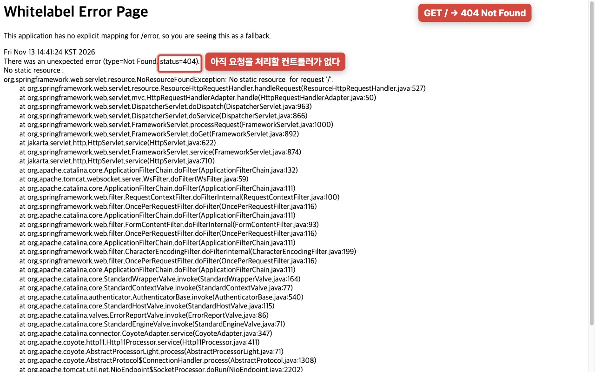

> **교재와 다른 점** Boot 3.2.1 → 4.1.2, `build.gradle`(Groovy) → `build.gradle.kts`(Kotlin). Boot 4부터 웹 스타터 이름이 `starter-web`에서 `starter-webmvc`로 바뀌었습니다.
> **확인해 볼 것** 메인 클래스 `SbbApplication`이 있는 패키지(`com.mysite.sbb`) 아래에 있어야 스프링이 컴포넌트를 찾습니다.

### 001-02 프로젝트 생성, application.yaml로 전환
[이 시점의 코드](https://github.com/jhs512/jsb-plus-2/tree/001-02) · [변경 내용](https://github.com/jhs512/jsb-plus-2/commit/001-02)

**무엇을** 설정 파일을 `application.properties`에서 `application.yaml`로 바꿨습니다.

**왜** 설정이 늘어나면 `spring.jpa.hibernate.ddl-auto`처럼 같은 앞부분이 반복됩니다. yaml은 들여쓰기로 계층을 표현해서 읽기 쉽습니다(14163·14168 방식).

`application.properties` → `application.yaml`
```diff
- spring.application.name=sbb
+ spring:
+   application:
+     name: sbb
+   output:
+     ansi:
+       enabled: always   # 콘솔 로그에 색을 입힘
```

> **확인해 볼 것** 같은 설정을 properties로 쓰면 `spring.output.ansi.enabled=always`입니다. 두 형식이 1:1로 대응합니다.

### 002-01 간단한 웹 프로그램, [실험] void 액션은 500
[이 시점의 코드](https://github.com/jhs512/jsb-plus-2/tree/002-01) · [변경 내용](https://github.com/jhs512/jsb-plus-2/commit/002-01)

**무엇을** `MainController`에 `GET /`, `GET /hello`를 처리하는 액션 메서드를 만들었습니다. 반환형은 일부러 `void`로 했습니다. **(실험 커밋)**

**왜** `@Controller`와 `@GetMapping`으로 URL과 메서드가 연결되는 것을 확인하고, "메서드가 실행되는 것"과 "브라우저가 응답을 받는 것"이 다르다는 것을 직접 봅니다(14163 3강).

`MainController.java`
```java
@Controller
public class MainController {
    @GetMapping("/hello")
    public void hello() {
        System.out.println("hello"); // 서버 콘솔에만 찍힌다
    }
}
```

**결과** 서버 콘솔에는 `hello`가 찍히지만(메서드는 실행됨), 브라우저는 **500**을 받습니다.
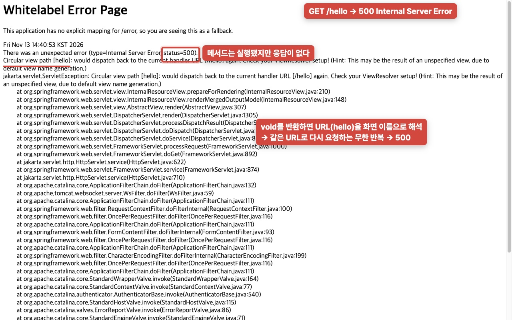

> **왜 500일까?** `void`를 반환하면 스프링은 요청 URL(`hello`)을 화면(뷰) 이름으로 씁니다. 그 화면을 찾으려고 다시 `/hello`로 보내고, 또 같은 메서드가 실행되는 무한 반복이 되어 `Circular view path` 에러가 납니다.
> **확인해 볼 것** 없는 주소(`/not-exist`)는 500이 아니라 404입니다. 매핑된 메서드가 아예 없기 때문입니다.

### 002-02 간단한 웹 프로그램, @ResponseBody로 문자열 응답
[이 시점의 코드](https://github.com/jhs512/jsb-plus-2/tree/002-02) · [변경 내용](https://github.com/jhs512/jsb-plus-2/commit/002-02)

**무엇을** 액션 메서드가 `String`을 반환하고 `@ResponseBody`를 붙였습니다. 브라우저 대신 반복해서 확인할 수 있도록 MockMvc 테스트도 만들었습니다.

**왜** `@ResponseBody`가 있으면 반환값이 **화면 이름이 아니라 응답 본문 그 자체**가 됩니다(14163 4강).

`MainController.java`
```diff
  @GetMapping("/hello")
- public void hello() {
-     System.out.println("hello");
- }
+ @ResponseBody // 반환값이 그대로 HTTP 응답 본문이 된다.
+ public String hello() {
+     return "안녕하세요.";
+ }
```

`MainControllerTest.java`
```java
mvc.perform(get("/hello"))
        .andExpect(status().isOk())
        .andExpect(content().string("안녕하세요."));
```

**결과** 이제 **200**과 함께 문자열이 그대로 보입니다.


> **확인해 볼 것** 문자열 대신 객체를 반환하면 어떻게 될까요? 스프링이 자동으로 JSON으로 바꿉니다(14168 29강).

### 003-01 DB 설정, H2·JPA 추가와 dev/test 프로파일 분리
[이 시점의 코드](https://github.com/jhs512/jsb-plus-2/tree/003-01) · [변경 내용](https://github.com/jhs512/jsb-plus-2/commit/003-01)

**무엇을** H2 데이터베이스와 Spring Data JPA를 추가하고, 설정을 **dev(파일 DB)**와 **test(메모리 DB)** 프로파일로 나눴습니다.

**왜** 교재는 DB 하나로 개발과 테스트를 함께 합니다. 그러면 테스트가 개발 데이터를 계속 쌓거나 지웁니다. 14163 5강처럼 둘을 분리합니다.

`build.gradle.kts`
```diff
  implementation("org.springframework.boot:spring-boot-starter-webmvc")
+ implementation("org.springframework.boot:spring-boot-starter-data-jpa")
+ implementation("org.springframework.boot:spring-boot-h2console")
+ runtimeOnly("com.h2database:h2")
```

`application-dev.yaml` / `application-test.yaml`
```yaml
# dev: 재시작해도 데이터가 남는 파일 DB
url: jdbc:h2:./db_dev
# test: 테스트가 끝나면 사라지는 메모리 DB
url: jdbc:h2:mem:db_test
```

`application.yaml`
```yaml
spring:
  profiles:
    active: dev   # 기본은 dev, 테스트 클래스는 @ActiveProfiles("test")
  jpa:
    hibernate:
      ddl-auto: update   # 엔티티를 보고 테이블을 자동 생성/수정
```

**결과** `/h2-console`에 접속됩니다. 아직 엔티티가 없어서 테이블은 없습니다.
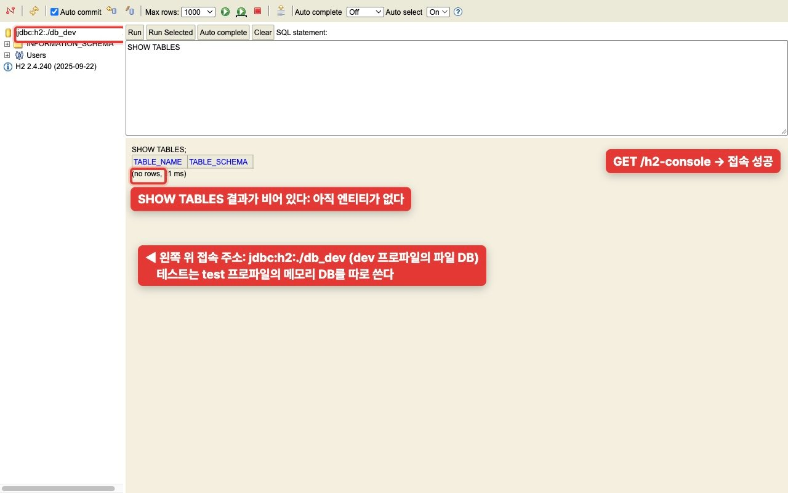

> **교재와 다른 점** DB 하나(`~/local`) → dev/test 분리. 개발 DB 파일(`db_dev.mv.db`)은 `.gitignore`에 추가했습니다.
> **확인해 볼 것** 앱을 한 번 실행하면 프로젝트 폴더에 `db_dev.mv.db` 파일이 생깁니다.

### 003-02 DB 설정, 테스트는 항상 test 프로파일
[이 시점의 코드](https://github.com/jhs512/jsb-plus-2/tree/003-02) · [변경 내용](https://github.com/jhs512/jsb-plus-2/commit/003-02)

**무엇을** Gradle 테스트 태스크에 `spring.profiles.active=test`를 지정했습니다. 그리고 일부러 `@ActiveProfiles`를 붙이지 않은 확인용 테스트를 만들었습니다.

**왜** 테스트 클래스마다 `@ActiveProfiles("test")`를 붙이는 방식은 하나만 빠뜨려도 기본 프로파일(dev)이 적용됩니다. 그러면 그 테스트가 개발용 파일 DB를 건드립니다. 실수가 생기지 않도록 테스트의 기본값을 아예 test로 고정합니다.

`build.gradle.kts`
```diff
  tasks.withType<Test> {
      useJUnitPlatform()
+     systemProperty("spring.profiles.active", "test")
  }
```

`DefaultTestProfileTest.java`
```java
@SpringBootTest // @ActiveProfiles 일부러 없음
class DefaultTestProfileTest {
    @Value("${spring.datasource.url}")
    private String datasourceUrl;

    @Test
    void t1() {
        assertThat(datasourceUrl).startsWith("jdbc:h2:mem:");
    }
}
```

**결과** 설정 전에는 이 테스트가 **개발용 파일 DB**(`jdbc:h2:./db_dev`)를 쓰고 있어서 실패했습니다. 설정 후에는 모든 테스트가 메모리 DB로 실행됩니다.
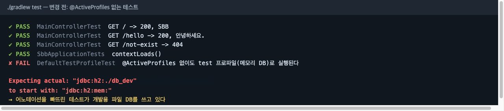
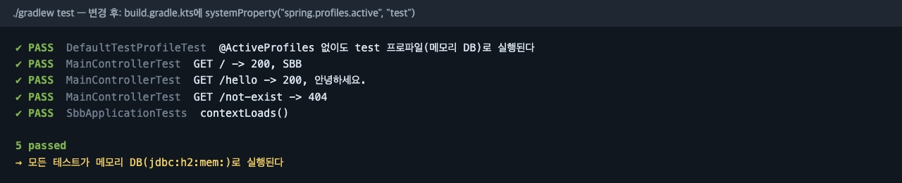

> **교재와 다른 점** 교재에는 없는 안전장치입니다. 1차 구현에서는 마지막(040)에야 넣었는데, DB 설정 단계로 옮겼습니다.

### 003-03 DB 설정, SQL 로그 출력
[이 시점의 코드](https://github.com/jhs512/jsb-plus-2/tree/003-03) · [변경 내용](https://github.com/jhs512/jsb-plus-2/commit/003-03)

**무엇을** JPA가 실행하는 SQL을 콘솔에 보기 좋게 출력하도록 설정했습니다. `?` 자리에 들어간 실제 값과 트랜잭션 시작·종료도 함께 출력합니다.

**왜** JPA는 SQL을 대신 만들어 줍니다. 그래서 "지금 무슨 SQL이 나갔는지"를 눈으로 확인하는 습관이 중요합니다(14163 6강). 다음 단계부터 엔티티를 만들면 이 로그로 테이블 생성 SQL을 확인합니다.

`application.yaml`
```diff
  jpa:
    hibernate:
      ddl-auto: update
+   show-sql: true                 # 실행되는 SQL 출력
+   properties:
+     hibernate:
+       format_sql: true           # 줄바꿈 정렬
+       highlight_sql: true        # 색상 강조
+       use_sql_comments: true     # 어떤 JPA 동작에서 나온 SQL인지 주석
+ logging:
+   level:
+     org.hibernate.orm.jdbc.bind: TRACE      # ? 자리에 바인딩된 실제 값
+     org.hibernate.orm.jdbc.extract: TRACE   # 조회 결과 값
+     org.springframework.transaction.interceptor: TRACE  # 트랜잭션 시작/종료
```

> **확인해 볼 것** 아직 엔티티가 없어서 출력될 SQL이 없습니다. 바로 다음 단계(004-01)에서 `create table question …`이 이 형식으로 찍힙니다.

### 004-01 엔티티, Question 엔티티
[이 시점의 코드](https://github.com/jhs512/jsb-plus-2/tree/004-01) · [변경 내용](https://github.com/jhs512/jsb-plus-2/commit/004-01)

**무엇을** 질문을 저장할 `Question` 엔티티를 만들었습니다.

**왜** `@Entity`가 붙은 클래스를 보고 JPA가 테이블을 만듭니다(`ddl-auto: update`). 테이블을 SQL로 직접 만들지 않고 자바 클래스로 설계합니다(교재 2-04).

`Question.java` (새 파일)
```java
@Entity            // 이 클래스를 기준으로 question 테이블이 만들어진다.
@Getter @Setter
public class Question {
    @Id                                    // 기본키
    @GeneratedValue(strategy = IDENTITY)   // 1, 2, 3 … 자동 증가
    private int id;

    @Column(length = 200)                  // varchar(200)
    private String subject;

    @Column(columnDefinition = "TEXT")     // 길이 제한 없는 텍스트
    private String content;

    private LocalDateTime createDate;      // 컬럼 이름은 create_date
}
```

**결과** H2 콘솔에서 `QUESTION` 테이블과 컬럼을 확인했습니다. 앞 단계에서 켠 SQL 로그에도 테이블 생성문이 찍힙니다.
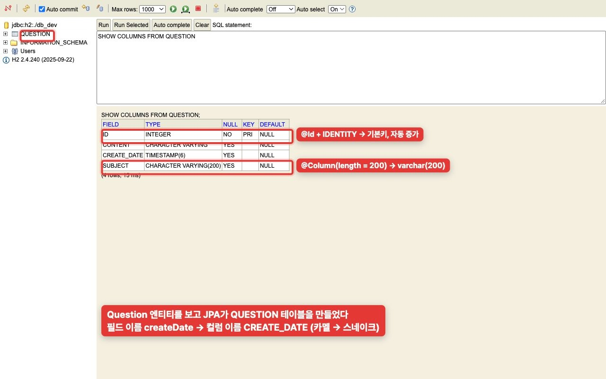
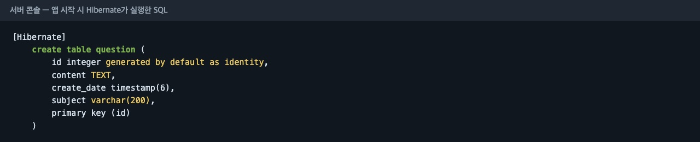

> **확인해 볼 것** `@Setter`는 지금은 편하지만, 009-02에서 생성자와 의미 있는 메서드로 바꿉니다(14168 방식).

### 004-02 엔티티, Answer와 @ManyToOne(LAZY)
[이 시점의 코드](https://github.com/jhs512/jsb-plus-2/tree/004-02) · [변경 내용](https://github.com/jhs512/jsb-plus-2/commit/004-02)

**무엇을** 답변을 저장할 `Answer` 엔티티를 만들고, 답변이 어느 질문에 속하는지 `@ManyToOne`으로 연결했습니다.

**왜** 답변 여러 개(N)가 질문 하나(1)에 속합니다. `@ManyToOne`을 붙이면 answer 테이블에 `question_id` 외래키 컬럼이 생깁니다. `@ManyToOne`의 기본값은 즉시 로딩(EAGER)이라 답변을 조회할 때마다 질문도 함께 조회합니다. 그래서 필요할 때만 조회하는 지연 로딩(LAZY)을 명시합니다(14163 25강).

`Answer.java` (새 파일, 핵심)
```java
@Entity
public class Answer {
    // ... id, content, createDate

    @ManyToOne(fetch = LAZY)   // 기본값 EAGER 대신 LAZY
    private Question question; // → question_id 컬럼 + 외래키
}
```

**결과** `ANSWER` 테이블에 `QUESTION_ID` 컬럼과 `QUESTION`을 가리키는 외래키 제약이 생겼습니다.
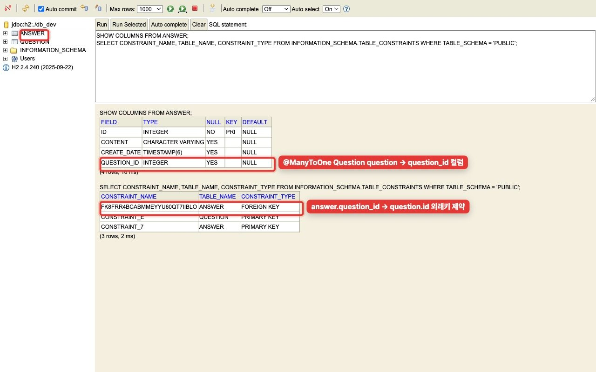

> **교재와 다른 점** 교재는 `@ManyToOne`만 씁니다(EAGER). 여기서는 `fetch = LAZY`를 붙였습니다.
> **확인해 볼 것** 외래키가 있으니 존재하지 않는 질문 번호(예: 999)로 답변을 INSERT하면 DB가 거부합니다.

### 004-03 엔티티, [실험] mappedBy 없는 OneToMany는 중간 테이블을 만든다
[이 시점의 코드](https://github.com/jhs512/jsb-plus-2/tree/004-03) · [변경 내용](https://github.com/jhs512/jsb-plus-2/commit/004-03)

**무엇을** `Question`에 답변 목록 필드를 `@OneToMany`로 추가했습니다. 이때 일부러 `mappedBy`를 빼 봤습니다. **(실험 커밋)**

**왜** 질문 쪽에서도 답변 목록을 바로 꺼내 쓰려면 `@OneToMany` 필드가 필요합니다. 그런데 이 필드와 `Answer.question`이 **같은 관계**라는 걸 JPA에게 알려 주지 않으면 어떻게 되는지 직접 봅니다(14163 11강).

`Question.java`
```diff
  private LocalDateTime createDate;
+
+ @OneToMany   // mappedBy 없음!
+ private List<Answer> answers = new ArrayList<>();
```

**결과** 만든 적 없는 `QUESTION_ANSWERS` 테이블이 생겼습니다. 이미 `answer.question_id`로 충분히 표현되는 관계를 중간 테이블에 한 번 더 저장하려는 것입니다.
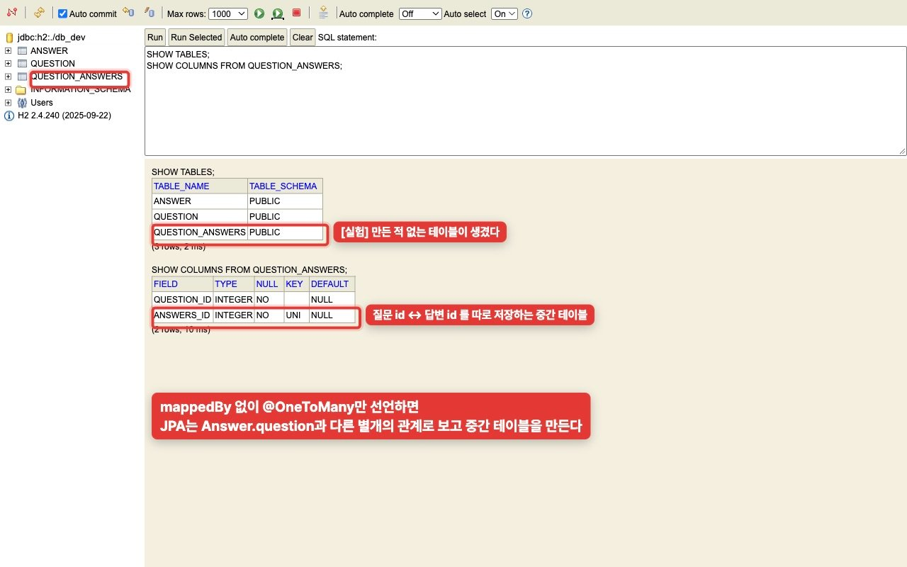

> **확인해 볼 것** 다음 커밋에서 `mappedBy = "question"` 한 단어를 넣으면 이 테이블이 사라집니다.

### 004-04 엔티티, mappedBy와 cascade로 OneToMany 완성
[이 시점의 코드](https://github.com/jhs512/jsb-plus-2/tree/004-04) · [변경 내용](https://github.com/jhs512/jsb-plus-2/commit/004-04)

**무엇을** `@OneToMany`에 `mappedBy = "question"`과 `cascade`를 넣었습니다.

**왜** `mappedBy = "question"`은 "이 관계의 주인은 `Answer.question` 필드(= `question_id` 외래키)"라는 뜻입니다. 질문 쪽 `answers`는 그 관계를 읽기만 하므로 중간 테이블이 필요 없습니다(14163 12강). `cascade`는 질문을 저장하거나 삭제할 때 답변도 함께 처리하도록 합니다(14163 21강).

`Question.java`
```diff
- @OneToMany
+ @OneToMany(mappedBy = "question", cascade = {CascadeType.PERSIST, CascadeType.REMOVE})
  private List<Answer> answers = new ArrayList<>();
```

| 옵션 | 뜻 |
|---|---|
| `mappedBy = "question"` | 외래키는 `Answer.question`이 관리 → 중간 테이블 없음 |
| `PERSIST` | 이 목록에 새로 추가한 답변은 자동 INSERT |
| `REMOVE` | 질문을 삭제하면 답변도 자동 DELETE |
| `= new ArrayList<>()` | null이 아니라서 바로 `add` 가능 (14163 23강) |

**결과** 이전 단계와 비교하면 `QUESTION_ANSWERS` 테이블이 사라졌습니다.

| 이전 (004-03) | 이후 (004-04) |
|---|---|
|  | 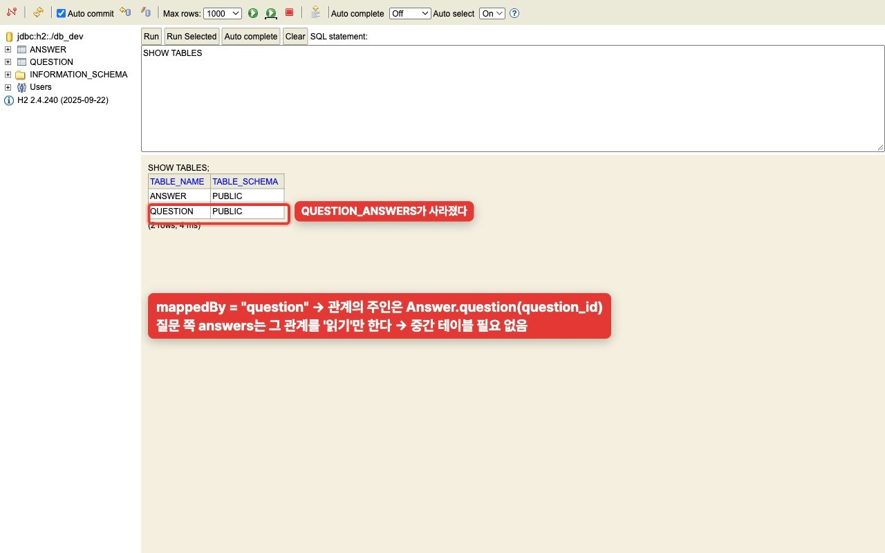 |

### 004-05 엔티티, BaseEntity와 JPA Auditing
[이 시점의 코드](https://github.com/jhs512/jsb-plus-2/tree/004-05) · [변경 내용](https://github.com/jhs512/jsb-plus-2/commit/004-05)

**무엇을** 모든 엔티티가 공통으로 갖는 id, 생성일, 수정일을 `BaseEntity` 하나로 모았습니다. 날짜는 JPA Auditing이 자동으로 채웁니다.

**왜** 교재는 엔티티마다 id와 날짜를 따로 선언하고, `createDate`를 서비스에서 `LocalDateTime.now()`로 직접 넣습니다. 공통 필드는 한 곳에서 관리하고 날짜는 자동으로 기록합니다(14168 2강).

`BaseEntity.java` (새 파일)
```java
@MappedSuperclass   // 테이블은 안 되고, 필드만 자식 엔티티 테이블에 들어간다
@EntityListeners(AuditingEntityListener.class)
@Getter
public abstract class BaseEntity {
    @Id @GeneratedValue(strategy = IDENTITY)
    private int id;

    @CreatedDate        // INSERT 될 때 자동 기록
    private LocalDateTime createDate;

    @LastModifiedDate   // INSERT, UPDATE 될 때 자동 기록
    private LocalDateTime modifyDate;
}
```

`Question.java`, `Answer.java`
```diff
- public class Question {
-     @Id @GeneratedValue(strategy = IDENTITY)
-     private int id;
-     private LocalDateTime createDate;
+ public class Question extends BaseEntity {
```

`SbbApplication.java`
```diff
  @SpringBootApplication
+ @EnableJpaAuditing   // @CreatedDate, @LastModifiedDate 동작에 필요
```

**결과** 두 테이블 모두 `CREATE_DATE`와 새 `MODIFY_DATE` 컬럼을 갖게 되었습니다.
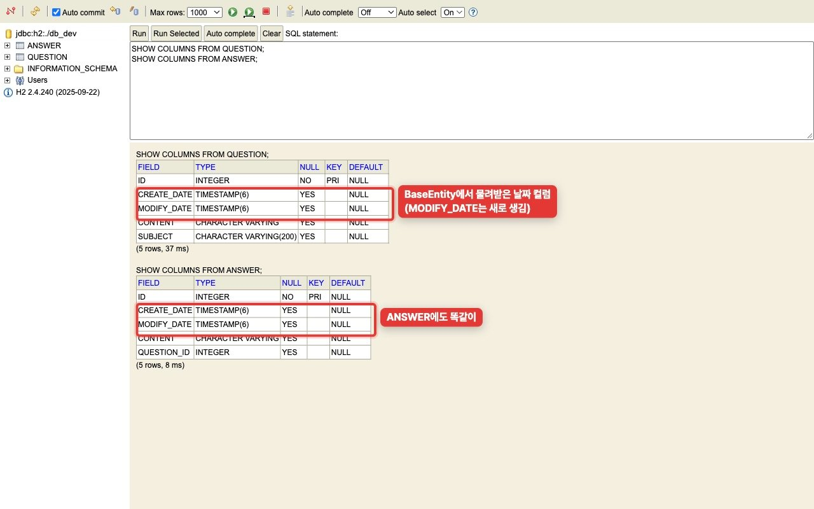

### 005-01 리포지터리, Repository와 샘플 데이터 자동 생성
[이 시점의 코드](https://github.com/jhs512/jsb-plus-2/tree/005-01) · [변경 내용](https://github.com/jhs512/jsb-plus-2/commit/005-01)

**무엇을** 질문·답변 리포지터리를 만들고, 앱이 시작될 때 샘플 데이터(질문 2개, 답변 1개)를 자동으로 넣는 `TestInitData`를 만들었습니다.

**왜** 교재는 테스트 코드로 데이터를 넣습니다. 여기서는 앱을 켤 때마다 같은 샘플 데이터가 보장되도록 `ApplicationRunner`를 씁니다(14163 14강).

`QuestionRepository.java` (새 파일)
```java
// JpaRepository<엔티티, PK 타입>: save, findAll, findById, count, delete가 자동으로 생긴다.
public interface QuestionRepository extends JpaRepository<Question, Integer> {
}
```

`TestInitData.java` (새 파일, 핵심)
```java
@Configuration
@RequiredArgsConstructor
public class TestInitData {
    @Autowired @Lazy
    private TestInitData self;   // 자기 자신의 프록시

    @Bean
    public ApplicationRunner testInitDataApplicationRunner() {
        return args -> self.work1();   // this.work1()이면 @Transactional이 안 걸린다
    }

    @Transactional
    public void work1() {
        if (questionRepository.count() > 0) return;   // 이미 있으면 건너뜀
        // 질문 2개, 답변 1개 save
    }
}
```

**결과** DB에 샘플 데이터가 들어갔고, 로그를 보면 `work1()` **트랜잭션 하나 안에서** INSERT 3번이 실행됐습니다.
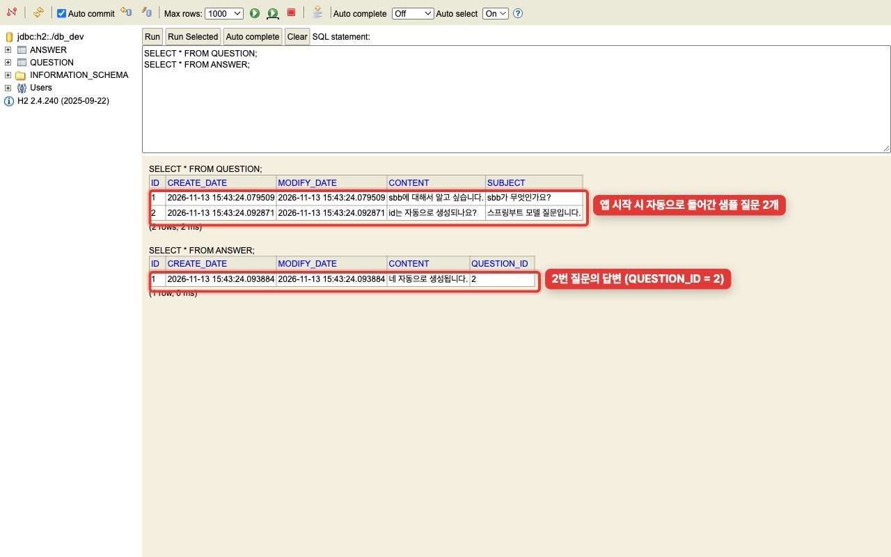
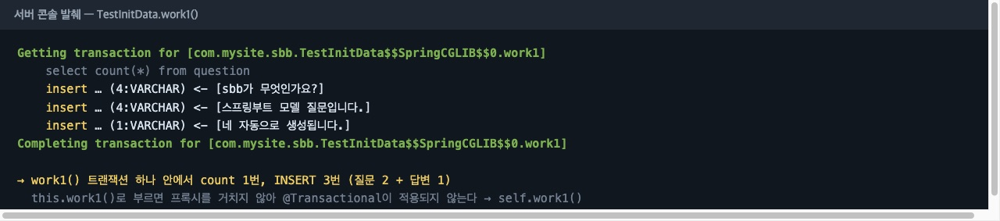

> **확인해 볼 것** `self.work1()`을 `this.work1()`로 바꾸면 로그에서 `Getting transaction for [...TestInitData...work1]` 줄이 사라집니다. `@Transactional`은 프록시를 거쳐 호출될 때만 동작하기 때문입니다.

### 005-02 리포지터리, findAll과 findById 테스트
[이 시점의 코드](https://github.com/jhs512/jsb-plus-2/tree/005-02) · [변경 내용](https://github.com/jhs512/jsb-plus-2/commit/005-02)

**무엇을** `QuestionRepository`의 기본 메서드 `findAll`, `findById`를 테스트로 확인했습니다.

**왜** 리포지터리가 제대로 동작하는지, 샘플 데이터가 테스트용 메모리 DB에도 들어가는지를 화면 없이 반복해서 확인하기 위해서입니다(교재 2-05, 14163 15강).

`QuestionRepositoryTest.java` (새 파일, 핵심)
```java
@SpringBootTest
class QuestionRepositoryTest {
    @Autowired
    private QuestionRepository questionRepository;

    @Test
    void t1() {
        List<Question> questions = questionRepository.findAll();
        assertThat(questions).hasSize(2);   // 샘플 데이터 2건
        assertThat(questions.get(0).getCreateDate()).isNotNull();   // Auditing이 채움
    }

    @Test
    void t2() {
        Question q = questionRepository.findById(1).get();
        assertThat(q.getSubject()).isEqualTo("sbb가 무엇인가요?");
    }
}
```

**결과**
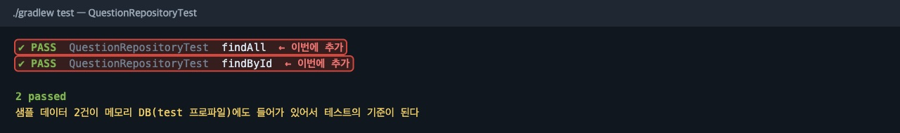

### 005-03 리포지터리, 쿼리 메서드 명명 규칙
[이 시점의 코드](https://github.com/jhs512/jsb-plus-2/tree/005-03) · [변경 내용](https://github.com/jhs512/jsb-plus-2/commit/005-03)

**무엇을** 메서드 이름 규칙(`findBy` + 필드 이름 + 조건)으로 조회 메서드 5개를 만들고 테스트했습니다.

**왜** 메서드 이름만 규칙대로 지으면 Spring Data JPA가 SQL을 만들어 줍니다. 실제로 어떤 WHERE 절이 나가는지 로그로 확인합니다(교재 2-05, 14163 16·17강).

`QuestionRepository.java`
```diff
  public interface QuestionRepository extends JpaRepository<Question, Integer> {
+     Optional<Question> findBySubject(String subject);
+     Optional<Question> findBySubjectAndContent(String subject, String content);
+     List<Question> findBySubjectLike(String subject);        // %는 호출하는 쪽에서
+     List<Question> findBySubjectIn(List<String> subjects);
+     List<Question> findByIdLessThanOrderByIdDesc(int id);
  }
```

**결과**
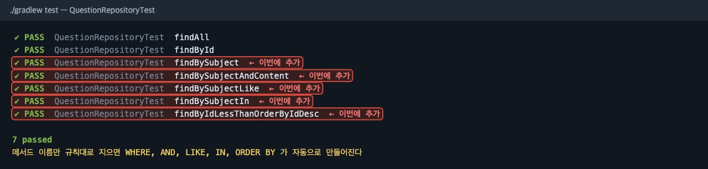
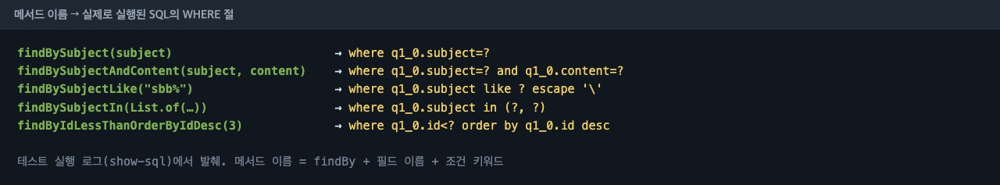

### 005-04 리포지터리, [실험] 트랜잭션 밖 LAZY 로딩은 실패한다
[이 시점의 코드](https://github.com/jhs512/jsb-plus-2/tree/005-04) · [변경 내용](https://github.com/jhs512/jsb-plus-2/commit/005-04)

**무엇을** 트랜잭션 밖에서 LAZY 컬렉션(`question.getAnswers()`)을 읽으면 `LazyInitializationException`이 나는 것을 테스트로 남겼습니다. **(실험 커밋)**

**왜** LAZY는 "실제로 쓸 때 SELECT"입니다. 그런데 그 순간에 DB 연결(영속성 컨텍스트)이 이미 닫혀 있으면 가져올 수 없습니다(14163 25강). 일부러 실패하는 상황을 만들어 보고, 다음 단계에서 해결합니다.

`QuestionRepositoryTest.java`
```java
@Test
void t8() {
    Question q2 = questionRepository.findById(2).get();   // 여기서 연결이 닫힌다

    assertThatThrownBy(() -> q2.getAnswers().size())       // 이제야 answers를 읽으려 함
            .isInstanceOf(LazyInitializationException.class);
}
```

**결과** 예외가 나는 것이 확인되어 테스트는 통과합니다.
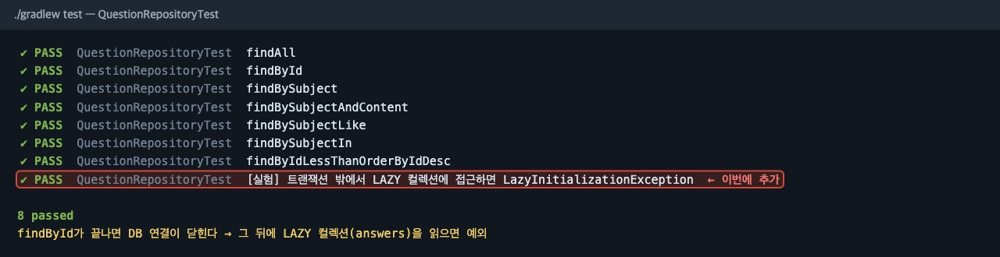

### 005-05 리포지터리, @Transactional로 LAZY 조회와 수정·삭제 테스트
[이 시점의 코드](https://github.com/jhs512/jsb-plus-2/tree/005-05) · [변경 내용](https://github.com/jhs512/jsb-plus-2/commit/005-05)

**무엇을** 테스트 메서드에 `@Transactional`을 붙여 LAZY 조회, 수정, 삭제, cascade 삭제를 테스트했습니다.

**왜** 테스트 메서드 전체를 하나의 트랜잭션으로 묶으면 두 가지가 해결됩니다(14163 18·25강).
1. 메서드가 끝날 때까지 DB 연결이 유지되어 **LAZY 조회가 된다.**
2. 메서드가 끝나면 **롤백**되어, 수정·삭제 테스트가 다른 테스트에 영향을 주지 않는다.

`QuestionRepositoryTest.java`
```java
@Test
@Transactional   // 테스트 메서드 전체가 하나의 트랜잭션 → 끝나면 롤백
void t10() {
    Question q = questionRepository.findById(1).get();
    q.setSubject("수정된 제목");
    questionRepository.flush();   // UPDATE를 지금 바로 실행(로그 확인용)

    assertThat(questionRepository.findById(1).get().getSubject()).isEqualTo("수정된 제목");
}   // 롤백 → 다른 테스트는 여전히 "sbb가 무엇인가요?"를 본다
```

**결과** 바로 앞의 실험(트랜잭션 밖 LAZY)과 달리, 같은 `getAnswers()`가 정상 동작합니다.
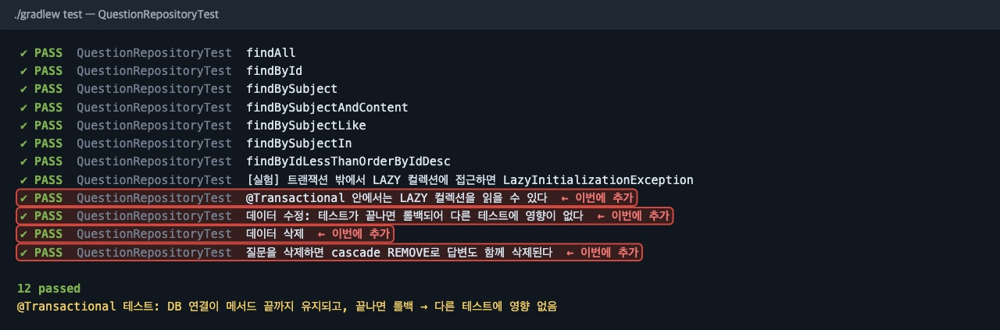

### 005-06 리포지터리, 답변 생성 2가지 방법(save vs addAnswer)
[이 시점의 코드](https://github.com/jhs512/jsb-plus-2/tree/005-06) · [변경 내용](https://github.com/jhs512/jsb-plus-2/commit/005-06)

**무엇을** 답변을 만드는 두 가지 방법을 비교했습니다. 교재처럼 `answerRepository.save()`로 저장하는 방법과, 강사처럼 `question.addAnswer()`로 질문에 맡기는 방법입니다. 샘플 데이터도 두 번째 방법으로 바꿨습니다.

**왜** `@OneToMany` 필드에 `cascade = PERSIST`가 있으면, 질문의 답변 목록에 추가만 해도 트랜잭션이 끝날 때 자동으로 INSERT 됩니다(14163 21강). 리포지터리를 따로 주입받지 않는 객체지향적인 방식입니다.

`Question.java`
```diff
+ public Answer addAnswer(String content) {
+     Answer answer = new Answer();
+     answer.setContent(content);
+     answer.setQuestion(this);   // 관계의 주인(question_id) 쪽을 채워야 DB에 반영된다
+     answers.add(answer);        // 자바 객체 쪽 관계도 함께 맞춘다
+     return answer;
+ }
```

`AnswerRepositoryTest.java`
```java
// 방법 1(교재): 즉시 INSERT
answerRepository.save(answer);
assertThat(answer.getId()).isGreaterThan(0);

// 방법 2(강사): 트랜잭션이 끝나거나 flush 할 때 INSERT
Answer answer = q2.addAnswer("답변 by addAnswer");
assertThat(answer.getId()).isEqualTo(0);    // 아직 INSERT 전
questionRepository.flush();                 // 변경 감지 → cascade PERSIST → INSERT
assertThat(answer.getId()).isGreaterThan(0);
```

**결과**
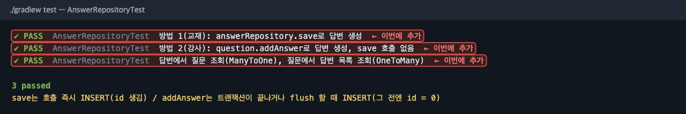

> **확인해 볼 것** `addAnswer` 직후 `id`가 0인 이유는 INSERT가 아직 실행되지 않았기 때문입니다. 이 차이는 027(앵커)에서 다시 중요해집니다.

### 006-01 도메인별 분류, 14168 방식 패키지 구조로 이동
[이 시점의 코드](https://github.com/jhs512/jsb-plus-2/tree/006-01) · [변경 내용](https://github.com/jhs512/jsb-plus-2/commit/006-01)

**무엇을** 패키지를 14168 강의 방식으로 바꿨습니다. 도메인 코드는 `domain/{주제}/{엔티티}/{역할}`로, 앱 전체에서 쓰는 코드는 `global/`로 옮겼습니다.

**왜** 교재 방식(`question/`, `answer/` 폴더 하나에 엔티티·리포지터리·서비스·컨트롤러가 다 들어감)은 처음엔 단순합니다. 하지만 기능이 늘어나면 한 폴더가 커지고, 공통 코드(`BaseEntity`, 샘플 데이터)가 최상위에 섞입니다. 파일이 아직 적을 때 구조를 정리합니다(교재 2-06의 "도메인별 분류"를 한 단계 더 세분화).

이동 전 → 이동 후
```text
com.mysite.sbb                         com.mysite.sbb
├── BaseEntity.java                    ├── SbbApplication.java
├── MainController.java                ├── domain
├── SbbApplication.java                │   ├── home/home/controller/MainController.java
├── TestInitData.java                  │   └── question
├── question                           │       ├── question/entity/Question.java
│   ├── Question.java                  │       ├── question/repository/QuestionRepository.java
│   └── QuestionRepository.java        │       ├── answer/entity/Answer.java
└── answer                             │       └── answer/repository/AnswerRepository.java
    ├── Answer.java                    └── global
    └── AnswerRepository.java              ├── jpa/entity/BaseEntity.java
                                           └── initData/TestInitData.java
```

> **왜 `question/question`처럼 두 번?** 앞의 `question`은 **큰 주제(게시판)**, 뒤는 그 안의 **개별 엔티티**입니다. 답변은 질문 게시판에 속하므로 `question/answer`입니다(14168의 `post/post`, `post/postComment`와 같은 원리).
> **결과** 파일 위치와 `package`, `import`만 바뀌었습니다. 동작은 같아서 테스트 20건이 그대로 통과합니다.

### 006-02 도메인별 분류, TestInitData를 BaseInitData로
[이 시점의 코드](https://github.com/jhs512/jsb-plus-2/tree/006-02) · [변경 내용](https://github.com/jhs512/jsb-plus-2/commit/006-02)

**무엇을** `TestInitData`의 이름을 `BaseInitData`로 바꿨습니다.

**왜** 이 샘플 데이터는 테스트뿐 아니라 개발 환경(dev)에서도 쓰입니다. 이름이 "Test"면 테스트 전용으로 오해하기 쉬워서, 용도에 맞게 바꿉니다(14168 2강).

```diff
- public class TestInitData {
+ public class BaseInitData {
      @Autowired @Lazy
-     private TestInitData self;
+     private BaseInitData self;
```

### 007-01 질문 목록, 타임리프 없이 문자열로 HTML 응답
[이 시점의 코드](https://github.com/jhs512/jsb-plus-2/tree/007-01) · [변경 내용](https://github.com/jhs512/jsb-plus-2/commit/007-01)

**무엇을** `GET /question/list`에서 질문 목록을 보여 줍니다. 타임리프 없이 **자바 문자열로 HTML을 직접** 만들어 응답합니다.

**왜** 템플릿 엔진 없이 HTML을 만들면 얼마나 불편한지 먼저 겪어 봅니다(14163 27강). 다음 커밋에서 같은 화면을 타임리프로 바꿉니다.

`QuestionController.java` (새 파일, 핵심)
```java
@GetMapping("/question/list")
@ResponseBody
public String list() {
    List<Question> questions = questionRepository.findAll();

    String lis = questions.stream()
            .map(q -> "<li>" + q.getId() + " : " + q.getSubject() + "</li>")
            .collect(Collectors.joining("\n"));

    return "<h1>질문 목록</h1>\n<ul>\n" + lis + "\n</ul>";   // HTML을 문자열로 조립
}
```

**결과**


> **확인해 볼 것** 제목에 `<b>`나 `<script>`가 들어 있으면 어떻게 될까요? 문자열을 그대로 이어 붙였기 때문에 HTML로 해석됩니다. 타임리프의 `th:text`는 이를 자동으로 이스케이프합니다.

### 007-02 질문 목록, 타임리프와 Model
[이 시점의 코드](https://github.com/jhs512/jsb-plus-2/tree/007-02) · [변경 내용](https://github.com/jhs512/jsb-plus-2/commit/007-02)

**무엇을** 타임리프를 도입했습니다. 컨트롤러는 데이터만 `Model`에 담고, HTML은 `question_list.html` 템플릿이 만듭니다.

**왜** HTML은 템플릿이, 데이터 준비는 컨트롤러가 맡도록 역할을 나눕니다(교재 2-07, 14163 28·30·31강). 화면은 이전과 같지만 **만드는 방식**이 바뀝니다.

`QuestionController.java`
```diff
  @GetMapping("/question/list")
- @ResponseBody
- public String list() {
-     ...
-     return "<h1>질문 목록</h1>\n<ul>\n" + lis + "\n</ul>";
+ public String list(Model model) {
+     List<Question> questionList = questionRepository.findAll();
+     model.addAttribute("questionList", questionList);   // 템플릿에서 ${questionList}
+     return "question_list";   // @ResponseBody가 없으니 템플릿 이름
  }
```

`templates/question_list.html` (새 파일)
```html
<h1>질문 목록</h1>
<ul>
    <li th:each="question : ${questionList}">
        <span th:text="|${question.id} : ${question.subject}|">1 : 제목</span>
    </li>
</ul>
```

`application-dev.yaml`
```diff
+ thymeleaf:
+   cache: false   # 개발 중에는 템플릿 수정이 바로 반영되도록 (14163 29강)
+   prefix: file:src/main/resources/templates/   # 빌드 없이 소스 폴더의 템플릿을 읽음 (14168)
```

**결과** 같은 화면이 템플릿으로 만들어집니다.
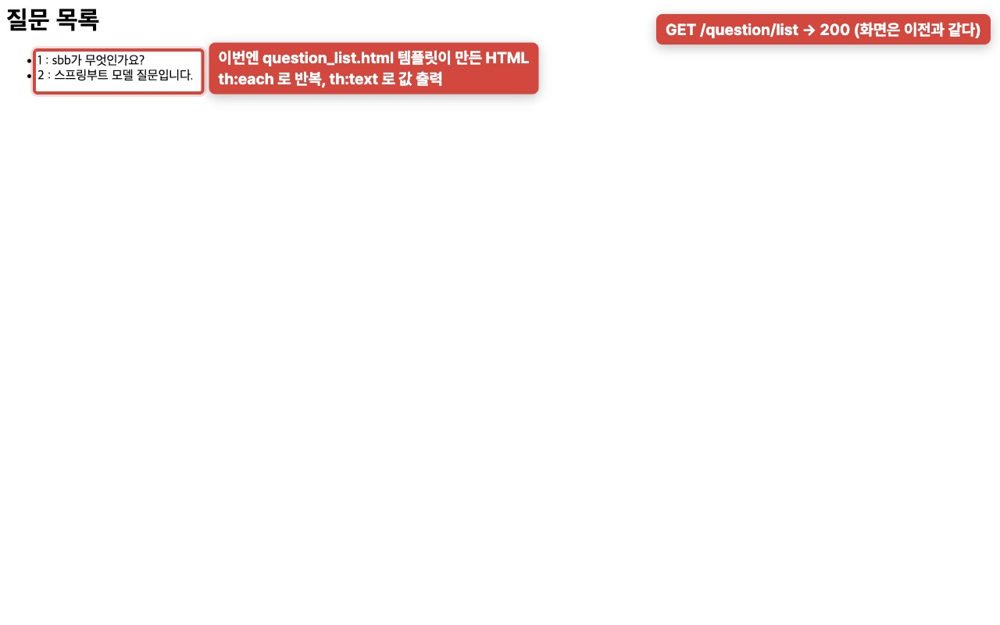

### 007-03 질문 목록, 표로 출력하고 작성일시 표시
[이 시점의 코드](https://github.com/jhs512/jsb-plus-2/tree/007-03) · [변경 내용](https://github.com/jhs512/jsb-plus-2/commit/007-03)

**무엇을** 목록을 표(`table`)로 바꾸고 작성일시를 출력했습니다.

**왜** 목록 데이터는 표가 읽기 쉽습니다(교재 2-07, 14163 32강). 날짜는 `#temporals.format`으로 원하는 형식으로 바꿉니다.

`question_list.html`
```diff
- <ul>
-     <li th:each="question : ${questionList}">
-         <span th:text="|${question.id} : ${question.subject}|">1 : 제목</span>
-     </li>
- </ul>
+ <table>
+     <thead><tr><th>번호</th><th>제목</th><th>작성일시</th></tr></thead>
+     <tbody>
+     <tr th:each="question : ${questionList}">
+         <td th:text="${question.id}">1</td>
+         <td th:text="${question.subject}">제목</td>
+         <td th:text="${#temporals.format(question.createDate, 'yyyy-MM-dd HH:mm')}">2026-01-01 00:00</td>
+     </tr>
+     </tbody>
+ </table>
```

**결과**
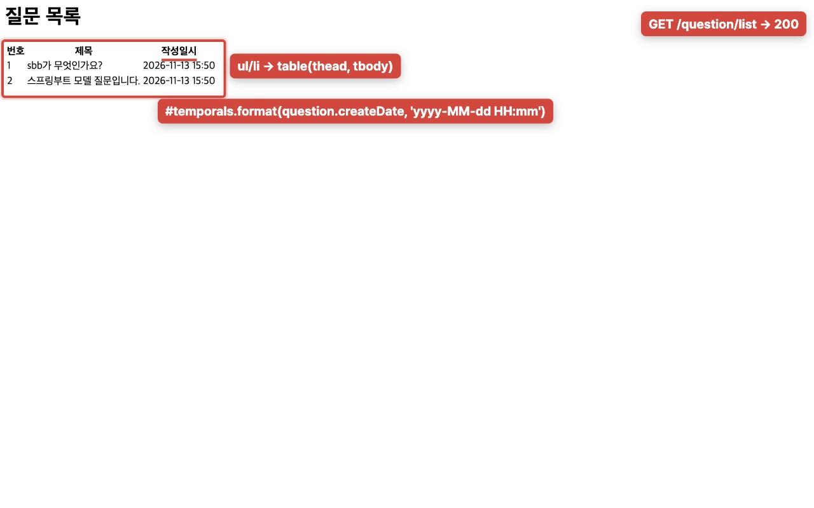

### 008-01 루트 URL, / 접속 시 질문 목록으로 리다이렉트
[이 시점의 코드](https://github.com/jhs512/jsb-plus-2/tree/008-01) · [변경 내용](https://github.com/jhs512/jsb-plus-2/commit/008-01)

**무엇을** `/`로 들어오면 질문 목록(`/question/list`)으로 보냅니다.

**왜** 사이트의 첫 화면을 질문 목록으로 합니다(교재 2-08). `redirect:`는 서버가 다른 화면을 대신 그리는 것이 아니라, 브라우저에게 **"이 주소로 다시 요청해"**(302 + `Location` 헤더)라고 알려 주는 것입니다(14168 28강).

`MainController.java`
```diff
  @GetMapping("/")
- @ResponseBody
- public String index() {
-     return "SBB";
- }
+ public String index() {
+     return "redirect:/question/list";
+ }
```

`MainControllerTest.java`
```java
mvc.perform(get("/"))
        .andExpect(status().isFound())                    // 302
        .andExpect(redirectedUrl("/question/list"));
```

**결과** 화면만 보면 그냥 목록입니다. 하지만 네트워크 탭을 보면 요청이 **두 번** 오갔습니다. `/`는 302를 받고, 브라우저가 `Location`의 주소로 다시 요청했습니다.
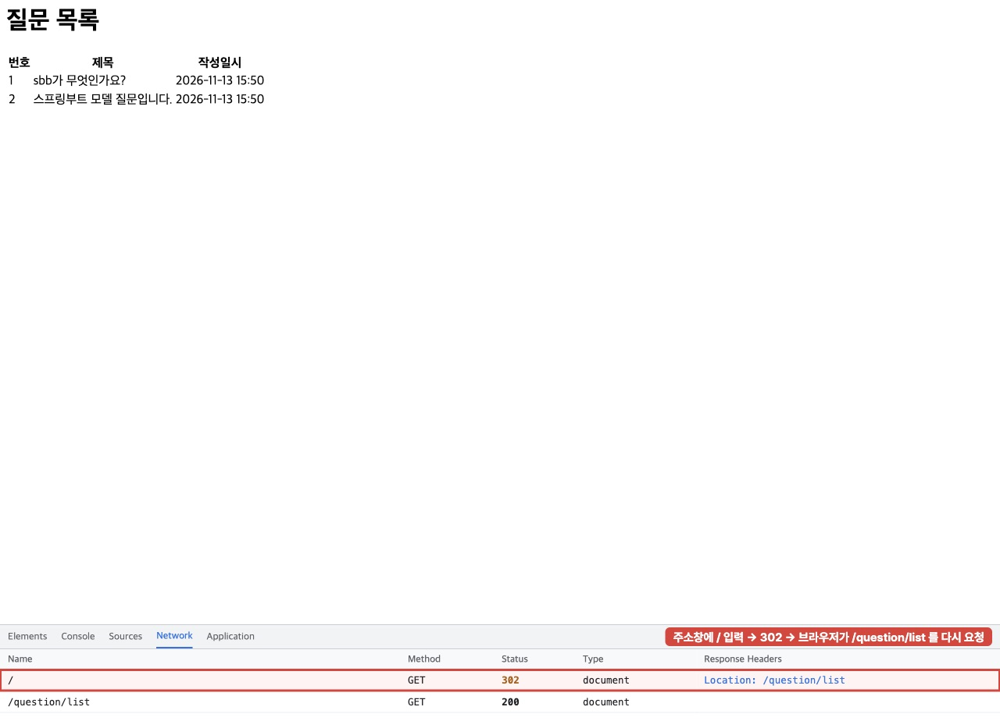

> **확인해 볼 것** 브라우저 개발자 도구(F12) → Network 탭 → `Preserve log`를 체크하고 `/`에 접속하면 같은 모습을 볼 수 있습니다(14168 28강).
